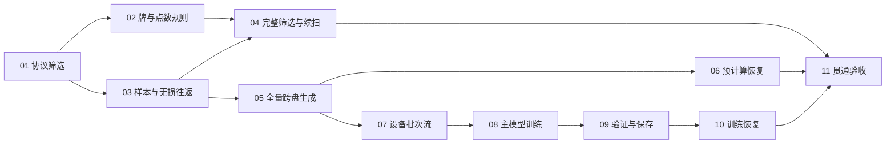

# 新预计算链路任务拆分草案

状态：用户已在随后明确要求按顺序实现，视为接受任务粒度与阻塞关系。11 份任务已发布到正式 issues 目录并标记为 ready-for-agent；实现按依赖顺序进行。

依据：[完整实施方案](implementation-plan.md)、[目录设计](directory-layout.md)、[领域术语](../../CONTEXT.md)、[ADR 0001](../../docs2/adr/0001-frozen-precomputed-samples.md)。本拆分不修改已确认的功能和参数。

## 拆分原则

- 每票完成一个可独立演示或验证的行为路径，包含相关配置、必要实现和回归验证。
- 公共配置、文件操作、格式等能力随最早需要它的可运行场景引入，不单独创建只有目录或工具函数的基础层票。
- 新链路按入口分目录，训练入口与核心流程保持在同一个训练脚本中；各票按已有目录设计归属代码。
- 每票控制在一个新上下文可完成的范围内。所有票都做自己的验证，最后集成票不代替前面各票的验收。
- 没有必须先做的旧代码重构；继续使用 libriichi 与现有模型定义，其余链路重新实现。

## 提议的任务

| 编号 | 标题 | 直接阻塞票 | 可验证交付 |
| --- | --- | --- | --- |
| 01 | 独立扫描并隔离协议损坏的牌谱 | 无 | 配置驱动的筛选入口，将压缩、文本、JSON 和对局边界错误牌谱移入隔离区并报告 |
| 02 | 隔离牌库存和点数不一致的牌谱 | 01 | 同一筛选入口能发现物理牌数量、赤牌和含供托的点数错误，保留合法特殊结算 |
| 03 | 单份牌谱生成六元样本并完成无损缓存往返 | 01 | 有效牌谱经过 Rust 提取和冻结 GRP 后，写成新格式 chunk 并精确还原全部字段 |
| 04 | 完成样本适用性筛选并支持中断续扫 | 02、03 | 筛选覆盖输入可用性与空视角边界，中断后按文件名游标继续 |
| 05 | 全量顺序生成固定样本数的跨盘数据集 | 03 | 预计算入口把全部 train/val 生成定长 chunk，遵守 C/D 配额并发布完整数据集描述 |
| 06 | 预计算按已提交 chunk 恢复且不重漏样本 | 05 | 在文件中间、写盘/进度之间及跨盘切换时中断，重启仍得到正确数据集 |
| 07 | 确定性读取 chunk 并在设备上跨块组 batch | 05 | 两级打乱、单块预取、按 batch 解码、尾批保留和直接定位均可验证 |
| 08 | 从 chunks 完成主模型训练并保存训练产出 | 07 | 从头初始化三网络，进行联合优化，输出初始/周期 checkpoint 和 TensorBoard |
| 09 | 将固定子集及全量验证接入保存边界 | 08 | 周期验证与轮末全量验证完成后再提交对应训练状态 |
| 10 | 恢复训练状态、样本顺序及追加 epoch | 09 | 中断续训保持已提交模型与数据位置一致，完成后可增加目标轮数继续 |
| 11 | 小规模贯通验收、资源复测与操作说明 | 04、06、10 | 用隔离数据贯通三个入口、复测资源和跨盘供数，并交付可操作说明 |

## 阻塞图

图中只列直接依赖，不重复传递依赖。02 和 03 可以在 01 完成后独立推进；06 与 07 可以在 05 后独立推进。

05 不以完整筛选 04 为代码阻塞：它可以用受控的有效牌谱验证生产路径。07 也不以预计算恢复 06 为阻塞：它只需要正常完成的数据集描述和 chunk。实际全量使用仍须遵循筛选、生成、训练的顺序，11 的阻塞关系保证最终交付包含完整筛选和两种恢复能力。

03 的验收通过程序接口和临时产物完成完整的“牌谱→六元样本→chunk→还原”路径，不新增设计之外的第四个产品入口。后续 05 将该路径扩展为独立的全量预计算入口。

## 设计覆盖检查

| 已确认能力 | 负责票 |
| --- | --- |
| 入口分组、限定导入、独立配置与基础文件操作 | 01 起随场景引入；11 贯通检查 |
| 协议、物理牌、赤牌、点数和供托筛选 | 01、02 |
| 样本适用性、合法空视角、60 局容量与筛选恢复 | 04 |
| 冻结 GRP、六元标签、float32/float64 无损格式 | 03 |
| 全量顺序、预分配 buffer、尾块与 C/D 配额 | 05 |
| 小型进度、生成 ID、发布区间与中断恢复 | 05、06 |
| 两级打乱、设备 batch 解码、单块预取与尾批 | 07 |
| 三网络、联合损失、AdamW、AMP 与初始状态保存 | 08 |
| 固定验证子集、全量 val、指标与提交边界 | 09 |
| 训练恢复、数据身份、TensorBoard 衔接与追加 epoch | 10 |
| 实际入口贯通、资源和跨盘测量、操作说明 | 11 |

任务按一票一文件发布；验收清单和实际完成记录保留在下列 issue 中。

## 逐票草案

1. [01 协议损坏牌谱隔离](issues/01-quarantine-protocol-errors.md)
2. [02 牌库存与点数规则](issues/02-quarantine-tile-and-score-errors.md)
3. [03 单谱样本与无损往返](issues/03-single-log-lossless-roundtrip.md)
4. [04 样本适用性与筛选恢复](issues/04-sample-validation-and-scan-resume.md)
5. [05 全量固定分块与跨盘生成](issues/05-full-dataset-generation.md)
6. [06 预计算提交恢复](issues/06-precompute-resume.md)
7. [07 确定性设备批次流](issues/07-deterministic-device-batches.md)
8. [08 主模型训练产出](issues/08-train-from-chunks.md)
9. [09 验证与保存边界](issues/09-validation-and-checkpoint-commit.md)
10. [10 训练恢复与追加轮数](issues/10-training-resume.md)
11. [11 贯通与资源验收](issues/11-integrated-acceptance.md)

## 发布与后续实施

任务已按本地跟踪器约定发布为独立 issue 文件，状态为 ready-for-agent。

每次从阻塞票已验收的任务中选择下一票；按编号顺序执行也是合法顺序。正式实施仍须得到用户明确授权，批准任务拆分本身不触发实现、全量筛选、缓存生成或正式训练。

用户已授权按顺序实现；后续如实施证据暴露规格冲突，记录到对应 issue 后再停下澄清。
