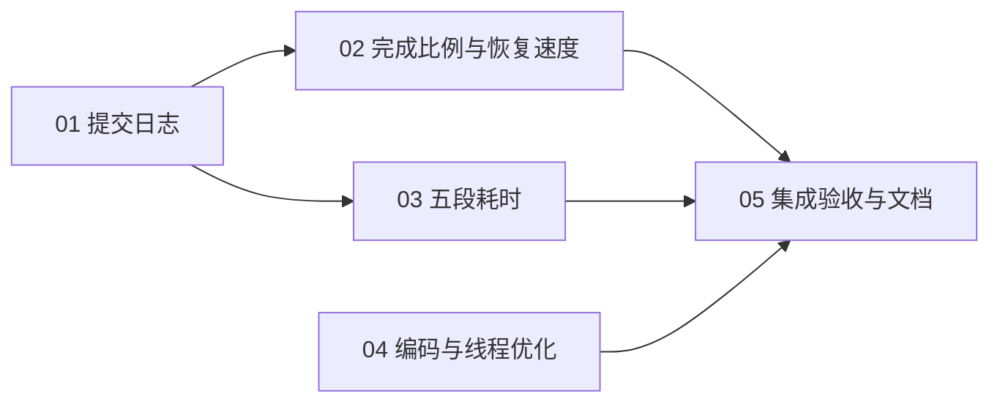

# 预计算进度与编码提速任务清单

日期：2026-10-01。状态：用户已明确要求开始实现，任务拆分和直接依赖已接受；5 份任务已按 01→05 完成。任务的 ready-for-agent 表示分诊角色，执行完成以验收勾选及 Comments 为准；综合结果见 [验收记录](acceptance.md)。

依据：[正式规格](spec.md)、[Q39–Q44 确认记录](../new-precompute-pipeline/precompute-progress.md)、[性能实验](../new-precompute-pipeline/precompute-performance.md)、[领域术语](../../CONTEXT.md)及[既有 ADR](../../docs2/adr/0001-frozen-precomputed-samples.md)。已确认的功能取舍不重新讨论，本轮只审阅任务拆分。

## 拆分原则

- 每票交付能通过公开入口或既有公开编解码接口观察的完整行为，包含相关配置、实现及必要回归。
- 先让运行过程可见，再增加完成比例、恢复速度和阶段耗时。准确的牌谱完成数不与最初的生命周期日志合并，以控制文件内断点与提交失败的状态组合。
- 编码和线程优化可以独立验证，不人为依赖日志；最终性能验收汇合各条分支。
- 公共计数、计时或配置能力随对应行为引入，不创建单独的“搭框架”或“加测试层”票。目前没有必须先完成的大范围重构。
- 每票包含自己的验证；末票做正式实现的综合复测，不代替前面各票的功能验收，也不复用临时 monkey patch 作为产品实现。
- 按编号 01→05 实施满足全部依赖。独立分支表示代码前置条件，不要求同时运行测试或基准；性能候选必须顺序测量。

## 任务分解

| 编号 | 标题 | 直接阻塞票 | 可独立验证的交付 |
| --- | --- | --- | --- |
| 01 | 在 chunk 提交边界输出可配置的进度日志 | 无 | 启动、恢复、扫描、提交、切换与完成均有即时输出；显示已提交块/样本、磁盘用量和游标；日志周期可配置 |
| 02 | 准确显示牌谱完成比例、恢复速度和 ETA | 01 | 正确处理跨块牌谱和文件内恢复，只按已提交增量计算速度和当前 split 的剩余时间 |
| 03 | 在进度日志中展示五段累计耗时 | 01 | 从 Rust 提取到写盘提交的五段开销可见，计时不重复叠加且恢复后重新累计 |
| 04 | 优化编码与默认线程并保持旧数据兼容 | 无 | 采用 16/1/4，减少编码副本及重复观测扫描，保持筛选完整性、六元样本精度、格式及恢复兼容 |
| 05 | 完成集成验收、性能复测与操作文档 | 02、03、04 | 用正式实现验证完整行为和旧进度恢复，复测真实 D 盘吞吐/RSS并交付准确操作说明 |

## 阻塞图

只列直接阻塞关系。02 与 03 均复用 01 的日志触发边界，彼此没有前置依赖；04 可使用现有生成入口、公开编解码接口及隔离数据独立验收。05 已通过 02/03 间接依赖 01，不重复列出传递依赖。

## 每票边界

01 的最小完整路径是“公开预计算入口 → 生成样本 → 成功提交 chunk 与进度 → 立即看到可信的基本日志”。它包含恢复时已有计数/游标的展示以及写盘失败不报成功，但不在这一票实现复杂的完整牌谱计数、速度或阶段耗时。

02 在已有日志上增加 Q40 的文件比例与速度口径。它处理游标位于谱内/谱末、旧累计成果与本次增量的区分，以及 buffer、尾块、空 split 等边界，不能为显示进度修改原恢复字段含义。

03 在相同输出点增加 Q41 的五段计时。计时反映本次实际执行开销，不把包含子阶段的总时间重复相加，也不要求五段合计精确等于全部 wall time。

04 将 Q42、Q43、Q44 作为一条完整提速路径交付：前置筛选仍完整、生成端采用较快参数和编码方式、产物继续供旧 reader 消费并支持恢复。它同时处理配置与必要回归，不单拆“改默认值”或“删检查”这种缺少完整行为验证的小票。

05 对正式代码做有界集成与性能验收，并把文档中的“待实现”更新为经过验收的真实状态。此前实验的约 1.86 倍提速和 5.1 GiB 峰值 RSS 仅为比较依据，不作为固定通过门槛。

## 规格覆盖

| 已确认需求或契约 | 负责票 |
| --- | --- |
| Q39 日志周期、生命周期事件、及时 flush | 01 |
| Q40 已提交块/样本、C/D 用量、游标 | 01 |
| Q40 完整牌谱计数、百分比、增量速度、当前 split ETA | 02 |
| Q41 五段本次累计耗时 | 03 |
| Q42 筛选保留完整检查、编码省去重复观测逐值检查 | 04 |
| Q43 默认线程与文件批次 16/1/4，保留配置能力 | 04 |
| Q44 标量直接提取、连续布局和紧凑二值数组 | 04 |
| 提交成功才报告、失败不报完成、恢复 JSON 不加统计字段 | 01、02、03；05 综合验收 |
| float32/float64 精度、原格式、旧 reader 与旧进度兼容 | 04；05 综合验收 |
| 真实数据有限复测、资源记录与文档同步 | 05 |

各票共用正式规格的范围边界：不自动继续正式预计算，不修改真实数据，不增加生成进程池或流水线，不改变奖励模型、样本顺序或恢复 schema。

## 任务索引

1. [01 在 chunk 提交边界输出可配置的进度日志](issues/01-committed-progress-logging.md)
2. [02 准确显示牌谱完成比例、恢复速度和 ETA](issues/02-file-progress-and-resume-rates.md)
3. [03 在进度日志中展示五段累计耗时](issues/03-stage-timings.md)
4. [04 优化编码与默认线程并保持旧数据兼容](issues/04-compatible-codec-and-thread-tuning.md)
5. [05 完成集成验收、性能复测与操作文档](issues/05-integrated-performance-acceptance.md)

## 发布与实施

用户已授权按此拆分开始实现。各票保留验收清单与完成证据；实现和有限验证不会自动启动正式全量预计算或训练。

