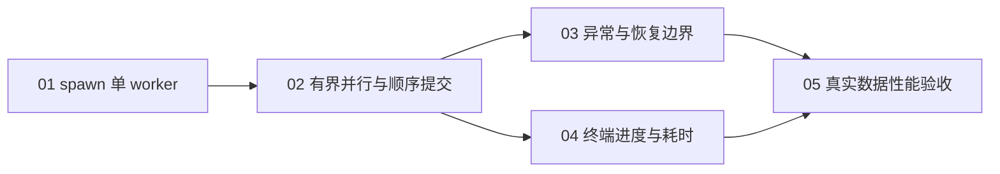

# 并行牌谱筛选任务拆分草案

状态：5 份任务均已实现并完成验收；最终独立审查结果为 Standards 0 findings、Spec 0 findings。未启动全量牌谱筛选。

依据：[并行牌谱筛选规格](spec.md)、[完整实施方案](../new-precompute-pipeline/implementation-plan.md)。本拆分只覆盖 Q33-Q38 已确认的筛选并行优化，不改变筛选规则、隔离目录、报告语义或恢复格式。

## 拆分原则

- 每票交付一条可通过公开筛选入口或 `run_quarantine` 验证的完整行为路径。
- 最先建立可工作的 `spawn` 单 worker 路径，再扩展为有界并行，避免一次同时改变进程模型、排序提交和异常语义。
- 异常恢复和终端观测都依赖有界顺序提交，但彼此不互相阻塞，可以分别实现。
- 性能验收放在功能与观测能力完成之后，不把全量筛选作为普通测试，也不自动继续用户现有长任务。
- 任务描述强调可观察行为，不固定容易随实现变化的内部函数或文件布局。

## 提议的任务

| 编号 | 标题 | 直接阻塞票 | 可验证交付 |
| --- | --- | --- | --- |
| 01 | 通过 spawn 单 worker 完成轻量筛选 | 无 | 完整筛选在独立 spawn worker 中运行；并发参数可配置；worker 不加载 PyTorch，也不执行文件副作用 |
| 02 | 有界并行校验并按文件顺序提交 | 01 | 多份牌谱可并行校验，但移动、报告和游标始终按文件名顺序由主进程提交，且在途工作有明确上限 |
| 03 | 在并行异常后保持可恢复边界 | 02 | 数据错误继续隔离，未知异常立即停止；未提交的提前读取结果不产生副作用，旧进度可直接恢复 |
| 04 | 展示筛选进度与分阶段耗时 | 02 | 每个提交周期在终端显示计数、速度、ETA、隔离数、游标和三个阶段的平均耗时，进度 JSON 保持原结构 |
| 05 | 真实牌谱性能验收与操作说明 | 03、04 | 在至少数千份真实牌谱上只读对比单 worker 与默认并发结果和资源开销，并更新用户操作文档 |

## 阻塞图

图中只列直接依赖。03 与 04 可以在 02 完成后独立推进；05 必须等待两者完成，因为真实性能验收既要验证故障后的恢复边界，也要依靠最终统计口径记录性能。

## 边界说明

01 不只创建进程工具，而是交付 `worker_processes=1` 时可完整运行的筛选入口，因此可以独立验证。它同时完成公共 codec 的 PyTorch 延迟导入，保证筛选 worker 的启动和常驻内存不被无关训练依赖放大。

02 负责正常路径的并发与提交顺序。03 再集中验证失败路径、取消和旧游标恢复，以免单票同时承担过多状态组合。04 只增加终端可观察性，不把统计字段写入恢复状态。

05 是有限、只读的性能验收，不移动真实牌谱、不更新真实筛选进度，也不启动约 145 万份牌谱的全量任务。它记录当前硬件上的实测结果，但不承诺固定倍数加速。

## 逐票草案

1. [01 通过 spawn 单 worker 完成轻量筛选](issues/01-spawn-single-worker.md)
2. [02 有界并行校验并按文件顺序提交](issues/02-bounded-parallel-ordered-commit.md)
3. [03 在并行异常后保持可恢复边界](issues/03-failure-and-resume-boundary.md)
4. [04 展示筛选进度与分阶段耗时](issues/04-terminal-progress-and-timings.md)
5. [05 真实牌谱性能验收与操作说明](issues/05-real-data-performance-acceptance.md)

任务已按相同编号发布到 `issues/`，验收项和实际证据记录在各票的 Comments 中。
