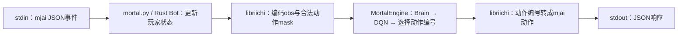
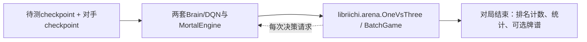

# 现有推理、复盘与评测入口

日期：2026-10-08。依据当前源码的只读核对；没有执行推理、训练或实际对局。本文描述旧实现。新增入口位置及普通mjai/独立Mortal一对三范围已由设计讨论Q59–Q62确认，尚未实现。

范围补充：Q63已明确新入口只加载优化后的Conv2d checkpoint，评测双方均为新格式。下文关于旧格式与异构引擎的内容用于说明现状和底层能力，不代表本期要实现旧格式运行时加载。

## 入口与共享层

| 文件/对象 | 职责 | 是否直接命令行入口 |
| --- | --- | --- |
| `mortal/mortal.py` | 读取mjai事件，返回玩家动作；也提供复盘模式 | 是，参数为玩家ID 0..3 |
| `mortal/mortal` | Bash包装，切到脚本目录再运行mortal.py | 是，只是包装器 |
| `mortal/engine.py::MortalEngine` | 将观测交给Brain/DQN，返回动作编号、Q值等 | 否，是两类入口共用的Python适配器 |
| `mortal/one_vs_three.py` | 独立一对三对局评测，加载待测与对手模型 | 是 |
| `mortal/player.py::TestPlayer` | 供旧训练调用的对局评测组件 | 否，由旧mortal/train.py调用 |
| `mortal/player.py::TrainPlayer` | 在线训练的数据生成，通过对局产出牌谱 | 否，由mortal/client.py等调用 |
| `mortal/precompute_pipeline/train/train.py::_evaluate` | 消费val chunks计算离线验证指标 | 不是独立对局评测入口 |

## 普通mjai推理



`mortal/mortal.py`读取配置指定的checkpoint，用其中的结构信息创建Brain与DQN，加载参数并构造MortalEngine和`libriichi.mjai.Bot`。当前此入口固定CPU、AMP关闭。AuxNet不参与实际动作选择，优化器、训练游标和AMP训练状态也不参与推理。

Rust Bot通过PlayerState处理事件；可以行动时，由MortalBatchAgent安排观测编码，再调用Python engine.react_batch。引擎把NumPy数组拼成张量，前向得到合法动作的Q值，默认选最大值；Rust再生成弃牌、立直、吃碰杠或和牌等协议事件，并可附上Q值、mask等元数据。

这条路径存在规则相关行为：quick_eval可在满足条件且只有一种弃牌候选时直接返回；启用和牌保护时，Rust可能根据规则改选网络提出的和牌动作。新模型适配不能把这些行为误当作都在神经网络里完成。

MortalEngine不负责读取checkpoint，也不硬编码网络内部必须是Conv1d。新模型只要保持输入观测、输出特征、DQN动作空间及引擎接口一致，就有复用此适配器和Rust规则接口的基础。二维表示可在模型内部完成，观测版本仍是v4，不应因Conv2d改名而升级mjai或obs版本。

协议推理的stdout用于JSON响应；诊断日志应走stderr，不能把训练样式的进度文本混入协议流。

## 复盘模式

复盘仍使用`mortal/mortal.py`，由`MORTAL_REVIEW_MODE=1`开启：关闭quick_eval以取得更完整的网络评价；无动作时补`none`响应；保留输入日志，EOF后额外计算并输出model_tag与phi_matrix。

额外矩阵由独立的GRU版GRP产生，加载`config['grp']`配置及其权重。它不是AuxNet，也不是预计算冻结奖励使用的GRP_Transformer。支持新的主策略权重不等于已经决定替换复盘的顺位预测模型。

## 独立一对三评测

普通Mortal对Mortal链路为：



入口`mortal/one_vs_three.py`读取`[1v3]`配置。待测模型占一席，对手模型占另外三席；对手三席共享策略权重，但并不共享不可见手牌。每个seed让待测模型轮换四个座位，产生四个半庄，以减少座位偏差。Rust使用天凤半庄规则推进对局，遇到决策时分别调用两个引擎。

脚本输出挑战者的一至四位次数、平均顺位和按`[90,45,0,-135]`换算的平均顺位点；顺位点不是牌桌原始得点，也不是预计算局奖励。可配置保存`.json.gz`对局日志。两边设备、AMP、普通compile等由各自配置控制。

资源上，每次Rust调用同时持有该批全部对局和GameResult中的内存牌谱，直到整批结束；`log_dir=None`只关闭最后的序列化、压缩和写盘。Python可以按连续seed区间分批调用并累加四档rankings。旧样例每批2000场、500批共100万场，不能直接当作新入口的轻量默认。四档排名可直接得到基本统计，和率/放铳率等详细行为统计则需要额外解析牌谱；现有OneVsThree Python接口并不返回内存牌谱。

该脚本还有Akochan分支。当前它调用`ako_vs_py`，实际是一个Akochan挑战三个Python模型席位，返回Akochan作为挑战者的排名。Rust另外提供`py_vs_ako`；不能把现有分支直接解释成“新模型一打三Akochan”。是否支持哪种方向，应在选择评测范围后明确。

对手框架通过Python引擎接口交互，理论上允许两个引擎内部采用不同模型表示；现有Python加载代码仍硬编码旧Brain与旧checkpoint字段，新旧模型混合对战需要明确的加载适配，并未自动实现。

## 旧训练内置对局评测与在线数据生成

旧`mortal/train.py`按test_every调用`TestPlayer.test_play`，把当前内存中的Brain/DQN与固定baseline送入OneVsThree；之后通过`Stat.from_dir`解析牌谱，得到平均顺位、和牌率、放铳率等统计，写入TensorBoard并参与best checkpoint判断。

`TrainPlayer.train_play`则由client侧用于产生在线训练数据。它同样调用OneVsThree，但重点是带探索策略生成新牌谱，返回排名及日志文件列表；不是离线chunks训练所必需的组件。

这两种player方法在执行时会删除其配置的已有log_dir。独立one_vs_three本身不递归清空目录，但Rust按seed/key/座位命名并用File::create写日志，重名仍会覆盖。此次只读检查没有触发这些副作用。

## 预计算训练的离线验证

当前预计算训练不调用TestPlayer，其路径是：

```text
val chunks → DatasetBatchReader → Brain + DQN + AuxNet
           → 损失/顺位准确率等样本加权指标 → TensorBoard/checkpoint
```

它不生成新对局，也不比较对手。支持独立对局评测，不应自动解释为每500批训练都插入一轮实际麻将比赛；那会改变此前已确认的训练开销与验证安排。

## 现有配置与权重读取差异

- 旧推理及对局入口通过`mortal/config.py`读取MORTAL_CFG，未设置时读取当前工作目录的config.toml。Bash包装器还会切换工作目录，因此与直接从仓库根运行Python有区别。
- 旧入口从checkpoint的`config/control/version`、`config/resnet`重建Brain，读取`mortal`和`current_dqn`权重；mortal.py还需要tag或timestamp。
- 当前预计算训练checkpoint使用`mortal`、`dqn`、`contract`等字段。此前就不能直接当作旧入口的完整文件使用；新的原生二维格式还增加了模型表示差异。
- 推理适配重点是新模型构造、checkpoint解析和入口配置。通常不需要修改Rust的动作编号、mjai协议或重新生成chunks。
- 实际推理batch由当前需要决策的场景数决定，单玩家通常很小，杠选择可能多出观测；对局评测的batch也会变化。训练batch2048及静态CUDA Graph策略不能直接套用到推理。

## 源码定位

- `mortal/mortal.py:20`、`:29`、`:57`、`:71`：入口、CPU模型加载、Bot、复盘GRP。
- `mortal/engine.py:43`、`:53`：推理上下文及批量前向。
- `libriichi/src/mjai/bot.rs:45`：事件推进、行动请求与JSON响应。
- `libriichi/src/agent/mortal.rs:114`、`:200`、`:292`：Python回调、观测编码、动作映射。
- `mortal/one_vs_three.py:12`、`libriichi/src/arena/one_vs_three.rs:36`、`:116`：独立评测、四座位轮换与统计。
- `mortal/player.py:45`、`:120`，`mortal/train.py:498`，`mortal/client.py:53`：旧训练评测与在线数据生成。
- `mortal/precompute_pipeline/train/train.py:266`：离线验证。
