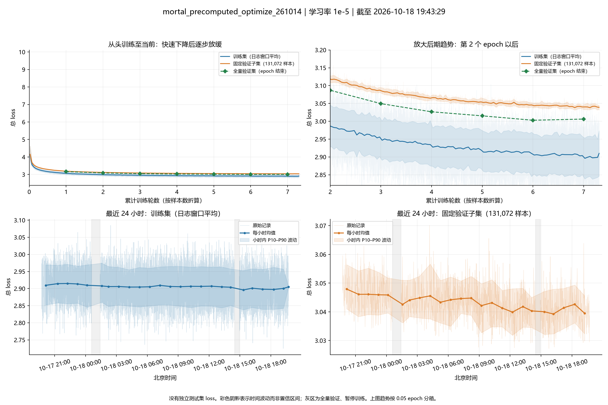
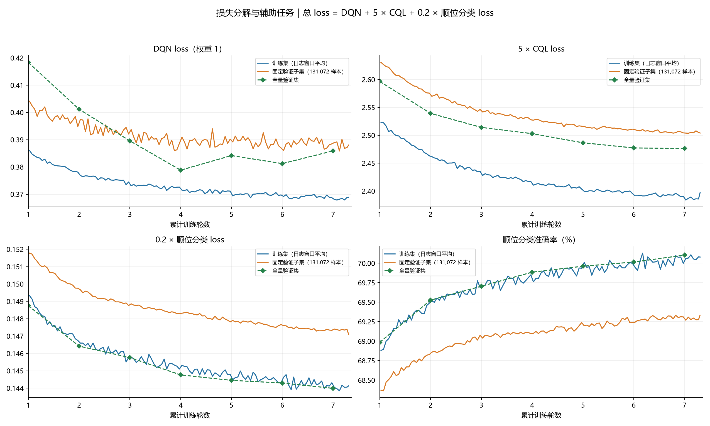

# mortal_precomputed_optimize_261014：训练收敛分析

结论：训练已进入改善放缓的后期、接近平台，但固定验证子集均值仍在缓慢下降，暂不能判断已经完全收敛；未见 loss 发散或无法收敛的证据。DQN 验证项后期停滞和波动值得跟踪，但当前不足以确认整体过拟合。

## 数据范围与指标含义

- 本次从随机初始化开始训练，学习率始终为 `1e-5`，batch 为 2048；没有拼接此前 `1e-4` 训练的历史。
- 最后训练指标：北京时间 2026-10-18 19:43:29；19:43:31 日志以 `KeyboardInterrupt` 结束。这是中断记录，不能据此判定数值异常。
- 最后 checkpoint：2026-10-18 19:42:31，已完成 7 个 epoch，第 8 个 epoch 完成 31.0124%，累计 6,131,706,344 个样本、2,994,000 批。
- 最后训练日志到第 8 个 epoch 的 31.1223%，最后 450 批对应的 9 个日志窗口尚未保存到 checkpoint。图中保留这些已观测训练指标；最后验证指标对应已保存 checkpoint。
- **没有独立测试集 loss。** 实际记录为 `train/*`、`validation/periodic/*`、`validation/epoch/*`。两种验证均读取同一个 val split，不能解释为验证集和独立测试集。
- 固定验证子集每次包含 131,072 条样本，seed 为 0；全量验证每轮结束运行一次，包含 114,305,380 条样本。
- 总 loss = DQN loss + 5 × CQL loss + 0.2 × 顺位分类 loss。DQN 为 `0.5 × MSE`；它是训练目标误差，不是实战胜率。

## 趋势和波动



上图顶部的均值线按 0.05 epoch 分箱，底部按小时聚合。彩色带表示对应时间箱内的 P10–P90 波动范围，不是均值置信区间。灰区为全量验证阶段，此时训练暂停；原始时间序列不跨越长空档连线。时间采用 Asia/Shanghai。

| 完成 epoch | 全量验证总 loss | 相对上一轮变化 | DQN loss | CQL loss（未加权） | 顺位分类准确率 |
| --- | ---: | ---: | ---: | ---: | ---: |
| 1 | 3.163657 | — | 0.418335 | 0.519314 | 68.985% |
| 2 | 3.086915 | -0.076742 | 0.401163 | 0.507866 | 69.527% |
| 3 | 3.049499 | -0.037416 | 0.389560 | 0.502836 | 69.705% |
| 4 | 3.026545 | -0.022954 | 0.378820 | 0.500592 | 69.885% |
| 5 | 3.015217 | -0.011328 | 0.384169 | 0.497320 | 69.962% |
| 6 | 3.002875 | -0.012342 | 0.381224 | 0.495471 | 70.015% |
| 7 | 3.006175 | +0.003300 | 0.385896 | 0.495258 | 70.104% |

第 1～6 轮的全量验证总 loss 持续降低；第 7 轮相对第 6 轮回升 0.003300，约 0.110%。这是一轮小幅回升，还不构成持续恶化趋势。全量验证的当前最低记录在第 6 轮，但输出目录只保留 latest.pth，不代表第 6 轮权重仍可直接取回。

固定验证子集按完整 epoch 聚合的平均 loss：第 5 轮 3.059123、第 6 轮 3.049500、第 7 轮 3.043011。第 8 轮目前只有约31%，其平均值为 3.040369，不能当作完整一轮直接作等量比较。

最近24小时中，前6小时验证子集平均 loss 为 3.046170，最后6小时为 3.040361，降低约0.005809（0.191%）；相应训练平均 loss 从2.912236降到2.899707。最近6小时验证子集记录的标准差约0.005881，短时波动已经与一天的改善幅度接近，因此需要看多次均值和后续全量验证，不能只比较最后两次记录。相邻验证存在时间相关性，这些统计没有用于作独立样本显著性检验。

## 损失分解



- 全量验证 DQN loss 在第4轮达到0.378820，此后第5～7轮为0.384169、0.381224、0.385896，呈停滞及波动。与此同时，固定子集 DQN 的整轮平均值仍略有下降，所以还不能确认整个验证分布都在退化。
- 第6到第7轮：DQN贡献增加约0.004671；加权CQL贡献减少约0.001061；加权顺位分类贡献减少约0.000310，合计导致总loss上升约0.003300。
- CQL 与顺位分类 loss 仍改善；全量验证顺位分类准确率从第6轮70.015%升到第7轮70.104%。该准确率是辅助任务指标，不能直接换算成麻将实战胜率。
- 训练loss降低而验证DQN后期没有同步改善，是需要观察的泛化风险信号；但训练与验证还存在数据分布和 train/eval 模式差异，不能仅凭两条曲线的间距证明过拟合。

## 判断及边界

**当前判断：接近平台、仍缓慢改善；尚未确认完全收敛，也没有无法收敛的迹象。** 全量验证只有7个epoch末端观测点，第8轮尚未完成。若继续训练，可用接下来1～2个完整epoch的全量验证及固定子集均值确认是否还有收益；如果训练loss继续下降而全量验证连续多轮变差，才更支持过拟合判断。该建议未被执行，本次没有修改超参数或启动训练。

所有已记录标量均为有限值，最后checkpoint的主模型、DQN及AuxNet张量也全部有限。没有发现持续loss爆炸；但日志未记录完整梯度范数，不能据此断言训练过程绝无瞬时梯度溢出。

## 复核及文件

- 使用 TensorBoard `EventAccumulator` 读取所有标量并遵守恢复清理标记；本次日志只有一次从头启动，没有发现 resume 段。
- 5,988 次周期验证及7次全量验证，共5,995条loss记录，均与文本日志交叉核对一致（允许TensorBoard float32舍入）。
- 核对checkpoint实际学习率、训练契约、样本进度及最后验证指标；读取使用 `torch.load(weights_only=True, map_location='cpu')`。
- `metrics.npz` 保存全部标量的原始快照，每个tag对应三列：step、wall_time、value；`analysis.json` 保存结构化统计；`full_validation.csv` 保存全量验证表。
- 图表同时提供PNG和SVG；脚本为 `analyze.py`，运行输出为 `analysis-run.log`。

复现命令（从 `~/Mortal` 执行；使用已有临时Matplotlib依赖目录 `/tmp/mortal-convergence-plot-20261010`）：

```bash
/home/tml104/miniconda3/envs/mortal/bin/python .scratch/training-convergence-261014-20261018/analyze.py
```

原始训练目录、配置、checkpoint及TensorBoard均未修改。
