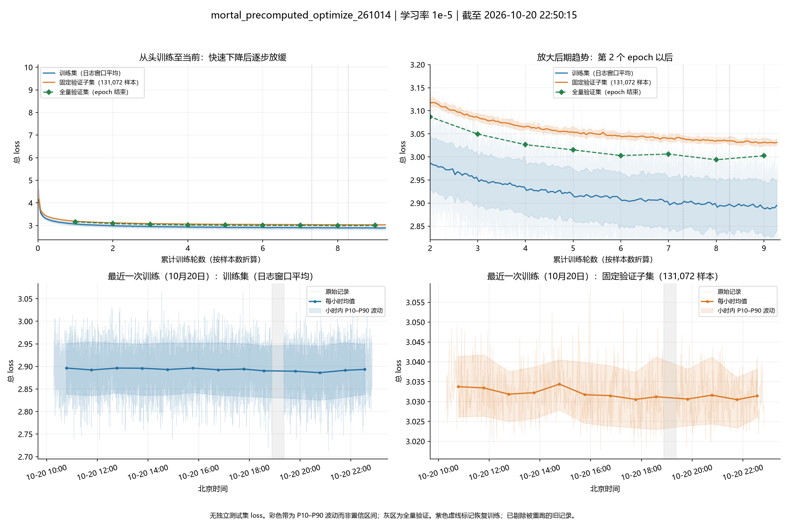
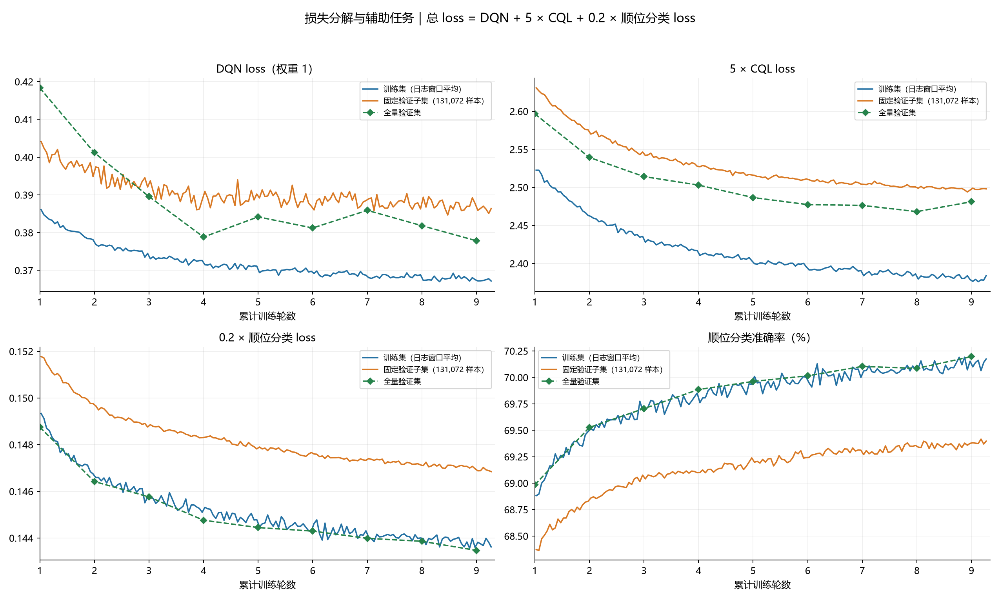

# 261014 主模型训练分析更新（2026-10-26）

**结论：仍在缓慢改善，已接近平台；尚不能确认完全收敛，也未发现持续发散或无法收敛的迹象。** 相比10月18日的分析，新增第8、9轮结果：第8轮刷新全量验证最低loss，第9轮小幅反弹；固定验证子集的整轮均值继续下降。

## 数据截止时间与来源

- 分析日期为2026-10-26，实际最新指标截至北京时间 **2026-10-20 22:50:15**。指定训练目录中没有10月21日至26日的新训练日志，不能把这段日历时间解释为模型持续训练却没有改善。
- 本次只分析 `artifacts/mortal_precomputed_optimize_261014`，不混入旧 `1e-4` 训练及其epoch8评测模型的数据。本次从随机初始化开始，学习率始终为 `1e-5`。
- checkpoint已完成9个epoch，第10个完成29.0254%；累计训练7,792,632,728个样本、3,805,000批。最后训练日志与checkpoint步数相同，没有尚未保存的已记录尾部训练窗口。
- 三次运行分别于10月14日启动、10月19日从第2,994,000批恢复、10月20日从第3,391,500批恢复。按TensorBoard恢复标记剔除了旧记录中的9个和7个训练窗口，共128个标量，避免重跑样本被重复计入。
- **没有独立测试集loss**。实际指标为训练集loss、固定验证子集loss和全量验证集loss。两种验证均来自同一个 `val` split，不是两个独立数据集。
- 每轮训练有838,796,504个样本；周期验证使用固定131,072个样本、seed=0；全量验证使用114,305,380个样本。周期验证和全量验证的绝对值不能直接当成同一数据集上的前后变化。
- 总loss = DQN loss + 5 × CQL loss + 0.2 × 顺位分类loss。

## 总loss趋势与波动



上方按累计样本折算训练轮数，均值线按0.05 epoch分箱，紫色虚线标出两次恢复位置。下方为最近一次运行（10月20日约10:16—22:50），显示原始记录及小时均值；灰区为全量验证、暂停训练的时间。彩色带为时间箱内P10–P90波动，不是置信区间。原始时间曲线不跨越长空档连线。

| 完成epoch | 全量验证总loss | 相对上一轮变化 | DQN loss | CQL loss（未加权） | 顺位分类loss（未加权） | 顺位分类准确率 |
| --- | ---: | ---: | ---: | ---: | ---: | ---: |
| 1 | 3.163657 | — | 0.418335 | 0.519314 | 0.743752 | 68.985% |
| 2 | 3.086915 | -0.076742 | 0.401163 | 0.507866 | 0.732099 | 69.527% |
| 3 | 3.049499 | -0.037416 | 0.389560 | 0.502836 | 0.728806 | 69.705% |
| 4 | 3.026545 | -0.022954 | 0.378820 | 0.500592 | 0.723811 | 69.885% |
| 5 | 3.015217 | -0.011328 | 0.384169 | 0.497320 | 0.722237 | 69.962% |
| 6 | 3.002875 | -0.012342 | 0.381224 | 0.495471 | 0.721483 | 70.015% |
| 7 | 3.006175 | +0.003300 | 0.385896 | 0.495258 | 0.719933 | 70.104% |
| 8 | 2.993826 | -0.012349 | 0.381830 | 0.493627 | 0.719296 | 70.085% |
| 9 | 3.002432 | +0.008606 | 0.377834 | 0.496226 | 0.717347 | 70.197% |

本次第8轮总loss为2.993826，是目前9次全量验证中的最低值，比上次分析时的最佳第6轮3.002875低约0.301%。第9轮回升0.008606，约0.287%，但没有出现连续多轮全量loss上升。

轮内日志均值如下。注意这些均值覆盖一轮内不断更新的多个模型，不等同于轮末保存点的全量验证。

| epoch | 训练loss均值 | 固定验证子集loss均值 | 固定子集记录的标准差 |
| --- | ---: | ---: | ---: |
| 5 | 2.925475 | 3.059123 | 0.007077 |
| 6 | 2.914159 | 3.049500 | 0.006851 |
| 7 | 2.905982 | 3.043011 | 0.006164 |
| 8 | 2.899463 | 3.037773 | 0.006167 |
| 9 | 2.894174 | 3.033220 | 0.006043 |
| 10（仅29.03%，非完整轮） | 2.889648 | 3.031002 | 0.005389 |

第7到第9轮，周期验证均值从3.043011降到3.033220，约下降0.322%。第10轮目前只有29%，不能把其均值作为完整轮与前几轮直接比较。等长的最近两个0.25-epoch区间（8.75—9.00和9.00—9.25）均值分别为3.031151、3.030962，改善很小，说明局部已较平坦。

最近一次运行的前3小时和末3小时，固定验证子集平均loss为3.033022与3.030875，下降约0.002147；末3小时单次记录标准差约0.005323。当前改善幅度已经小于短时波动尺度，单次升降不适合用来决定收敛。相邻验证来自连续模型更新、存在时间相关性，本报告没有将它们当成独立样本做显著性检验。

## 分项变化与收敛判断



第8到第9轮的总loss回升由以下变化合成：

| 项目 | 对总loss的贡献变化 |
| --- | ---: |
| DQN loss | -0.003996 |
| 5 × CQL loss | +0.012992 |
| 0.2 × 顺位分类loss | -0.000390 |
| 合计 | +0.008606 |

因此，本次回升主要来自CQL项，不能沿用“第7轮回升主要来自DQN”的旧判断。第9轮DQN loss降到0.377834、顺位分类loss降到0.717347，均为目前全量验证的最低记录；顺位分类准确率升到70.197%。这些辅助任务指标不能直接换算成实际对局胜率。

判断分为三点：

1. **没有无法收敛或数值发散的证据。** 整体loss长期下降，最新模型张量和全部记录标量均为有限值，没有持续爆炸。
2. **已接近平台，但仍有小幅收益。** 第8轮刷新全量最佳，固定子集轮均值持续降低；最新局部区间已经很平，尚不足以确认完全停止改善。
3. **尚无充分证据确认整体过拟合。** 第9轮全量总loss回升需要观察，但DQN及顺位分类改善、固定子集均值也没有持续恶化。若后续连续多个完整epoch全量loss上升、训练loss却继续下降，过拟合的证据才会增强。

如果之后继续训练，建议观察接下来1～2个完整epoch的全量验证及固定子集均值，再决定是否以当前配置视为实用收敛。本次没有调整学习率、启动训练或运行新的模型验证。上述“当前第8轮最佳”仅指此次261014训练中的loss记录，不意味着目录中仍保留了对应权重；当前主目录只有latest.pth。

## 复核范围与输出

- 读取三个TensorBoard事件文件，按恢复清理标记保留有效记录；有效训练loss记录76,100条，周期验证7,610条，全量验证9条。
- 7,619条验证loss与对应文本日志逐条交叉核对一致，允许TensorBoard float32舍入。
- 核对各指标step对齐、每个step唯一、加权分项重建总loss误差小于2e-6、样本进度与checkpoint一致。
- 使用 `torch.load(weights_only=True, map_location='cpu')` 检查checkpoint；模型主干、DQN及AuxNet张量和日志标量全部有限。日志没有完整梯度范数，不能据此断言从未出现AMP处理过的瞬时梯度溢出。
- `metrics.npz` 为标量快照，各tag三列依次是step、wall_time、value；`analysis.json` 为统计结果；`full_validation.csv` 为全量验证表。
- 两组图各有PNG和SVG版本。分析脚本为 `analyze.py`，运行输出为 `analysis-run.log`。
- 原始日志、模型、训练配置及用户已有代码改动均未修改；没有独立测试集数据，也未重新执行训练或实战评测。

复现命令（从 `~/Mortal` 执行，依赖已有的临时Matplotlib目录 `/tmp/mortal-convergence-plot-20261010`）：

```bash
/home/tml104/miniconda3/envs/mortal/bin/python .scratch/training-convergence-261014-20261026/analyze.py
```
