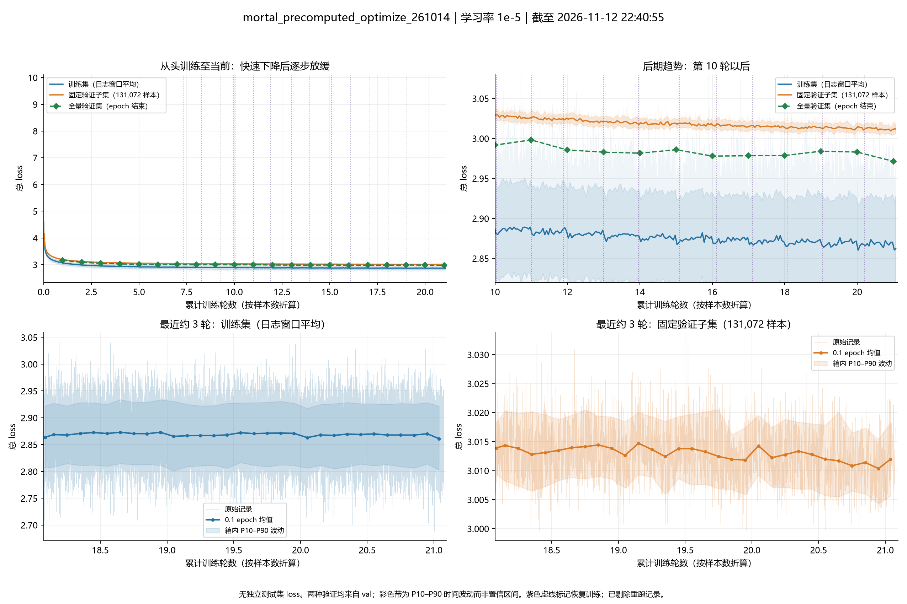
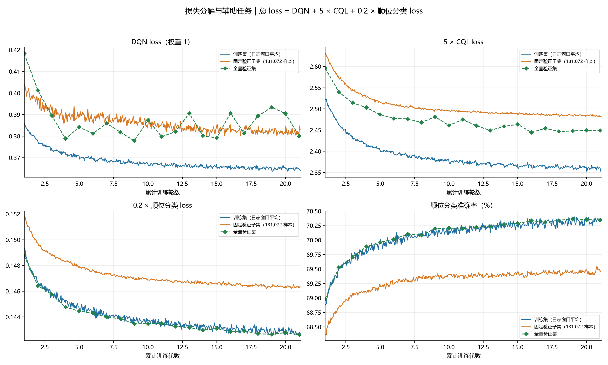

# 261014 主模型：2026-11-12 晚间更新

本报告及同目录图表、统计已覆盖今早的版本。

**最新判断：训练处于改善缓慢、接近平台的后期，但第21轮全量验证刷新了最低loss，因此尚不宜认定已经完全收敛或停止改善。没有无法收敛、持续发散的证据。**

## 快照范围与指标含义

- 指标截止北京时间 **2026-11-12 22:40:55**，对应checkpoint时间为 **2026-11-12 22:40:56**。训练仍在继续，本次只读打开checkpoint，将TensorBoard记录截断至该保存点，保证数据与权重进度一致。
- 已完成 **21** 个epoch，第 **22** 个完成 **7.4593%**；累计样本 **17,677,295,032**，累计批次 **8,631,500**。
- 本次仅分析 `artifacts/mortal_precomputed_optimize_261014`。该模型从随机初始化开始，学习率始终为 `1e-5`，batch=2048；没有混入旧训练或评测结果。
- **没有独立测试集loss。** 实际指标为训练集、固定验证子集、全量验证集。后两者都来自同一个val split，不能分别称为验证集和测试集。
- 固定验证子集有131,072条样本、seed=0；全量验证有114,305,380条样本。不同样本范围的绝对loss不能直接作为前后变化比较。
- 总loss = DQN loss + 5 × CQL loss + 0.2 × 顺位分类loss。
- 终端 `event=train` 后来改为每250批输出，TensorBoard仍每50批记录50批窗口指标。本报告统一采用TensorBoard，按恢复标记剔除失效记录。

## 总loss趋势与波动



上方为从头训练及第10轮后的放大趋势，均值线按0.05 epoch分箱；下方为最近约3轮的原始波动和0.1 epoch均值。横轴由累计样本折算，不把暂停的日历时间当作训练进度。紫色虚线标记恢复训练。彩色带是箱内P10–P90波动范围，不是置信区间。

| 完成epoch | 全量验证总loss | 比上一轮变化 | DQN loss | CQL loss（未加权） | 顺位分类loss（未加权） | 顺位分类准确率 |
| --- | ---: | ---: | ---: | ---: | ---: | ---: |
| 1 | 3.163657 | — | 0.418335 | 0.519314 | 0.743752 | 68.985% |
| 2 | 3.086915 | -0.076742 | 0.401163 | 0.507866 | 0.732099 | 69.527% |
| 3 | 3.049499 | -0.037416 | 0.389560 | 0.502836 | 0.728806 | 69.705% |
| 4 | 3.026545 | -0.022954 | 0.378820 | 0.500592 | 0.723811 | 69.885% |
| 5 | 3.015217 | -0.011328 | 0.384169 | 0.497320 | 0.722237 | 69.962% |
| 6 | 3.002875 | -0.012342 | 0.381224 | 0.495471 | 0.721483 | 70.015% |
| 7 | 3.006175 | +0.003300 | 0.385896 | 0.495258 | 0.719933 | 70.104% |
| 8 | 2.993826 | -0.012349 | 0.381830 | 0.493627 | 0.719296 | 70.085% |
| 9 | 3.002432 | +0.008606 | 0.377834 | 0.496226 | 0.717347 | 70.197% |
| 10 | 2.991740 | -0.010692 | 0.387385 | 0.492176 | 0.717367 | 70.207% |
| 11 | 2.998191 | +0.006451 | 0.379774 | 0.494986 | 0.717425 | 70.198% |
| 12 | 2.985628 | -0.012563 | 0.382069 | 0.492060 | 0.716298 | 70.223% |
| 13 | 2.982909 | -0.002720 | 0.390552 | 0.489835 | 0.715896 | 70.233% |
| 14 | 2.981622 | -0.001287 | 0.380147 | 0.491700 | 0.714880 | 70.273% |
| 15 | 2.985954 | +0.004332 | 0.379236 | 0.492724 | 0.715483 | 70.289% |
| 16 | 2.977981 | -0.007973 | 0.390699 | 0.488883 | 0.714339 | 70.333% |
| 17 | 2.978380 | +0.000400 | 0.381308 | 0.490832 | 0.714569 | 70.309% |
| 18 | 2.978745 | +0.000365 | 0.389397 | 0.489331 | 0.713471 | 70.340% |
| 19 | 2.984069 | +0.005324 | 0.393387 | 0.489608 | 0.713219 | 70.367% |
| 20 | 2.983016 | -0.001053 | 0.390478 | 0.489950 | 0.713930 | 70.354% |
| 21 | 2.971420 | -0.011596 | 0.379985 | 0.489763 | 0.713099 | 70.342% |

新增第21轮全量验证于 **2026-11-12 21:47:22** 完成：

- loss为 **2.971420**，刷新本次训练历史最低值。
- 比第20轮 **2.983016** 低约 **0.389%**。
- 比此前第16轮最低值 **2.977981** 低约 **0.220%**。

因此，今早“第17～20轮未刷新最低值”的事实已经获得新的后续信息：第21轮突破了之前的最低值。本报告不再据前4轮的停滞推断当前已经停止改善。与此同时，从第16到21轮的累计改善仍较小，整体接近平台的判断依然成立。

## 周期验证均值

以下均值汇总整轮中持续变化的模型状态，不等于轮末checkpoint的单次验证。

| 完成epoch | 训练loss记录均值 | 固定验证子集loss均值 | 固定子集记录标准差 |
| --- | ---: | ---: | ---: |
| 10 | 2.889912 | 3.030188 | 0.005683 |
| 11 | 2.886260 | 3.027072 | 0.005215 |
| 12 | 2.883130 | 3.024647 | 0.004881 |
| 13 | 2.880399 | 3.022387 | 0.005156 |
| 14 | 2.878360 | 3.020062 | 0.004970 |
| 15 | 2.876186 | 3.018596 | 0.004784 |
| 16 | 2.874606 | 3.017809 | 0.004909 |
| 17 | 2.872997 | 3.016084 | 0.004920 |
| 18 | 2.871468 | 3.015176 | 0.004758 |
| 19 | 2.870313 | 3.013672 | 0.004776 |
| 20 | 2.869092 | 3.013057 | 0.004773 |
| 21 | 2.868075 | 3.012176 | 0.004622 |

第19、20、21轮固定验证子集均值为3.013672、3.013057、3.012176，连续小幅下降。第20到21轮下降约0.000881（约0.0292%）。同期单次记录标准差约0.0046，短期波动仍大于每轮均值改善。

第22轮仅完成约7.46%，其均值不作为完整轮比较。固定子集只占全量val约0.115%，应同时参考全量结果。相邻验证记录存在时间相关性，本报告没有将这些点视为独立样本进行显著性检验。

## 损失分解



第20到21轮总loss下降约0.011596，分解为：

| 分项 | 对总loss的贡献变化 |
| --- | ---: |
| DQN loss | -0.010493 |
| 5 × CQL loss | -0.000937 |
| 0.2 × 顺位分类loss | -0.000166 |

这次改善主要来自DQN项：从0.390478降到0.379985，约占总loss下降量的90.5%。CQL和顺位分类loss也有所改善。仅凭这些汇总值不能判断具体改善原因，例如不能据此确认是BN或某项参数造成的。

DQN历史全量最低值仍为第9轮的0.377834；第21轮恢复到较低水平，但还不能说价值估计已经完全收敛。第21轮辅助顺位分类准确率约70.342%，没有随总loss同步创最高值。这是辅助分类指标，不能换算成实战胜率。

## 收敛判断与建议

1. **收益放缓、接近平台的迹象仍明显。** 最近多轮总体变化较小，继续维持当前配置不宜预期快速改善。
2. **仍有可观察到的收益，不能认定已经停止改善。** 第21轮刷新全量验证最低值，周期验证均值也继续下降。相较今早，本次新增数据削弱了“已经完全收敛”的判断。
3. **未见无法收敛或持续发散。** 长期loss下降，当前模型及全部已记录标量有限，没有持续loss爆炸；也没有足够证据确认整体过拟合。

更准确的描述是“处于收敛后期、低收益阶段，但仍有小幅改善”。如果要据此决定是否继续，建议关注后续全量验证能否持续优于第21轮，以及实际对局表现；单个新低同样不能保证后续持续下降。本次未停止训练、调整超参数或启动评测。

当前最低loss对应的是此次261014训练的第21轮，不能与此前旧训练的epoch8评测模型混淆。当前目录只保留latest.pth，最优指标的历史记录不意味着对应权重一定仍可单独取回。

## 复核与输出

- TensorBoard恢复清理共剔除672个失效标量；有效训练loss记录172,630条、周期验证loss记录17,263条、全量验证记录21条。
- 17,284条验证loss与文本日志逐条核对一致，允许float32舍入；各指标step对齐、无重复，加权分项重建总loss误差小于2e-6。
- 原始训练日志、权重、配置和用户源码没有修改；读取checkpoint使用 `torch.load(weights_only=True, map_location='cpu')`。
- 已记录标量和当前主干、DQN、AuxNet张量均为有限值，但没有完整梯度范数记录，不能断言从未发生AMP处理过的瞬时梯度溢出。
- 本次覆盖 `loss_trends.png/svg`、`validation_components.png/svg`、`analysis.json`、`full_validation.csv`、`metrics.npz`、`analysis-run.log` 和本报告；分析脚本保持原样。
- 没有独立测试集指标，也没有本次新增实战结果；不能仅凭本报告判断独立测试表现、段位或棋力上限。

复现命令（从 `~/Mortal` 执行，依赖已有临时Matplotlib目录 `/tmp/mortal-convergence-plot-20261010`）：

```bash
/home/tml104/miniconda3/envs/mortal/bin/python .scratch/training-convergence-261014-20261112/analyze.py
```

重新执行会按新的checkpoint截止点覆盖图表及结构化统计；`report.md` 的文字结论需随新结果重新核对。当前快照完整保存在metrics.npz。
