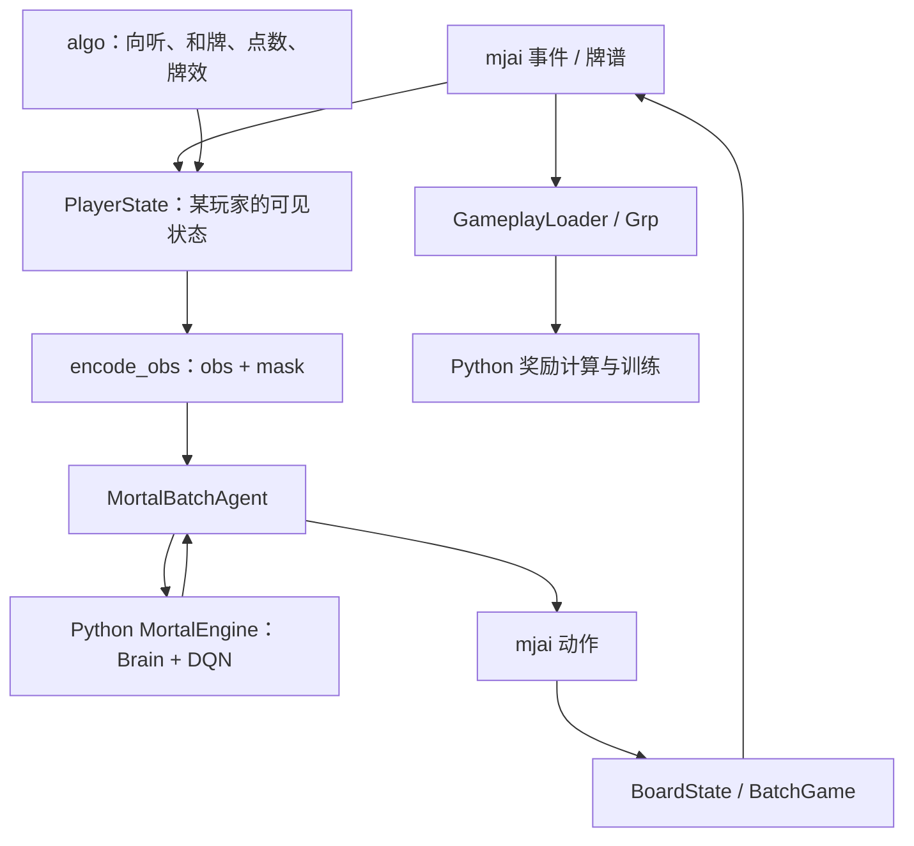
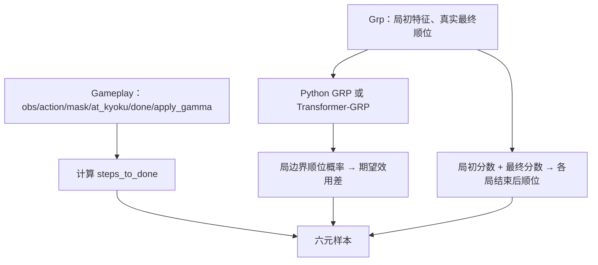
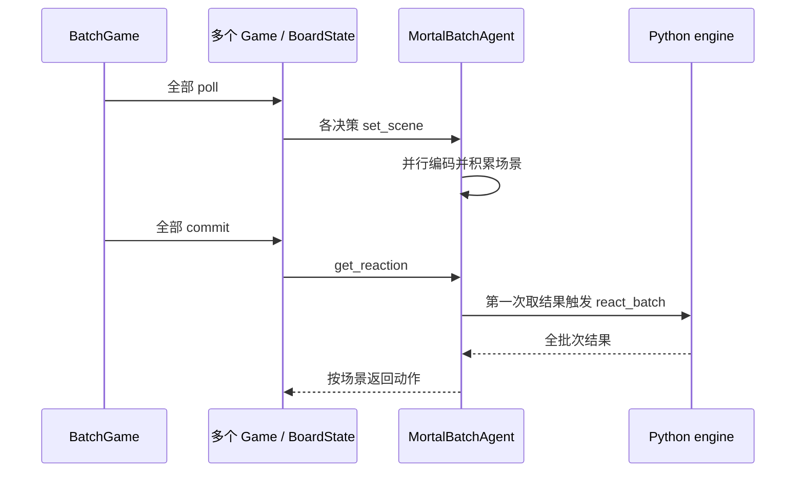

# libriichi 代码文档：从牌、事件到模型决策与完整对战

本文面向第一次接触 `libriichi` 的读者，按“基本数据 → 事件 → 状态 → 算法与观测 → 决策 → 数据集 → 对战”的顺序解释代码。目标是让你理解库的运行过程、正确调用接口，并知道二次开发应修改哪里、需要维持哪些约束。

内容依据本仓库 **2026-09-30 的源码**，覆盖 `libriichi/` 的模块、主要类型、算法、Python 接口、命令行工具和测试入口。“当前实现”特指这一份代码，不代表所有立直麻将规则或 mjai 实现。源码与本文不一致时，以源码及测试为准。

路径链接相对本文所在的 `docs2/`。终端命令除另有说明外，都在仓库根目录 `~/Mortal` 执行。`0..=3` 表示包含两端；数组区间 `[a:b)` 表示包含 `a`、不包含 `b`。

## 阅读导航

1. [库的职责与整体结构](#overview)
2. [构建、加载与公开边界](#build)
3. [麻将术语、牌和座位的表示](#primitives)
4. [mjai：用事件描述一场比赛](#events)
5. [PlayerState：单玩家视角状态机](#state)
6. [algo：向听、和牌、点数和单人牌效](#algorithms)
7. [模型契约：46 个动作与观测张量](#observations)
8. [agent 与 Bot：把模型输出变成动作](#agents)
9. [dataset：把牌谱变成训练数据](#dataset)
10. [arena：从洗牌到半庄结束](#arena)
11. [stat：统计的接口与计算口径](#statistics)
12. [动手示例](#examples)
13. [辅助代码、工具与测试](#tools)
14. [二次开发导航与兼容性](#development)
15. [接口速查与易错点](#reference)

第一次阅读建议顺序读至第 10 节，再运行第 12 节的小例子。只想接入 Python，可先看第 2、7、8、12 节；处理训练数据时，第 9 节需要和第 7 节一起读。

<a id="overview"></a>

## 1. 库的职责与整体结构

### 1.1 Mortal 为什么需要 libriichi

神经网络可以评价动作，但它本身不知道牌如何表示、什么时候可以立直、碰牌后谁出牌，以及牌谱中哪些位置需要生成训练样本。`libriichi` 提供这些规则与数据处理能力。

| 工作 | 输入 | 输出 | 主要位置 |
| --- | --- | --- | --- |
| 维护玩家状态 | 有序 mjai 事件 | 手牌、可见信息、可行动类别 | `state/` |
| 计算麻将规则 | 手牌、面子、场况 | 向听、有役判断、符番、点数 | `algo/` |
| 编码模型输入 | 玩家状态、观测版本 | `obs` 与合法动作 `mask` | `state/obs_repr.rs` |
| 提取训练原料 | 完整牌谱 | 各玩家的动作样本、局初特征 | `dataset/` |
| 执行对战 | 随机种子、四家策略 | 事件日志、最终分数和顺位 | `arena/`、`agent/` |
| 对外接入与分析 | Python 引擎、事件或日志 | Bot 反应、统计结果 | `mjai/`、`stat.rs` |

PyTorch 网络、反向传播、优化器、checkpoint、GRP 奖励预测和在线参数服务都在 Python 侧。`libriichi` 不加载 `.pth` 权重，也不训练神经网络。



### 1.2 三条核心数据流

**在线推理**：外部服务器发来一行事件，`Bot` 更新 `PlayerState`。需要决策时，Rust 编码观测，Python 模型返回动作编号，Rust 补出 `actor`、`pai`、`consumed` 等字段，输出 mjai JSON。

**离线训练**：`GameplayLoader` 回放牌谱，在决策时刻截取观测，并从后续事件推断真实动作。Python 用 `Grp` 的局初特征预测顺位，计算局奖励与折扣步数，将最终样本交给网络训练。

**自对战**：`BoardState` 持有真实牌山和四份玩家状态，推进到需要行动的位置；`BatchGame` 收集多场对局的请求，交给批量 agent；动作落地后继续推进，直到半庄结束。

三个流程复用同一套 `PlayerState` 和观测编码，这是训练与推理能够采用相同输入语义的基础。

### 1.3 源码地图

```text
libriichi/
├── Cargo.toml、build.rs       构建配置、PyO3 链接设置
├── src/
│   ├── lib.rs                Rust 模块与 Python 扩展注册
│   ├── consts.rs             观测版本、形状、动作数、GRP 特征数
│   ├── tile.rs、hand.rs      单张牌、手牌格式转换
│   ├── chi_type.rs           吃牌类型
│   ├── mjai/                事件定义和逐事件 Bot
│   ├── state/               单玩家状态、更新、辅助计算、编码
│   ├── algo/                向听、和牌、计分、单人牌效
│   │   ├── data/            编译期嵌入的查表数据
│   │   └── sp/              单人牌效搜索与概率计算
│   ├── agent/               策略接口、Python/Akochan 适配
│   ├── dataset/             动作数据、GRP 数据、隐藏信息
│   ├── arena/               单局、整场、批量对战
│   ├── stat.rs              牌谱统计
│   ├── rankings.rs          同分规则与顺位转换
│   ├── array.rs             观测构造用二维数组
│   ├── macros.rs            牌字面量等宏
│   ├── py_helper.rs          Python 子模块注册工具
│   ├── vec_ops.rs            切片逐元素加法
│   └── bin/                 stat、validate_logs 命令行程序
└── benches/bench.rs          Criterion 基准
```

源码入口：[lib.rs](../libriichi/src/lib.rs)。后文按职责进一步拆解各目录。

<a id="build"></a>

## 2. 构建、加载与公开边界

### 2.1 三个名字不要混淆

| 名称 | 出现位置 | 例子 |
| --- | --- | --- |
| Cargo package：`libriichi` | Cargo 选择构建包 | `cargo build -p libriichi` |
| Rust library crate：`riichi` | Rust 的 `use` 路径 | `use riichi::state::PlayerState;` |
| Python module：`libriichi` | Python 导入 | `from libriichi.state import PlayerState` |

[Cargo.toml](../libriichi/Cargo.toml) 同时生成 `cdylib` 和 `rlib`：前者供 Python 动态加载，后者供 Rust 链接。Linux 产物 `libriichi.so` 是平台前缀 `lib` 加 Rust 库名 `riichi`。

当前 package 版本为 `0.1.0`，Rust edition 为 2024。主要依赖如下：

| 类别 | 依赖 | 用途 |
| --- | --- | --- |
| 跨语言 | `pyo3`、`numpy`、`pyo3-log` | Python 类、NumPy 数组、日志桥接 |
| 数据 | `serde`、`serde_json`、`serde_with`、`ndarray` | mjai 序列化、字段边界检查、张量 |
| 文件与并行 | `flate2`、`glob`、`rayon` | gzip、目录扫描、并行提取/编码 |
| 算法与存储 | `boomphf`、`ahash`、`tinyvec`、`byteorder` | 查表、缓存、小数组和二进制读入 |
| 对战 | `rand`、`rand_chacha`、`sha3` | 可复现牌山 |
| 协调与工具 | `crossbeam`、`parking_lot`、`indicatif`、`anyhow` | 编码等待、互斥锁、进度条、错误上下文 |

### 2.2 构建并让 Python 找到扩展

前置条件是 Rust stable、目标 Python 环境及 NumPy。项目 `environment.yml` 使用 Python 3.12；PyTorch 在需要网络时另行安装。应在最终运行 Python 的同一个环境中构建扩展。

```bash
conda activate mortal
cargo build -p libriichi --lib --release
```

确认允许替换旧扩展后，将产物放到实际导入的位置：

```bash
cp target/release/libriichi.so mortal/libriichi.so
(cd mortal && python -c 'import libriichi; print(libriichi.__file__, libriichi.__version__, libriichi.__profile__)')
```

Windows 对应将 `target/release/riichi.dll` 复制为 `mortal/libriichi.pyd`。`cargo build` 只更新 `target/`；不替换 `mortal/` 的副本，Python 就可能运行旧代码。排查时先看 `libriichi.__file__`，并重启已加载旧扩展的进程。

从根目录交互使用本文 Python 示例，可以先设置：

```bash
export PYTHONPATH="$PWD/mortal${PYTHONPATH:+:$PYTHONPATH}"
python
```

扩展本身不读取 `config.toml`。`MORTAL_CFG` 是上层 Python 配置加载器的约定，不是 `PlayerState`、`Grp` 等接口的必需参数。

### 2.3 feature 的实际作用

| feature | 默认 | 作用 |
| --- | --- | --- |
| `pymod` | 开启 | 启用 `pyo3/extension-module` 扩展链接模式 |
| `mimalloc` | 开启 | 使用 MiMalloc 全局分配器 |
| `abi3` | 关闭 | 启用 PyO3 稳定 ABI 支持；具体兼容范围仍需结合构建配置确认 |
| `sp_reproduce_cpp_ver` | 关闭 | 切换单人牌效算法至原 C++ 行为，包括向听算法、计算长度等差异 |

`--no-default-features` 不会从源码移除全部 Python 类型或依赖，它主要关闭默认的扩展链接模式和分配器。Rust 测试和二进制按 CI 使用这一选项，避免把可执行程序当成 Python 扩展链接。

[build.rs](../libriichi/build.rs) 添加 PyO3 扩展链接参数。根 workspace 的 release profile 开启 LTO，`codegen-units=1`，保留调试信息，关闭整数溢出检查；因此不能依靠 release 溢出报错替代输入检查。

### 2.4 导入时发生什么

`lib.rs` 中的 `#[pymodule] fn libriichi(...)`：

1. 初始化 Rust → Python 日志桥接。
2. 调用向听表和和牌表的 `ensure_init()`，解压编译进库的查表数据。
3. 设置 `__version__`、`__profile__`（`debug` 或 `release`）；debug 导入还会向 stderr 提示。
4. 注册六个 Python 子模块。

[py_helper.rs](../libriichi/src/py_helper.rs) 同时写入 `sys.modules['libriichi.xxx']`，使 `from libriichi.xxx import ...` 可用。这些子模块来自动态扩展，不是磁盘上的 Python 包目录。

| Python 子模块 | 注册的接口 |
| --- | --- |
| `libriichi.consts` | `MAX_VERSION`、`ACTION_SPACE`、`GRP_SIZE`、两个形状函数 |
| `libriichi.state` | `PlayerState`、`ActionCandidate` |
| `libriichi.dataset` | `GameplayLoader`、`Gameplay`、`Grp` |
| `libriichi.arena` | `OneVsThree`、`TwoVsTwo` |
| `libriichi.stat` | `Stat` |
| `libriichi.mjai` | `Bot` |

**Rust 的 `pub` 不等于 Python 可见。** `Tile`、`Event`、`AgariCalculator`、`SPCalculator` 没有注册为 Python 类；`PlayerState` 的部分 Rust 公共方法也没有绑定。反过来，crate 根的 `arena`、`dataset`、`consts` 是私有模块；虽然内部有 `pub` 类型并提供 Python 接口，外部 Rust crate 不能直接写 `riichi::arena::Board`。开发时同时检查 `lib.rs` 可见性和 `register_module()`。

<a id="primitives"></a>

## 3. 麻将术语、牌和座位的表示

### 3.1 阅读源码需要的术语

| 概念 / 常见变量 | 含义 |
| --- | --- |
| 局 / `kyoku` | 从发牌到和牌或流局；连庄会让同一局号重复出现 |
| 半庄 / `hanchan` | 通常东一至南四，并可能连庄或西入 |
| 庄家 / `oya`，子家 / `ko` | 当前庄家与其他三家；计分、连庄规则不同 |
| 场风 / `bakaze`，自风 / `jikaze` | 当前东/南/西场、该玩家相对庄家的风位 |
| 本场 / `honba` | 连庄、流局形成的计数，结算时附加点数 |
| 供托 / `kyotaku` | 尚未被领取的立直棒数量，每根 1000 点 |
| 手牌 / `tehai`，起手牌 / `haipai` | 未放入固定面子的牌；开局每家 13 张 |
| 牌河 / `kawa`，弃牌 / `sutehai` | 已打出的牌及其时序信息 |
| 摸牌 / `tsumo`，打牌 / `dahai` | 取得一张牌、舍弃一张牌 |
| 摸切 / `tsumogiri`，手切 / `tedashi` | 打出本次摸牌、打出原有手牌 |
| 顺子 / `shuntsu`，刻子 / `kotsu` | 同花色连续三张、相同牌三张 |
| 雀头 / `pair` | 普通和牌形中的一对牌 |
| 门前 / `menzen` | 未吃、碰、明杠；暗杠不破门前 |
| 吃 / `chi`，碰 / `pon` | 用别人弃牌组成顺子、刻子；吃只能来自上家 |
| 大明杠 / `daiminkan` | 别人弃牌与自己三张相同牌开杠 |
| 加杠 / `kakan` | 给已有的碰追加第四张牌 |
| 暗杠 / `ankan` | 自己四张相同牌开杠 |
| 宝牌 / `dora`，赤宝牌 / `aka` | 增加番数的牌；宝牌本身不构成役 |
| 里宝牌 / `ura`，岭上牌 / `rinshan` | 立直和牌时的额外宝牌、开杠后的补牌 |
| 和牌 / `agari`、`hora` | 满足牌形和役等条件；自摸与荣和共用和牌动作 |
| 荣和 / `ron`，放铳 / `houjuu` | 用别人弃牌和牌、自己的弃牌被荣和 |
| 流局 / `ryukyoku` | 没有普通和牌而结束，包括荒牌与中途流局 |
| 向听数 / `shanten` | 距离听牌的牌形指标，0 为听牌，-1 为和牌形 |
| 待牌 / `waits`，受入 / `required_tiles` | 能补成和牌形的牌、能降低向听数的牌 |
| 振听 / `furiten` | 限制荣和的状态；不禁止自摸 |
| 一发 / `ippatsu`，抢杠 / `chankan` | 依赖事件时序成立的和牌条件 |

“牌谱”“观测”“主策略训练样本”“局奖励”等统一术语见 [CONTEXT.md](../CONTEXT.md)。本节解释实现中的日文转写，不重新定义训练领域模型。

### 3.2 Tile：38 个编号中只有 37 个表示真实牌种

[tile.rs](../libriichi/src/tile.rs) 定义 `pub struct Tile(u8)`，负责 mjai 字符串转换和牌操作。

| ID | mjai 字符串 | 含义 |
| --- | --- | --- |
| `0..=8` | `1m` … `9m` | 万子 |
| `9..=17` | `1p` … `9p` | 筒子 |
| `18..=26` | `1s` … `9s` | 索子 |
| `27..=30` | `E S W N` | 东南西北 |
| `31..=33` | `P F C` | 白、发、中 |
| `34..=36` | `5mr 5pr 5sr` | 赤五万、赤五筒、赤五索 |
| `37` | `?` | 未知牌占位符，不能作为正常手牌参与规则计算 |

`Tile::try_from(...)` 和字符串解析检查输入范围；`new_unchecked` 不检查，应只用于已知合法的编号。`Tile::default()` 是未知牌。

| 方法 | 语义 |
| --- | --- |
| `as_u8()`、`as_usize()` | 取得编号 |
| `deaka()` | 赤五映射到普通五，其余不变 |
| `akaize()` | 普通五映射到赤五，其余不变 |
| `is_aka()`、`is_jihai()`、`is_yaokyuu()` | 判断赤牌、字牌、幺九牌 |
| `is_unknown()` | 判断 `?` |
| `next()`、`prev()` | 宝牌循环的后继/前驱：数牌 9→1，风牌北→东，三元牌中→白 |
| `augment()` | 交换万/筒，保留赤牌身份；索子、字牌不变 |
| `cmp_discard_priority()` | 单人牌效评价相近时的固定弃牌优先级 |

`next()` 不是无条件的编号加一。吃牌生成能使用它，是因为候选已经保证牌处在允许的顺子位置。

### 3.3 34 维手牌与赤牌的关系

算法通常使用 `[u8;34]`，每个位置是该基本牌的张数。**五的计数包含赤五**；“不包含 aka”是指没有独立的赤牌槽位。身份另存于 `[bool;3] akas_in_hand`。

```text
# 一张 5m、一张 5mr
tehai[4] = 2
akas_in_hand = [true, false, false]
```

在 `[u8;37]` 格式中，普通五与赤五各有计数，普通五槽位不再包含赤五。混用两种表示会造成牌数和宝牌数错误。

[hand.rs](../libriichi/src/hand.rs) 提供测试/调试转换：

| 函数 | 输入 / 输出 |
| --- | --- |
| `hand("123m 405p 77z")` | 天凤紧凑字符串 → 合并赤牌的 `[u8;34]` |
| `hand_with_aka(...)` | 紧凑字符串 → 分开赤牌的 `[u8;37]` |
| `tile34_to_vec(...)`、`tile37_to_vec(...)` | 计数数组 → `Vec<Tile>` |
| `tiles_to_string(tiles, aka)` | 34 维计数和赤牌标志 → 紧凑字符串 |

紧凑字符串使用 `0m/0p/0s` 表示赤五、`1z..7z` 表示东南西北白发中，不是 mjai 单牌格式。帮助函数面向可信测试数据，不能替代完整手牌合法性检查。

### 3.4 绝对座位、相对座位和顺位

mjai 的 `actor`、`target`、`oya`、分数数组使用整场不变的绝对玩家编号 `0..=3`。`PlayerState` 把大多数四家数组旋转到自己在第 0 位：

```text
relative = (absolute + 4 - player_id) % 4
0：自己；1：下家；2：对家；3：上家
```

例如 `player_id=2`，相对数组对应绝对玩家 `[2,3,0,1]`。`scores`、`oya`、牌河和立直状态等按此视角存放；`player_id` 和 `ActionCandidate.target_actor` 仍是绝对编号。

顺位是另一种编号，`rank=0..=3` 对应一至四位。[rankings.rs](../libriichi/src/rankings.rs) 稳定地按分数降序排序，同分时绝对编号较小者优先：

```text
scores         = [25000, 25000, 30000, 20000]
player_by_rank = [2, 0, 1, 3]   # 第几个名次属于谁
rank_by_player = [1, 2, 0, 3]   # 每位玩家取得第几个名次
```

局号也有不同粒度：

| 字段 | 含义 |
| --- | --- |
| mjai `start_kyoku.kyoku` | 当前场的第 1..4 局 |
| `PlayerState.kyoku` | 当前场的第 0..3 局，场风另存 |
| `Board.kyoku` | 从东一累计，东一为 0、南一为 4 |
| `Gameplay.at_kyoku` | 牌谱中第几次开局，从 0 起；连庄也递增 |
| GRP `grand_kyoku` | 场风和局号的合并；连庄时可与上一条相同 |

<a id="events"></a>

## 4. mjai：用事件描述一场比赛

### 4.1 Event 是协议的类型定义

[mjai/event.rs](../libriichi/src/mjai/event.rs) 的 `Event` 通过 `#[serde(tag="type")]` 和 `snake_case` 映射为 JSON。每行是一条事件，不是整场日志的 JSON 数组。

| JSON `type` | 必需的主要字段 | 含义 |
| --- | --- | --- |
| `none` | 无 | 不采取动作 / 跳过 |
| `start_game` | 无；`names` 可省略 | 整场开始；可带四人名字、`seed:[nonce,key]` |
| `start_kyoku` | `bakaze,dora_marker,kyoku,honba,kyotaku,oya,scores,tehais` | 开局，`tehais` 固定为四组各 13 张 |
| `tsumo` | `actor,pai` | 摸牌 |
| `dahai` | `actor,pai,tsumogiri` | 打牌 |
| `chi`、`pon` | `actor,target,pai,consumed` | 吃/碰，`consumed` 是手中使用的两张 |
| `daiminkan` | `actor,target,pai,consumed` | 大明杠，`consumed` 为三张 |
| `kakan` | `actor,pai,consumed` | 加杠，`pai` 是追加牌，`consumed` 描述原来的碰 |
| `ankan` | `actor,consumed` | 暗杠，`consumed` 为四张 |
| `dora` | `dora_marker` | 新增宝牌指示牌 |
| `reach` | `actor` | 宣告立直；之后仍须打出宣言牌 |
| `reach_accepted` | `actor` | 接受立直，扣 1000 点、增加供托 |
| `hora` | `actor,target` | 和牌请求或结果；可带 `deltas,ura_markers` |
| `ryukyoku` | 无 | 流局请求或结果；可带 `deltas` |
| `end_kyoku` | 无 | 本局结束 |
| `end_game` | 无 | 整场结束 |

反序列化将 actor/target 限制为 `0..=3`，kyoku 限制为 `1..=4`。其他字段仍有业务约束：能解析成 `Tile` 不代表适合作为场风或宝牌指示牌。

省略 names 会得到四个空字符串。seed、deltas、ura_markers 是可选字段，但消费者可能有更严格要求：动作请求可以没有结算值，统计和部分数据提取不能没有它们。

### 4.2 请求和已经发生的事件

模型提出 `{"type":"hora","actor":0,"target":1}` 时，还不知道结算点数和里宝牌。服务器或 `BoardState` 裁定后广播带结果信息的 hora。`Event` 同时表达请求和事实，但调用场景不同。

`PlayerState.update()` 消费已发生的事实。生成动作 JSON 后应以服务器确认/广播为准，避免自己先更新、又处理广播而重复扣牌。`validate_reaction()` 可在提交前检查，且不修改状态。

hora 的 actor 等于 target 表示自摸，不同表示荣和。吃碰明杠的 target 是提供牌的人。

### 4.3 典型事件时序

```text
start_game
  start_kyoku
  tsumo(庄家)
  dahai
  tsumo / chi / pon / daiminkan / hora ...
  hora（可能连续多条，表示多人荣和）或 ryukyoku
  end_kyoku
  start_kyoku ...
end_game
```

立直拆成：

```text
tsumo(自己) → reach(自己) → dahai(宣言牌)
                          → reach_accepted（未被荣和等情况阻止时）
```

reach 与 reach_accepted 不能合并：宣言牌可能被荣和，供托扣除时机也不同。吃/碰后还需决策打牌；杠后进入岭上摸牌等流程。

### 4.4 三种包装类型

| 类型 | 作用 |
| --- | --- |
| `EventExt` | Event 加可选 meta，事件字段仍展平在 JSON 顶层 |
| `Metadata` | Q 值、mask 位图、贪心标记、批次大小、耗时、向听、振听、杠选择元数据 |
| `EventWithCanAct` | Event 加可选 can_act，控制接收事件后是否请求行动 |

`meta.q_values` 是**合法动作的紧凑列表**，通常不是 46 个值。`mask_bits` 第 i 位对应动作 i；按置位动作编号的升序，才能把 Q 值映射回动作。`kan_select` 内嵌杠第二阶段的元数据。快速直接打牌的分支可以没有 meta。

`Event::augment()` 统一交换事件里的万/筒牌字段，覆盖起手牌、摸打牌、副露、宝牌和里宝牌。它不旋转座位，也不修改 seed。

更多协议上下文见 [mjai.md](mjai.md)，具体支持范围以 Event 为准。

<a id="state"></a>

## 5. PlayerState：单玩家视角状态机

### 5.1 它知道什么、负责什么

`PlayerState` 是库的中心类型：维护指定玩家在当前局能够观察到的信息，并根据最新事件计算下一步可采取的动作类别。

即使输入包含四家明牌，`start_kyoku()` 也只把 `tehais[player_id]` 加入手牌；对手摸牌事件只减少剩余摸牌预算，不把牌面记入自己的可见集合。对手弃牌或副露之后，相关牌才成为公开信息。

它不持有真实牌山、不生成下一张牌、不裁决四家动作冲突，也不负责整场结算。`update()` 对 Hora、Ryukyoku、EndKyoku、EndGame 没有分数结算分支；下一局通过新的 StartKyoku 重建分数。获取最终分数应使用 `Grp`、`Stat` 或 arena 比赛结果。

### 5.2 state 目录分工

| 文件 | 主要内容 |
| --- | --- |
| [player_state.rs](../libriichi/src/state/player_state.rs) | 结构体、默认值、构造、JSON 包装、调试输出 |
| [update.rs](../libriichi/src/state/update.rs) | 事件分派、牌移动、可见牌、向听/振听、候选更新 |
| [action.rs](../libriichi/src/state/action.rs) | ActionCandidate、反应校验 |
| [getter.rs](../libriichi/src/state/getter.rs) | Rust/Python 可读接口 |
| [item.rs](../libriichi/src/state/item.rs) | 带副露与时序信息的牌河记录 |
| [agent_helper.rs](../libriichi/src/state/agent_helper.rs) | 弃牌 mask、计分、终局和牌守卫、即时向听、单人牌效适配 |
| [obs_repr.rs](../libriichi/src/state/obs_repr.rs) | 各版本观测和 46 维 mask |
| [sp_tables.rs](../libriichi/src/state/sp_tables.rs) | SinglePlayerTables 结果容器 |
| [test.rs](../libriichi/src/state/test.rs) | 逐事件回归与状态不变量检查 |

这些文件通过多个 `impl PlayerState` 共同实现一个类型，不是多个独立状态机。

### 5.3 内部字段按职责理解

| 字段组 | 主要字段 | 作用与约束 |
| --- | --- | --- |
| 身份与局况 | `player_id,bakaze,jikaze,kyoku,honba,kyotaku,scores,rank,oya,is_all_last` | 绝对身份加相对场况；rank 保留绝对座位同分规则 |
| 手牌 | `tehai,akas_in_hand,tehai_len_div3` | 34 维计数、赤牌身份、尚需在手牌中构成的面子数 |
| 固定面子 | `chis,pons,minkans,ankans,is_menzen` | 吃存顺子最小牌 ID，其余存刻/杠的基本牌 ID |
| 公开信息 | `tiles_seen,akas_seen,kawa,kawa_overview,fuuro_overview,ankan_overview` | 已见牌计数、时序牌河、公开面子 |
| 宝牌 | `dora_indicators,dora_factor,doras_owned,doras_seen` | 指示牌与倍率；自己拥有的宝牌含手牌，对手只含公开面子 |
| 牌形 | `shanten,waits,keep_shanten_discards,next_shanten_discards,has_next_shanten_discard` | 缓存向听及弃牌带来的变化 |
| 行动限制 | `forbidden_tiles,discarded_tiles,at_furiten` | 食替禁打、历史弃牌、振听 |
| 行动阶段 | `last_cans,last_self_tsumo,last_kawa_tile,ankan_candidates,kakan_candidates` | 最新候选与补全动作所需信息 |
| 特殊条件 | `riichi_declared,riichi_accepted,can_w_riichi,is_w_riichi,at_rinshan,at_ippatsu` | 立直阶段、首巡机会、两立直、岭上、一发 |
| 延迟标记 | `to_mark_same_cycle_furiten,chankan_chance,intermediate_kan,intermediate_chi_pon` | 在正确事件边界更新振听、一发与牌河 |
| 计数 | `at_turn,tiles_left,kans_on_board` | 自己摸牌次数、剩余摸牌预算、全桌杠数 |

`tehai_len_div3` 从 4 开始，每形成一个新的固定面子减 1。加杠升级已有碰，不再减 1；暗杠作为一个固定面子移出手牌。剩余手牌通常处于 `3n+1`（待摸牌）或 `3n+2`（待出牌）阶段。

### 5.4 update 的一次调用


默认每个事件重置 last_cans、暗杠候选和加杠候选，target_actor 设为事件 actor；没有 actor 时使用自己。候选只对当前时刻有效，不应跨事件长期缓存。

Rust 另有 `update_with_keep_cans(event, true)`，对 ReachAccepted、Dora、Hora 保留候选，供日志校验器跨公告检查下一条动作。它不是 Python update 的参数。

更新没有事务回滚保证。发生错误后，不要假设字段全部恢复到调用前；应丢弃或重新构造该条牌谱对应的状态。

### 5.5 各事件的核心行为

| 事件 | 对自己发生时 | 对他人发生时 |
| --- | --- | --- |
| StartKyoku | 清空旧局；载入 13 张、指示牌、相对分数；计算向听、待牌、顺位 | 不把对手起手牌记入自己的可见集合 |
| Tsumo | 预算减 1；增加手牌、已见牌和自己巡目；检查打牌、自摸、立直、杠、九种九牌 | 只消耗摸牌预算，不观察牌面 |
| Dahai | 扣手牌、记弃牌；清食替/一发/岭上标记；更新向听与振听 | 见证公开牌；检查荣和、吃碰杠；记牌河 |
| Chi / Pon | 扣 consumed、固定面子、破门前；允许打牌并设置食替限制 | 见证 consumed、更新副露、中断相关首巡/一发机会 |
| Daiminkan | 固定明杠、减少剩余面子数、准备岭上、重算牌形 | 更新副露与可见牌 |
| Kakan | 取手牌一张，把碰移到明杠集合，重算牌形 | 追加公开牌；检查抢杠荣和 |
| Ankan | 移出四张、保持门前、准备岭上 | 记录四张暗杠牌；当前代码不生成抢暗杠候选 |
| Dora | 新增指示牌并回算受影响的宝牌数量 | 同一公开信息处理 |
| Reach | 标记已宣告，允许选择宣言牌 | 标记对手已宣告 |
| ReachAccepted | 扣 1000、供托加 1、更新顺位、开启一发 | 对该对手扣分，更新公开立直状态 |

`witness_tile()` 表示“第一次变成该视角已知”，拒绝未知牌和第五张同种牌。`move_tile()` 表示自己的牌在手牌与桌面之间移动。自己打出的牌先前已见过，只移动不再次见证；别人打出的牌通常需要见证。副露消耗自己的牌不减少 doras_owned[0]，因为牌仍属于自己的面子。

### 5.6 缓存向听、即时向听与待牌

`PlayerState.shanten` 为增量更新服务，不保证在 `3n+2` 时等于直接对当前手牌计算的向听：

- 自己摸牌后通常保持之前的缓存，通过 next_shanten_discards 标记可让缓存减 1 的弃牌。
- `update_shanten()` 将 -1 截到 0，便于维护弃牌分类。
- Rust 的 `real_time_shanten()` 恢复通常定义的即时值，可以返回 -1；它没有 Python 绑定。
- Python 属性 shanten、样本 take_shantens、元数据 shanten 读取的都是缓存值。

waits[tid] 是当前记录的待牌，不等价于“现在能荣和该牌”。更新时模拟加牌并检查和牌形，参考已见数量；有役和振听条件在荣和候选中另行判断。是否能荣和应看 last_cans.can_ron_agari。

荒牌流局听牌认定使用向听为 0，不要求 waits 至少有一项为真。可见牌已用尽的空听与是否能荣和，是两个不同问题。

### 5.7 振听、立直与食替

**舍牌振听**：可以等待自己曾打出的某种牌时，禁止荣和；该牌即使已经全部可见，仍可能导致振听。不能仅用 waits 中的真值与牌河取交集来替代实现。

**同巡振听**：别人打出自己能荣和的牌后，先保留这次机会；进入下一事件时才通过延迟标记设置振听，避免当前观测被提前标记为已经放弃荣和。非立直状态在后续自身弃牌、重算待牌时清除/重建振听；立直后的相关振听保持。

**无役**：能成和牌形但没有役时，不产生荣和候选，并按实现立即标记无役振听。宝牌不能单独让无役手成立。

**立直**：要求门前、至少 1000 点、摸牌预算至少 4，并存在符合听牌要求的弃牌。宣告后的打牌 mask 限于合法宣言牌；接受立直后普通弃牌只允许摸切。

**立直后暗杠**：采用 `check_ankan_after_riichi(..., strict=false)`，按天凤口径检查摸牌能否组成暗杠且待牌不变，不因为役种增减而禁止。

**食替**：吃碰后的 forbidden_tiles 限制紧接着的弃牌。例如用 5s、6s 吃 4s 后，不能立即打 4s 或 7s。吃候选还预先排除吃完后无牌可打的情况。实际打牌限制由 `discard_candidates_aka()` 生成 mask。

### 5.8 ActionCandidate 与校验的边界

ActionCandidate 是“动作类别集合”，不是全部 46 个具体动作。原始只读字段如下：

```text
can_discard
can_chi_low, can_chi_mid, can_chi_high, can_pon
can_daiminkan, can_kakan, can_ankan
can_riichi, can_tsumo_agari, can_ron_agari, can_ryukyoku
target_actor
```

组合属性：can_chi 为三类吃的或；can_kan 为三类杠的或；can_agari 为自摸/荣和的或；can_pass 表示可拒绝吃、碰、大明杠或荣和；can_act 表示至少有一种实际动作。无事可做不意味着网络必须选择 pass。

`validate_reaction()` 检查 actor、类别、部分目标牌、手中所需牌、杠候选等，但不是完整的任意输入裁判：

- None 直接接受，不要求 pass mask 为真。
- Dahai 检查可打牌、持牌和摸切字段，没有再检查完整 discard_candidates_aka，因此不能替代立直后摸切/食替 mask。
- 吃碰检查依赖输入面子满足协议约定；辅助持牌检查也不是逐张扣除的完整数量模拟。

正常路径应先按 mask 选动作，再做事件检查。这个限制也适用于调用了该方法的 arena。

### 5.9 为什么牌河不只是牌列表

KawaItem 将一次弃牌与其前的吃碰/杠放在一起：chi_pon、kan、sutehai。Sutehai 记录牌面、当时是否普通宝牌、是否手切、是否宣言牌。

kawa 可以含 None：开局补庄家之前的空位，碰/大明杠跳过玩家时也补位，以保留相对时序。因此 kawa.len 不是纯弃牌数。编码器取前 6 个位置和最近 18 个位置，空位也占位置。

kawa_overview 另存实际弃牌集合；fuuro_overview 保留赤牌等细节；chis/pons 等则供规则算法使用。修改时必须维护这些表示的一致性。

<a id="algorithms"></a>

## 6. algo：向听、和牌、点数和单人牌效

### 6.1 四个算法模块回答不同问题

| 模块 | 主要问题 | 结果 |
| --- | --- | --- |
| [shanten.rs](../libriichi/src/algo/shanten.rs) | 离听牌还有多远？ | i8 向听数 |
| [agari.rs](../libriichi/src/algo/agari.rs) | 和牌形有哪些分解、是否有役、符番多少？ | bool、Option<Agari> |
| [point.rs](../libriichi/src/algo/point.rs) | 给定符番和庄闲关系应付多少点？ | Point |
| [sp/](../libriichi/src/algo/sp) | 单人连续摸打假设下，打哪张牌更有利？ | Vec<Candidate> |

“向听=-1”“有役”“现在合法和牌”“最佳策略应该和牌”分别属于不同层次，不能互相替代。

### 6.2 shanten：查表与组合

普通和牌形是四面子一雀头。`calc_normal(tiles, len_div3)` 把三个数牌花色和字牌分别处理：将每种牌 0..4 张的计数编码成五进制索引，查询该部分在不同面子/雀头分配下的代价，再组合四部分，返回所需代价减 1。

查表文件通过 include_bytes 嵌入，首次使用时由 LazyLock 解压：

| 文件 | 表项数 | 用途 |
| --- | --- | --- |
| `algo/data/shanten_suhai.bin.gz` | 1,940,777 | 单花色数牌 |
| `algo/data/shanten_jihai.bin.gz` | 78,032 | 字牌 |

每个表项展开为 10 个 u8 值。它们是被跟踪的算法资源，不是可删除缓存；正常运行不再从当前目录找这些文件。

公开函数：

- `calc_normal(&[u8;34], len_div3)`：普通形，len_div3 必须在 0..=4。
- `calc_chitoi(&[u8;34])`：七对子；四张相同牌只算一种对子，还需满足七种牌。
- `calc_kokushi(&[u8;34])`：国士无双；统计十三种幺九牌和是否已有一对。
- `calc_all(...)`：普通形优先，并在仍需计算且未固定面子（len_div3=4）时考虑七对子、国士。

它们假定计数和牌形阶段由调用者保证，不负责补齐副露、恢复赤牌身份或检查完整事件历史。函数返回 -1 说明牌形成立，尚未判断有役及振听。

### 6.3 agari：牌形分解与役种

`AgariCalculator` 输入必须是已经包含和牌张的 `3n+2` 手牌，另附 chis、pons、minkans、ankans、门前状态、场风、自风、去赤后的 winning_tile 和 is_ron。

算法将手牌压成结构 key，用 `agari.bin.gz` 的 9,362 个条目查询分解。内部 Div 描述雀头、刻子、顺子及部分特殊形标记；DivWorker 将这些信息与公开面子、和牌张位置结合，计算役和符。国士另作特殊处理。

| 方法 | 作用 |
| --- | --- |
| `has_yaku()` | 找到任意牌形役即可提前返回，供候选动作判断 |
| `search_yakus()` | 搜索分解并返回当前实现排序下最优的 Agari |
| `agari(additional_hans, doras)` | 在牌形役上加场况役与宝牌；有宝牌而没有任何役仍返回 None |
| `Agari::point(is_oya)` | 转成点数支付结构 |

Agari 为 `Normal {fu,han}` 或 `Yakuman(count)`，并不保存一张完整的役名清单。普通结果比较按番数、再按符数；役满结果比较役满倍数。高番结果中 fu 可能为 0，因为已经不影响点数。

当前识别的牌形役包括：

| 类别 | 役种 |
| --- | --- |
| 基本牌形/门前 | 平和、七对子、一杯口、二杯口 |
| 数牌与幺九 | 断幺九、一气通贯、三色同顺、三色同刻、混全带幺九、纯全带幺九、混老头 |
| 刻杠与役牌 | 对对和、三暗刻、三杠子、场风/自风/三元役牌、小三元 |
| 染手 | 混一色、清一色 |
| 役满 | 国士无双、九莲宝灯、四暗刻、四杠子、字一色、绿一色、大三元、大四喜、小四喜、清老头 |

门前自摸、立直、两立直、一发、海底、河底、岭上和抢杠不是仅凭牌形判断，由 `PlayerState.agari_points()` 计算 additional_hans。is_ron 本身只用于符和暗刻等判断，不会自动加入门前自摸役。天和/地和也在 PlayerState 中处理。

符的主要来源是底符、门前荣和/自摸、刻杠明暗及幺九、役牌雀头、等待形；七对子固定 25 符，连风雀头 4 符，普通符按十位进位，平和有专门分支。荣和张可同时放入顺子或刻子时，代码优先保留暗刻的有利解释，相关复杂形有测试。

### 6.4 立直后暗杠检查

`check_ankan_after_riichi(tehai, len_div3, tile, strict)` 要求手牌已含摸来的 tile 且原手处于听牌条件。它比较暗杠前后待牌；strict=false 使用天凤规则，strict=true 还比较听牌/和牌分解形状。两种模式都不负责检查役种是否改变。状态机实际传 false。

### 6.5 point：支付结构与结算分层

```text
Point {
    ron:        荣和时的基础点数
    tsumo_ko:   每名子家向和牌者支付的基础点数
    tsumo_oya:  庄家向子家和牌者支付的基础点数
}
```

庄家和牌时 tsumo_oya=0；自摸总额为 `tsumo_ko*3`。子家自摸总额为 `tsumo_ko*2 + tsumo_oya`。

`Point::calc(is_oya,fu,han)` 使用显式点数表。例：子家 30 符 3 番返回 ron=3900、tsumo_ko=1000、tsumo_oya=2000。30 符 4 番荣和为 7700，未采用切上满贯；13 番以上普通累计按累计役满处理。`Point::yakuman(is_oya,count)` 计算役满倍数。不支持的符番组合会 panic。

Point 不含本场、供托和包牌结算。`PlayerState.agari_points()` 补场况役、赤宝牌、里宝牌，返回 Point；`BoardState.handle_hora()` 再把 Point 转成四家的 deltas。这个分层解释了为什么只查符番不能直接得到最终分数变化。

### 6.6 sp：单人牌效的输入与假设

[sp/mod.rs](../libriichi/src/algo/sp/mod.rs) 说明其来源是 nekobean 的 C++ 单人麻将计算器。它计算已知信息下自己的连续摸打机会，不模拟对手策略、放铳风险、抢先和牌或实际鸣牌，因此 EV 不是 DQN 的 Q 值，也不是完整四人对局的胜率。

`InitState` 包含 tehai、akas_in_hand、tiles_seen、akas_seen。内部 State 用 `4 - tiles_seen[t]` 估算未见牌池。这个池包括对手暗手与未见区域，不能理解成已经知道真实牌山。

`SPCalculator` 另外接收固定面子、风位、宝牌和选项：

| 选项 | 含义 |
| --- | --- |
| `prefer_riichi` | 门前听牌后是否按立直倾向估算 |
| `calc_double_riichi,calc_haitei` | 是否考虑两立直、海底机会 |
| `maximize_win_prob` | 优化和牌概率；false 时优化 EV |
| `calc_tegawari` | 是否考虑不立即降向听的手变 |
| `calc_shanten_down` | 是否考虑先增加一向听的退向听路径 |
| `sort_result` | 是否排序结果；排序后第一项为所选评价标准的最好候选 |

`calc(init_state,can_discard,tsumos_left,cur_shanten)` 要求非和牌形、至少一次未来摸牌，默认最多 17 次。can_discard 区分 `3n+2` 打牌分析与 `3n+1` 摸牌分析。

### 6.7 sp 的计算过程

[calc.rs](../libriichi/src/algo/sp/calc.rs) 交替执行“摸牌求概率”和“弃牌选最优”：

1. 枚举可摸/可打的牌，计算向听变化及受入枚数。
2. 对 0..3 向听递归计算听牌概率、和牌概率和期望得点；4 向听以上仅计算受入等信息，概率数组为空。
3. 摸牌分支按未见牌数加权，弃牌分支为每个剩余时间位置选择最好结果。
4. draw_cache 与 discard_cache 按向听和 State 缓存结果，用 Rc 共享 Values，减少重复搜索。
5. 最终按 EV/和牌概率/听牌概率/是否退向听/受入数/固定弃牌优先级逐级比较。

无手变分支预先计算“第 j 次摸到某牌”和“此前未摸到有效牌”的概率，跳过枚举所有无效摸牌的组合；手变分支使用额外摸牌计数和近似概率。因此这是一套有明确假设和计算取舍的估计。

和牌得点会考虑门前自摸、假定立直及可能的一发等。仅一张宝牌指示牌时，里宝概率按当前未见牌估算；多张时使用 `uradora_prob_table.txt` 的统计表。该过程仍不等同于读取真实里宝牌。

结果 Candidate：

| 字段 | 意义 |
| --- | --- |
| `tile` | 当前弃牌候选；仅摸牌分析使用未知牌占位 |
| `tenpai_probs` | 各未来时间位置开始时，到计算终点的听牌概率 |
| `win_probs` | 相应和牌概率 |
| `exp_values` | 相应期望得点；第 0 项用于当前候选排序 |
| `required_tiles` | 受入牌及未见张数 |
| `num_required_tiles` | 受入总枚数 |
| `shanten_down` | 候选是否让向听增加；这里的 down 不能理解成降低向听数 |

概率数组不是“第 i 巡恰好和牌的概率分布”，也不是彼此独立的动作输出。越靠后的起始时间，剩余机会通常越少。

### 6.8 v4 实际采用的 sp 配置

`PlayerState.single_player_tables()` 将状态转换成 SPCalculator 输入。当前固定：最大化 EV、排序结果、关闭手变、关闭退向听搜索；根据分数是否至少 1000 设置 prefer_riichi，根据剩余摸牌预算和相对行动者估算未来自己能摸几次。

它要求即时向听非负且有至少一次未来摸牌。立直后的强制摸切，会先按已丢掉摸牌的 `3n+1` 手牌计算，再把结果牌名还原为摸牌。返回 `SinglePlayerTables {max_ev_table}`，供 v4 观测与 brief_info 使用。

普通模式的 calc_all 兼顾特殊手牌；开启 sp_reproduce_cpp_ver 后改用普通形向听、固定 17/18 步计算及输出校正，里宝单指示牌的分母也有差异。它会改变输入特征语义，不只是性能开关。

<a id="observations"></a>

## 7. 模型契约：46 个动作与观测张量

### 7.1 常量与维度

[consts.rs](../libriichi/src/consts.rs) 是 Rust 与 Python 的公共契约：MAX_VERSION=4、ACTION_SPACE=46、GRP_SIZE=7。

| version | 普通 obs | 额外 oracle obs |
| --- | --- | --- |
| 1 | `(938,34)` | `(211,34)` |
| 2 | `(942,34)` | `(217,34)` |
| 3 | `(934,34)` | `(217,34)` |
| 4 | `(1012,34)` | `(217,34)` |

`obs_shape(version)`、`oracle_obs_shape(version)` 对其他版本走 unreachable 分支。调用者应限制在 1..=4，不能用 0 表示默认版本。

普通观测为 float32，单样本形状 `(channels,34)`；mask 为 bool，形状 `(46,)`。模型批次通常堆叠成 `(B,channels,34)` 与 `(B,46)`。34 列表示基本牌种，并不是 34 个时间步；赤牌身份通过其他通道补充。

### 7.2 完整动作编号

| 编号 | 普通决策含义 | 事件 |
| --- | --- | --- |
| `0..=33` | 打出对应基本牌 | dahai |
| `34..=36` | 打出赤五万/筒/索 | dahai |
| `37` | 宣告立直 | reach |
| `38` | 吃，别人的牌是顺子的最小张 | chi low |
| `39` | 吃，别人的牌是顺子的中间张 | chi mid |
| `40` | 吃，别人的牌是顺子的最大张 | chi high |
| `41` | 碰 | pon |
| `42` | 决定开杠，类型由状态决定 | daiminkan / ankan / kakan |
| `43` | 和牌，由状态判断自摸/荣和 | hora |
| `44` | 主动九种九牌中途流局 | ryukyoku |
| `45` | 放弃当前吃碰大明杠/荣和机会 | none |

**牌 ID 37 是未知牌，动作 ID 37 却是立直。** 二者属于不同命名空间，不能把所有动作直接转成 Tile。

[chi_type.rs](../libriichi/src/chi_type.rs) 的 Low/Mid/High 看的是被吃的那张牌在顺子里的位置。例如别人打 4m，用 5m、6m 吃为 38；用 3m、5m 吃为 39；用 2m、3m 吃为 40。

### 7.3 杠为何需要两阶段

如果手里能杠两种牌，46 维空间中的单个 42 无法表达杠哪种。库复用前面的牌编号作为第二阶段选择：

```text
encode_obs(version, false)
  → 模型选择 42：决定杠
encode_obs(version, true)
  → 模型选择基本牌 ID：决定杠哪种牌
  → Rust 结合暗杠/加杠候选，生成完整事件
```

at_kan_select=true 时，观测专门标记选择阶段，mask 只开放杠候选的基本牌位置。虽然前 37 个槽位在常量注释中属于“打牌/杠选择”，实际杠候选会去赤，通常只使用 0..=33，不另行选择红五。

大明杠的牌已经由别人的弃牌决定。离线 loader 默认仍生成其第二阶段样本；在线 MortalBatchAgent 可直接构造事件，不必让网络重复选择唯一牌种。快速评估也可跳过唯一暗杠/加杠牌种的模型选择。

注意：第二阶段观测只是同一状态的另一种编码，调用 encode_obs 不推进状态，也不会真的开杠。

### 7.4 观测的编码方式

`ObsEncoderContext` 从全零数组开始，按固定顺序写通道，并通过 idx 累加检查最终通道数。常见写法有：

- **按牌置位**：例如某一列为 1 表示该牌是待牌。
- **数量分层**：持有三张同牌时，四层计数中的前三层为 1。
- **全行常量**：分数、赤牌持有标记等与牌列无关的信息，在 34 列填同一值。
- **one-hot 通道**：例如向听 0..6 对应七行，只将选中的整行填 1。
- **缩放数值**：例如已见张数除以 4。
- **衰减记录**：按距离最新河牌位置的间隔编码 `exp(-0.2*age)`。

因此它不是一张只含 0/1 的图片。v4 包含连续概率与 EV 特征，存储时任意量化会改变模型输入。

### 7.5 v4 的完整通道布局

以下区间全部使用 **零基、左闭右开 `[start:end)`**，总计 1012 行。四家顺序为自己、下家、对家、上家。这个表可用于调试，但新增代码仍应优先读 consts 中的形状。

| 通道区间 | 行数 | 内容 |
| --- | --- | --- |
| `[0:4)` | 4 | 自己手牌计数四层，赤五并入普通五 |
| `[4:7)` | 3 | 万/筒/索赤五持有标志 |
| `[7:15)` | 8 | 四家分数，每家两行，分别截到 100000、30000 后缩放 |
| `[15:19)` | 4 | 自己顺位 one-hot |
| `[19:23)` | 4 | 场内局号 one-hot |
| `[23:24)` | 1 | 本场截到 10，再除以 10 |
| `[24:25)` | 1 | 供托截到 10，再除以 10 |
| `[25:27)` | 2 | 场风、自风，对应牌列置位 |
| `[27:28)` | 1 | 局进度：`(min(场风-E,1)*4 + kyoku)/7`，西场也按南场部分编码 |
| `[28:35)` | 7 | 宝牌指示牌集合：计数四层与赤牌三行 |
| `[35:131)` | 96 | 自己牌河前 6、逆序最近 18 个位置，每位置 4 行 |
| `[131:132)` | 1 | 自己弃牌衰减概览 |
| `[132:327)` | 195 | 下家前 6、逆序最近 18 个河位置（每个 8 行），加 3 行衰减概览 |
| `[327:522)` | 195 | 对家同上 |
| `[522:717)` | 195 | 上家同上 |
| `[717:718)` | 1 | 剩余摸牌预算 / 69 |
| `[718:722)` | 4 | 四家已知拥有的宝牌数，截到 12 后缩放；含赤 |
| `[722:723)` | 1 | 未见宝牌计数，截到 23 后缩放 |
| `[723:751)` | 28 | 四家实际弃牌集合，每家计数四层与赤牌三行 |
| `[751:831)` | 80 | 四家公开副露，每家最多 4 组，每组计数四层与赤牌一行 |
| `[831:835)` | 4 | 四家暗杠概览，每家一行标记基本牌 |
| `[835:836)` | 1 | 每种已见牌数量 / 4 |
| `[836:845)` | 9 | 三名对手最后手切，每人牌面/赤/普通宝牌三行 |
| `[845:854)` | 9 | 三名对手立直宣言牌，同上 |
| `[854:857)` | 3 | 对手已宣告立直 |
| `[857:860)` | 3 | 对手立直已接受 |
| `[860:861)` | 1 | 自己 waits |
| `[861:862)` | 1 | 自己振听 |
| `[862:869)` | 7 | 缓存向听 0..6 的 one-hot |
| `[869:870)` | 1 | 自己立直已接受 |
| `[870:871)` | 1 | at_kan_select |
| `[871:874)` | 3 | 当前可响应的他家牌：牌面、赤、普通宝牌 |
| `[874:879)` | 5 | 可打基本牌、维持向听弃牌、降低缓存向听弃牌、无偶然役依赖的听牌弃牌、已宣告立直 |
| `[879:880)` | 1 | 可立直 |
| `[880:883)` | 3 | 可 chi low/mid/high |
| `[883:884)` | 1 | 可碰 |
| `[884:885)` | 1 | 可大明杠 |
| `[885:886)` | 1 | 暗杠候选牌 |
| `[886:887)` | 1 | 加杠候选牌 |
| `[887:888)` | 1 | 可和牌 |
| `[888:889)` | 1 | 可九种九牌流局 |
| `[889:891)` | 2 | 最大 EV，分别截到 100000、30000 后缩放 |
| `[891:925)` | 34 | 非退向听候选的“弃牌种 × 受入牌种”矩阵 |
| `[925:959)` | 34 | 退向听候选对应矩阵 |
| `[959:960)` | 1 | 按不退向听优先、再受入数等规则选出的弃牌 |
| `[960:961)` | 1 | 不处于弃牌阶段时的受入牌 |
| `[961:978)` | 17 | 听牌概率表 |
| `[978:995)` | 17 | 和牌概率表 |
| `[995:1012)` | 17 | 按当前最大 EV 缩放的期望值表 |

牌河单位置的布局：

| 对象 | 顺序 |
| --- | --- |
| 自己，4 行 | 杠牌标记、弃牌基本 ID、弃牌是赤、弃牌当时是普通宝牌 |
| 对手，8 行 | 吃碰 consumed 较小牌、较大牌、杠牌、弃牌、赤、普通宝牌、手切、立直宣言 |

前 6 和最近 18 段可以重复覆盖同一河位置，这是有意的固定窗口。三行对手衰减概览依次是所有弃牌、手切、宣言牌；对同一种牌的重复赋值保留后面更新的记录。

单人概率表在弃牌阶段以列表示候选弃牌；不在弃牌阶段时，每个值填满一行。不足 17 个时间位置时剩余行维持零。4 向听以上不计算概率，不能把零读成严格的“和牌概率为零”。

单人表无法计算时（例如已经能和牌或剩余机会不足），编码器尝试用不考虑里宝牌的和牌得点构造两行 EV，其他单人特征保持零。`[925:959)` 的存在也不意味着所有状态都在执行退向听递归：当前低向听 sp 配置关闭了该搜索，高向听的简单受入分支仍可标注退向听候选。

剩余预算 /69 是面向实际决策时刻设计的：庄家第一摸已经发生。不要把刚构造的空状态或尚未第一摸的局初状态当成正常模型样本，否则可能违反取值范围断言。

### 7.6 v1、v2、v3 的差异

IntegerEncoder 的版本行为会改变布局：v1 用累计层数编码整数；v2/v3 组合 one-hot、缩放和高斯 RBF；v4 保留 one-hot/缩放并加入单人牌效特征。

v1 的局号累计编码有历史实现特征，预留四行但有效变化只用前三行。v2 给对手牌河增加分阶段概览；v3 改为衰减概览，并给自己增加衰减行。v4 又改变分数、本场等的编码，因此不能在 v3 后简单追加若干行就得到 v4。

版本既是形状契约，也是特征语义契约。形状正确不代表旧权重能解释新通道。

### 7.7 Oracle 观测

Oracle 是在普通观测之外额外提供的隐藏信息，不是更高版本的普通观测。v2..v4 的 217 行由下列部分组成：

| 内容 | 行数 |
| --- | --- |
| 三名对手各自的手牌四层、赤三行、向听七行及缩放一行、待牌一行、振听一行 | `3*17=51` |
| 未来普通摸牌位置，每张基本牌一行、赤标记一行 | `69*2=138` |
| 剩余岭上牌，预留四张 | 8 |
| 五张宝牌指示牌 | 10 |
| 五张里宝指示牌 | 10 |

v1 对手向听部分用六行累计编码，没有额外缩放，合计 211 行。

对战中由 `BoardState.encode_oracle_obs()` 编码真实隐藏状态；离线由 `dataset::Invisible` 重建。两份代码分开存在，不能因为形状相同就假设所有边界行为完全一致。`mortal/model.py` 有 Oracle 输入通道支持，但当前 MortalEngine 的 v2..v4 调用 `brain(obs)`，并不把 invisible_obs 传给网络；不能只把 is_oracle 改为 true 就认为整条现有推理链可用。

<a id="agents"></a>

## 8. agent 与 Bot：把模型输出变成动作

### 8.1 Agent 与 BatchAgent

[agent/defs.rs](../libriichi/src/agent/defs.rs) 定义两套 Rust trait：

| 接口 | 关键方法 | 使用方式 |
| --- | --- | --- |
| Agent | `react(log,state,invisible_state)` | 一次处理一个玩家场景 |
| BatchAgent | `set_scene(index,...)`、`get_reaction(index,...)` | 先收集多场景，再批量计算并按 index 取结果 |

二者都有 name、oracle_obs_version 及 start_game/end_kyoku/end_game 生命周期钩子。调用方只应在 can_act 时请求反应。index 是该 agent 所管理的玩家实例索引，不等于绝对座位；一个 agent 可以同时控制很多场中的同一座位。

[batchify.rs](../libriichi/src/agent/batchify.rs) 的 BatchifiedAgent 为普通 Agent 建立实例列表，set_scene 当场调用 react 并暂存结果，get_reaction 取走结果。它适配了批量接口，但并不自动把普通策略变成神经网络批推理。

### 8.2 MortalBatchAgent 的批处理过程

[agent/mortal.rs](../libriichi/src/agent/mortal.rs) 是 Rust 与 Python 网络之间的适配器：

1. set_scene 克隆状态，通过 Rayon 任务并行编码 obs/mask。
2. 如需杠牌种选择，提前编码第二阶段，与普通决策放在同一模型批次。
3. SyncFields 用互斥锁保存数组及场景索引；WaitGroup 确保编码完成。
4. 第一次 get_reaction 调用 evaluate，一次调用 Python react_batch。
5. 后续场景从同一结果批次取出对应动作，不重复推理。
6. 根据状态把动作编号补成 EventExt，并生成紧凑元数据。

因此 batch_size 是实际编码的场景数量，可能包括杠二次选择，不一定等于比赛数。eval_time_ns 含整批模型调用等时间，不应直接当作某个样本独占 GPU 的时间。

### 8.3 Mortal 类型 Python 引擎契约

MortalBatchAgent 构造时读取：

| 成员 | 要求 |
| --- | --- |
| `name` | str，显示名称 |
| `version` | 支持的观测版本 |
| `is_oracle` | bool，是否请求隐藏观测 |
| `enable_quick_eval` | bool，是否跳过唯一普通弃牌等冗余推理 |
| `enable_rule_based_agari_guard` | bool，是否启用终局和牌守卫 |
| `react_batch` | callable |

arena 通过 new_py_agent 选择适配器，还要求 `engine_type='mortal'`。Bot 直接构造 MortalBatchAgent，不经过 engine_type 分派。

调用签名和返回约定：

```text
react_batch(obs_list, mask_list, invisible_obs_list_or_None)
    -> (actions, q_values, masks, is_greedy)

长度均为 B：
actions[i]     一个动作编号
q_values[i]    46 个 float
masks[i]       46 个 bool
is_greedy[i]   bool
```

返回顺序必须保持输入批次顺序。q_values 应已屏蔽非法动作，masks 与实际决策保持一致；Rust 使用返回的 mask 生成元数据，和牌守卫选替代动作时也依赖 Q 值屏蔽正确。不要返回紧凑 Q 列表，那是 Rust 写日志时才进行的压缩。

[mortal/engine.py](../mortal/engine.py) 的 MortalEngine 将 NumPy 列表 stack 为张量，通过 Brain 和 DQN 产生 Q 值。v1 可有随机 latent；v2..v4 走普通特征主干。动作通常取 argmax，也可按 Boltzmann/top-p 采样。屏蔽与决策需要对照 [model.py](../mortal/model.py) 的 DQN 实现。

### 8.4 补全事件时的规则

- 弃牌通过实际牌 ID 区分普通五与赤五；当它等于最近摸牌时设置 tsumogiri。
- 吃碰的 target 使用绝对 target_actor；consumed 按牌形构造，有可用赤五时按实现优先使用赤牌，模型没有独立的“吃碰是否消耗赤牌”动作。
- 杠按候选集合区分暗杠与加杠，或响应当前弃牌生成大明杠。
- 和牌使用 target_actor 区分荣和/自摸，暂不填写 deltas 与里宝牌。
- 45 输出 none；自定义引擎仍应严格限制输出编号在 0..=45，不能依赖兜底分支处理错误值。

### 8.5 快速决策与和牌守卫

enable_quick_eval 在只剩一种合法普通弃牌、且没有立直/和牌/杠/九种九牌等其他选择时直接输出事件，省去编码和模型调用。它不是“凡是 mask 只有一项就跳过”的通用优化。

`rule_based_agari()` 是策略规则，独立于合法和牌判断。它主要处理终局末位子家：估算本次和牌在有利里宝等情况下能否避免四位，或是否还有西入机会。如果守卫拒绝模型的动作 43，MortalBatchAgent 改选非和牌动作中 Q 值最高者。它不修改合法 mask，也不是数学上最优策略的保证。

### 8.6 mjai-log 类型 Python 引擎

[py_agent.rs](../libriichi/src/agent/py_agent.rs) 还支持 `engine_type='mjai-log'`，走 [mjai_log.rs](../libriichi/src/agent/mjai_log.rs)。它适合直接读取日志、自己实现规则策略的 Python 对手：

| 接口 | 约定 |
| --- | --- |
| `name` | 引擎名称 |
| `set_player_ids(player_ids)` | 构造时接收各实例对应的绝对座位 |
| `react_batch(game_states)` | 按输入顺序返回动作 JSON 字符串列表 |
| `start_game(index)` | 整场开始，可为空实现 |
| `end_kyoku(index)` | 本局结束，可为空实现 |
| `end_game(index,scores)` | 整场结束，可为空实现 |

GameState 包含 game_index、克隆的 PlayerState，以及 events_json。这里的 events_json 是**本局事件数组的 JSON 字符串**，与磁盘逐行牌谱的格式不同。GameState 没有作为可直接导入构造的公开类注册，但会作为回调参数交给 Python。

现成示例是 engine.py 的 ExampleMjaiLogEngine。只有此适配器显式转发生命周期到 Python；MortalBatchAgent 使用 trait 的默认空钩子，不要求 MortalEngine 实现同样的三个方法。

### 8.7 其他 Rust 策略

| 文件 | 实现 |
| --- | --- |
| [tsumogiri.rs](../libriichi/src/agent/tsumogiri.rs) | Tsumogiri：可以打牌就摸切，否则 none；连和牌也不选择，主要用于基线/测试 |
| [akochan.rs](../libriichi/src/agent/akochan.rs) | AkochanAgent：启动外部进程，通过管道收发 JSON，缓存吃碰/立直后的第二条动作 |

Akochan 默认查找 `akochan/system.exe`，可用 AKOCHAN_DIR 指定目录，AKOCHAN_TACTICS 指定策略文件（默认 tactics.json）。它发送增量事件，并用 can_act 控制最后一条才请求行动；Drop 时终止并回收子进程。此功能依赖外部 Akochan，不随 libriichi 自动提供。

### 8.8 Bot：逐事件在线入口

[mjai/bot.rs](../libriichi/src/mjai/bot.rs) 把一份 PlayerState、一个 MortalBatchAgent 和本局事件缓存组合成 Python 类：

```text
Bot(engine, player_id)
Bot.react(line, /, *, can_act=True) -> str | None
```

line 必须是位置参数，can_act 是仅关键字参数。流程为：解析 EventWithCanAct → 处理生命周期/日志 → 更新状态 → 如允许行动则 set_scene/get_reaction → 返回动作 JSON。

函数 can_act=False 或 JSON 顶层 can_act=false，任一条件都会禁止本次推理，但事件仍更新状态。无可行动类别也返回 Python None；模型主动跳过则返回字符串 `{"type":"none", ...}`，二者含义不同。

Bot 不提供牌山，因此当前外部事件推理应使用 is_oracle=False。它也不经过 mjai-log 引擎分派。收到 end_game 时，Bot 传给 Rust 钩子的是默认 GameResult，不是从事件流完整重建的比赛结果。

<a id="dataset"></a>

## 9. dataset：把牌谱变成训练数据

### 9.1 三种公开类型

| 类型 | 粒度 | 职责 |
| --- | --- | --- |
| GameplayLoader | 加载配置 | 解析牌谱、选择玩家视角、生成动作数据 |
| Gameplay | 一场牌谱的一个玩家视角 | 每个决策的观测、动作、mask 和局映射 |
| Grp | 一场牌谱 | 按开局事件排列的七维特征、最终分数/顺位 |

`libriichi.dataset.Grp` 是数据容器，`mortal.model.GRP` 是 GRU 网络，`GRP_Transformer` 是另一种 Python 网络。Rust 容器不执行顺位预测。

### 9.2 GameplayLoader 参数与返回结构

[dataset/gameplay.rs](../libriichi/src/dataset/gameplay.rs) 的构造签名：

```python
from libriichi.dataset import GameplayLoader

loader = GameplayLoader(
    version=4,
    oracle=False,
    player_names=None,
    excludes=None,
    trust_seed=False,
    always_include_kan_select=True,
    augmented=False,
)
```

除 version 外均为仅关键字参数。上例显式关闭 Oracle；**接口默认 oracle=True**，不能忽略这个区别。

| 参数 | 行为 |
| --- | --- |
| version | 观测版本，使用时应限定 1..4 |
| oracle | 是否提取隐藏观测；需要更多完整信息 |
| player_names | 非空时只保留名字在列表中的座位 |
| excludes | 仅在 player_names 为空时生效，排除这些名字 |
| trust_seed | Oracle 是否允许用 start_game.seed 恢复本库生成的牌山 |
| always_include_kan_select | 默认对所有杠生成第二阶段样本；关闭时按具体杠候选数量决定 |
| augmented | 先交换牌谱万/筒，再重新计算观测、mask 和动作 |

配置有同名只读属性，并支持 repr。玩家过滤基于 start_game.names，不是座位 ID；同名玩家可能保留多个视角。

```text
load_log(raw_log) -> list[Gameplay]
load_gz_log_files(filenames) -> list[list[Gameplay]]
```

load_log 接收逐行 JSON 字符串；文件接口只接收 gzip 文件路径。正常结果外层对应输入文件，内层是该文件通过过滤的玩家，最多四份。文件与玩家展开使用 Rayon 并行；任何文件错误会使该次整体调用返回错误，不是自动返回“成功项 + 失败项”。

### 9.3 为什么要看后续四条事件

一条事件本身通常不是训练标签。例如“别人打了 4m”之后，玩家可能吃、荣和或主动跳过。标签要从后面的真实行为推断。

Loader 为每个视角建立 PlayerState，以 `events.windows(4)` 遍历：

1. 用窗口第一条 cur 更新状态。
2. 如果没有可行动类别，不生成样本。
3. 找后续动作；窗口第二条是 ReachAccepted 或 Dora 时，跳过这一条公告看第三条。
4. 从后续 Dahai/Reach/副露等事件产生编号；扫描窗口中的连续 Hora，识别自己是否在多家荣和之中。
5. 能明确判断主动拒绝时生成 45；被别人更高优先级动作打断时，不随意标成主动 pass。
6. 必要时再追加同状态的杠牌种选择样本。

例如别人弃牌时自己只能吃，但另一家碰了这张牌，这不能证明自己主动放弃了吃，loader 不把它当作普通的拒吃样本。自己能碰/杠/荣和但无人和牌时，拒绝判定使用对应分支。

此处是固定窗口与指定公告模式，不是任意向后寻找下一个动作。输入应是顺序完整、符合当前实现习惯的牌谱，结尾需要保留和牌/流局、end_kyoku、end_game 等事件，使最后决策进入窗口。

### 9.4 Gameplay 字段与所有权

| Python 方法 | 返回内容 | 粒度 / 类型 |
| --- | --- | --- |
| take_obs | 普通观测列表 | 每决策一个 float32 `(C,34)` 数组 |
| take_invisible_obs | Oracle 额外观测列表 | 每决策一个 float32 `(O,34)`；关闭时为空 |
| take_actions | 动作标签 | 每决策一个整数，Rust i64 |
| take_masks | 合法 mask 列表 | 每决策一个 bool `(46,)` 数组 |
| take_at_kyoku | 牌谱中的开局序号 | bytes，每字节一个 Rust u8 |
| take_dones | 是否为本局最后一条样本 | bool 列表 |
| take_apply_gamma | 是否计入折扣步数 | bool 列表 |
| take_at_turns | 当时自己的摸牌巡目 | bytes，每字节一个 Rust u8 |
| take_shantens | 当时的缓存向听 | 整数列表，Rust i8 |
| take_grp | 此视角对应的 Grp | 每场/每视角一份 |
| take_player_id | 绝对座位 | 整数，Rust u8 |

大多数 take 方法使用 `mem::take` 移走内部向量/对象，NumPy 数组通过 from_owned_array 接管数据。同一字段再次 take 通常为空，take_grp 第二次得到默认容器。take_player_id 只复制数值，可重复调用。内部 player_name 没有对应公开 take 方法。

当前 PyO3 将 `Vec<u8>` 等字节序列转换成 Python bytes，而非 list[int]。例如 `at_kyoku[0]` 仍是整数，`list(at_kyoku)` 可显式转成整数列表；直接与 `[0]` 比较不会相等。这里的 bytes 是数值序列，不是需要按字符集解码的文本。

正常非空视角的逐决策字段应按同一索引一起使用。当前实现对零样本视角仍会向 dones 末尾 push(true)，因此不能无条件假定所有输入都会得到等长非空数组。消费前应检查样本数与长度；单个零样本视角也不等于整份牌谱完全不可用。

### 9.5 dones、局索引与折扣的精确定义

at_kyoku 在遇到 EndKyoku 后递增。某位玩家在某局可能没有动作，因此其样本局索引可以跳号。

dones 根据相邻样本的局索引判断：下一条进入更晚的局，本条为 true；最后一条也为 true。它表示“该玩家这局最后一个被提取的决策”，不是“这一条 mjai 事件就是 end_kyoku”。

apply_gamma 的源码条件是：

```text
apply_gamma = label <= 37
```

因此为 true 的是弃牌、杠第二阶段牌种选择、立直；杠决定 42、吃碰、和牌、流局和 pass 为 false。源码附近“only discard and kan”的注释不能替代这个实际条件。

Python 反向计算：

```text
steps[i] = 0                                   如果 dones[i]
steps[i] = steps[i+1] + int(apply_gamma[i])      否则
```

例如某局标签为 `[37, 17, 45, 43]`，最后一条 done=true，apply_gamma 为 `[true,true,false,false]`，折扣步数为 `[2,1,0,0]`。末条样本本身即使 apply_gamma=true，其 steps 仍为 0。

### 9.6 Grp 的七列特征

[dataset/grp.rs](../libriichi/src/dataset/grp.rs) 每遇到一条 StartKyoku 生成一行：

| 列 | 内容 | 编码 |
| --- | --- | --- |
| 0 | grand_kyoku | 东一至东四为 0..3，南场 4..7，其他场按 `7+kyoku` |
| 1 | honba | 本场原值 |
| 2 | kyotaku | 供托原值 |
| 3..6 | scores | 绝对玩家 0..3 的分数除以 10000 |

返回 float64 `(K,7)`，K 是开局次数，连庄也占一行。GRP 输入不旋转成当前玩家视角；源码假设东一庄家是绝对玩家 0，因此自定义座位/赛制不能只复用七列就默认语义相同。

接口：

```text
Grp.load_log(raw_log) -> Grp
Grp.load_gz_log_files(filenames) -> list[Grp]
take_feature() -> float64 ndarray，移走内部数据
take_rank_by_player() -> 长度 4 的 bytes，保存最终零基顺位，复制
take_final_scores() -> 长度 4 的 int 列表，保存最终分数，复制
```

它逆序扫描日志，用最后一局局初分数，加该局 Hora/Ryukyoku 的 deltas，再减该局接受立直支付的棒，恢复最终分数；多家荣和的 deltas 累加。随后按分数排序。总分不足 100000 时，差额补给当时的一位，视为终局剩余供托归属。

这依赖 25000 起始分、总分 100000 一类规则假设，不是任意比赛的通用结算器。最后一局结果事件存在但缺 deltas 会报错；解析成功也不代表日志结构已被完整验证。尤其当前实现并没有严格证明每个 StartKyoku 后都存在终局结果，截断日志不能因为 Grp 返回对象就视为可信训练数据。

### 9.7 从 Rust 原料到主策略六元样本

[mortal/dataloader.py](../mortal/dataloader.py) 将 Gameplay 进一步加工：



最终样本为：

```text
(obs, action, mask, steps_to_done, kyoku_reward, rank_after_kyoku)
```

Oracle 路径在 obs 后插入 invisible_obs。Rust 不计算 GRP 概率、局奖励、训练用折扣指数或辅助顺位标签。

局奖励由 [reward_calculator.py](../mortal/reward_calculator.py) 使用每个历史前缀的最终顺位预测，换算名次效用并取相邻边界差；最后追加真实终局顺位。奖励按 at_kyoku[i] 取值，同局动作共享未折扣的局奖励；局结束后顺位使用下一边界 at_kyoku[i]+1。

标准 dataloader 使用 GRU 版 GRP。Transformer 与预计算链路位于 [transformer_pipeline/](../mortal/transformer_pipeline)，Rust 仍提供同一组原料；缓存的写入、压缩和恢复协议属于 Python。相关架构约定见 [ADR 0001](adr/0001-frozen-precomputed-samples.md)。

### 9.8 Invisible：隐藏信息如何得到

[dataset/invisible.rs](../libriichi/src/dataset/invisible.rs) 不直接暴露为 Python 类。它按局保存 yama、rinshan、宝牌指示牌和里宝牌指示牌，顺序统一为早到晚。

两条构造路径：

- **可信种子**：trust_seed=true 且 start_game 有 seed 时，用 Board 与局号/本场恢复本库的洗牌结果。只对采用相同算法、相同版本约定的日志有效。
- **日志重建**：记录实际摸牌、岭上牌、已翻宝牌和首份里宝牌信息；从 136 张总牌扣去所有已知牌，随机补全剩余位置，达到 70 张普通牌山、4 张岭上、5+5 张指示牌。

第二条要求完整的四家起手牌和实际摸牌，不能拿在线隐藏手牌日志直接做 Oracle。随机补全意味着同一日志的不可见尾部不保证每次一致，它不是精确恢复未发生的真实顺序。

编码时另维护三个对手的 PlayerState 及 yama_idx/rinshan_idx。可信种子路径当前没有随 augmented 再交换重建的隐藏牌山，因此不要未经一致性验证就组合 trust_seed=true 与 augmented=true。

离线 encode 与 arena 的 Oracle 编码虽然目标相同，但牌山余量的实现不同：离线按普通摸牌索引截取，arena 还按 tiles_left 截断；杠后的一致性需要专门对照，不能仅凭 shape 判断等价。

### 9.9 数据接口的输入边界

load_log 按 lines 逐条解析，日志中间的空白行不会自动忽略。GameplayLoader 要求第一条 StartGame，但它不是完整的日志校验器；窗口提取也没有在每次 add_entry 中强制断言 label 一定落在 mask 内。

稳妥的消费者应检查：有效样本数、各字段长度、动作范围、mask[action]、局索引与 GRP 序列长度。对未知手牌、缺结算字段、超过 u8 计数范围的异常长比赛等，不能指望所有错误都以同一种 Python Exception 返回；一部分底层前提由 assert/expect 保证。

<a id="arena"></a>

## 10. arena：从洗牌到半庄结束

### 10.1 四层对象

| 类型 | 负责的范围 |
| --- | --- |
| Board | 一局开始前的牌山、起手、指示牌、分数与局况 |
| BoardState | 一局进行中的真实状态、四份 PlayerState、裁决与结算 |
| Game | 一场比赛的跨局状态：局号、本场、供托、分数和终止判断 |
| BatchGame | 同时推进多场比赛，把决策请求合并交给 BatchAgent |

Python 入口 OneVsThree/TwoVsTwo 再负责组装座位、种子、agent 和日志输出。Board 等内部对象没有直接的 Python 构造接口。

### 10.2 可复现洗牌

[arena/board.rs](../libriichi/src/arena/board.rs) 的 Board.init_from_seed 接收 `(nonce,key)`：

1. 将 nonce、key 的小端字节与 `[kyoku,honba]` 一起做 SHA3-256。
2. 结果作为 ChaCha12Rng 的种子。
3. 打乱固定的 136 张序列，每个花色恰一张赤五。
4. 切出四家各 13 张、4 张岭上、5 张宝牌指示牌、5 张里宝牌指示牌和 70 张普通牌山。

供托与分数不参与该局种子。相同种子、局号和本场在相同实现中得到相同初始牌；策略行为不同仍会改变谁得到后续牌、是否开杠等。

Board 的 yama、rinshan、dora_indicators 从 Vec 尾端 pop，ura_indicators 从前向后读取。手工构造测试牌山时必须注意方向。Board 的默认分数是数组默认值，不会自动变成 25000；正式开局的 25000 由 BatchGame.tenhou_hanchan 设置。

### 10.3 单局推进与动作优先级

Board.into_state 创建四份 PlayerState。第一次 poll 自动广播 StartKyoku 和庄家第一摸。以后 poll 反复 step，直到至少一位玩家可以行动，或者本局结束。

```text
BoardState.poll(reactions[4])
  → 检查各家反应
  → 按动作优先级选择当前落地事件
  → 广播事件，更新四份 PlayerState
  → 无人需要行动则继续摸牌/处理公告
  → 返回 InGame 或 End
```

当前优先级：Hora 最高，Pon/Daiminkan 其次，其他实际动作再次，None 最后。选择 Hora 后 handle_hora 会检查全部反应并处理多人荣和，因此不是只让第一位请求者和牌。

广播调用 state.update；若自己的内部事件都无法更新，会作为内部错误 panic。外部策略动作则先经 validate_reaction，但仍受第 5.8 节所述校验范围限制。

暗杠立即翻新宝牌；明杠/加杠通常延后到弃牌，连续杠还有补充的摸牌前翻牌分支。加杠后先保留抢杠窗口。顺序由 need_new_dora_at_discard/at_tsumo 等字段控制，修改杠逻辑时必须一起看这些标记。

### 10.4 流局、和牌与包牌

| 情况 | 当前处理 |
| --- | --- |
| 荒牌流局 | 向听 0 为听牌；一/二/三家听牌分别分配 3000 点罚符，零/四家为 0 |
| 流局满贯 | 根据弃牌是否全为幺九、是否被鸣牌等跟踪；满足时按满贯自摸型支付，替代普通听牌罚符 |
| 九种九牌 | 玩家主动选择动作 44 |
| 四风连打 | 首巡风牌条件满足时中途流局 |
| 四家立直 | 四份立直均被接受后中途流局 |
| 四杠散了 | 四杠由多家完成时，在相关弃牌与荣和机会之后检查；同一家四杠可继续 |
| 多家荣和 | 允许；不采用三家荣和流局 |
| 包牌 | 大三元/大四喜通过碰或大明杠确认时，记录责任玩家；结算依对应分支支付 |

和牌时，PlayerState 基于实际里宝牌计算 Point，BoardState 加本场与供托后生成 deltas。多人荣和从放铳者下家方向处理；当前代码把供托与本场附加分交给第一位处理的和牌者，之后清零。

包牌自摸由责任人承担；荣和时在责任人和放铳者间分摊基础支付，相关本场由包牌者承担。具体遵循代码采用的天凤口径，不是所有平台通用。

库声明的规则基础接近天凤四人赤牌规则，但两个明确区别是：不使用三家荣和流局；天和、地和按单倍役满处理，不与其他役叠加。役满特殊待形也没有全部按双倍役满处理，例如国士与四暗刻分支各加一倍。

### 10.5 跨局和整场终止

[arena/game.rs](../libriichi/src/arena/game.rs) 的 tenhou_hanchan 固定 length=8、初始分数 `[25000;4]`。一局结束后：

- 有玩家分数小于 0，整场结束；恰好 0 不属于这个飞人条件。
- 中途流局增加本场，保持局号，继续开局。
- 庄家不能连庄时局号加 1；有人和牌则本场归零，否则本场加 1。
- 可连庄时本场加 1；终局阶段庄家至少 30000 且为一位，可结束比赛。
- 南场结束无人达到终止条件时可西入；西入的 30000 终止还要考虑庄家连庄优先。
- 局号达到 length+4 后不再新开局，半庄相当于不进入北场；同一西四局的连庄由连庄逻辑处理。

结束时，剩余供托交给最高分者，同分按座位顺序处理。[arena/result.rs](../libriichi/src/arena/result.rs) 的 GameResult 保存 names、scores、seed 和各局日志。dump_json_log 在局日志外补 StartGame、EndGame，输出逐行 JSON。

### 10.6 批量调度为什么分 poll 和 commit

BatchGame 每轮先对所有比赛 poll，让需要行动的场景执行 set_scene；再对所有比赛 commit，调用 get_reaction 或收集结果。



这里不是每个牌桌都在独立线程里完整运行；牌局主循环集中调度，耗时观测编码等才借助并行任务。运行中的比赛结束后会从工作集合移除，但输出结果按原始比赛索引保存。

### 10.7 Python 对战接口

```text
OneVsThree(*, disable_progress_bar=False, log_dir=None)
TwoVsTwo(*, disable_progress_bar=False, log_dir=None)
```

| 类 | 方法 | 返回 |
| --- | --- | --- |
| OneVsThree | `py_vs_py(challenger,champion,seed_start,seed_count)` | challenger 的四种名次计数 |
| OneVsThree | `ako_vs_py(engine,seed_start,seed_count)` | Akochan 作为 challenger 的名次计数 |
| OneVsThree | `py_vs_ako(engine,seed_start,seed_count)` | Python 引擎作为 challenger 的名次计数 |
| TwoVsTwo | 上述三个同名方法 | None |
| TwoVsTwo | `py_vs_ako_one(engine,seed,split)` | None，运行一次座位拆分 |

[one_vs_three.rs](../libriichi/src/arena/one_vs_three.rs) 每个 seed 让 challenger 分别坐 0、1、2、3，其他三席由 champion 控制，共 `4*seed_count` 个半庄。seed_start 的 nonce 递增，key 不变。

[two_vs_two.rs](../libriichi/src/arena/two_vs_two.rs) 每个 seed 运行 challenger 占 `[0,2]` 与 `[1,3]` 两个拆分，共 `2*seed_count` 个半庄。这是两种策略各控制两席，麻将仍是四家个人竞争，没有团队积分规则。py_vs_ako_one 的 split=0 用第一拆分，其余值走第二分支，通常应显式使用 0 或 1。

log_dir 非空时会创建目录，并写入如 `nonce_key_a.json.gz` 的日志。Rust arena 不主动清空目录，但 File::create 会覆盖同名输出；上层 [player.py](../mortal/player.py) 的 TrainPlayer/TestPlayer 还会主动清空配置目录。因此对战不是无副作用的普通导入测试。

### 10.8 状态隔离与隐藏信息边界

普通 PlayerState 只使用自己的可见信息，但 arena 的原始日志包含完整起手牌和实际摸牌。mjai-log 回调接收这些原始事件，库没有在该接口上对自定义策略强制隐藏对手信息。写公平的日志策略时，应主动遵循可见信息约束，或另行实现日志遮蔽。

Mortal 普通 obs 路径基于 PlayerState 编码；真正隐藏信息通过单独的 Oracle 路径提供。不要把两种接口的数据可见范围混为一谈。

<a id="statistics"></a>

## 11. stat：统计的接口与计算口径

### 11.1 入口

[stat.rs](../libriichi/src/stat.rs) 按事件累加统计，不调用 PlayerState 重新证明每次动作是否合法。

```text
Stat.from_log(log, player_id) -> Stat
Stat.from_dir(dir, player_name, disable_progress_bar=False) -> Stat
stat.total_pt([p1,p2,p3,p4]) -> int
stat.avg_pt([p1,p2,p3,p4]) -> float
str(stat) / repr(stat)
```

目录接口递归读 `.json` 和 `.json.gz`，按 start_game.names 找所有名字匹配的座位。一次比赛有多个同名座位，会统计多个玩家视角，因此 stat.game 是参与统计的“玩家场次”，不一定等于文件数。

total_pt 是四种名次次数的加权和，avg_pt 再除以 game。文本汇总默认显示 `[90,45,0,-135]` 的名次 pt，但调用方法时可传其他权重。Python 没有公开 `Stat()` 构造器，应通过加载方法获得对象；Rust 的 Default/Add/Sum 等能力不自动等价于 Python 运算符。

### 11.2 可读写累计字段

| 类别 | 字段 |
| --- | --- |
| 场次与总分 | `game,round,oya,point,rank_1,rank_2,rank_3,rank_4,tobi` |
| 副露 | `fuuro,fuuro_num,fuuro_point,fuuro_agari,fuuro_agari_jun,fuuro_agari_point,fuuro_houjuu` |
| 和牌 | `agari,agari_as_oya,agari_jun,agari_point_oya,agari_point_ko` |
| 放铳 | `houjuu,houjuu_jun,houjuu_to_oya,houjuu_point_to_oya,houjuu_point_to_ko` |
| 立直 | `riichi,riichi_as_oya,riichi_jun,riichi_agari,riichi_agari_point,riichi_agari_jun,riichi_houjuu,riichi_ryukyoku,riichi_point,chasing_riichi,riichi_got_chased` |
| 默听和牌 | `dama_agari,dama_agari_jun,dama_agari_point` |
| 流局/特殊 | `ryukyoku,ryukyoku_point,yakuman,nagashi_mangan` |

字段都是累计量：`*_jun` 是巡目之和，`*_point` 是得点变化之和。`fuuro` 是发生过副露的局数，`fuuro_num` 是这些局里的吃、碰、大明杠次数。暗杠不计副露，加杠也不作为新一次副露累加。

### 11.3 只读计算属性

| 类别 | 属性 |
| --- | --- |
| 名次 | `avg_rank,rank_1_rate,rank_2_rate,rank_3_rate,rank_4_rate,tobi_rate` |
| 平均得点 | `avg_point_per_game,avg_point_per_round,avg_point_per_agari,avg_point_per_oya_agari,avg_point_per_ko_agari,avg_point_per_riichi_agari,avg_point_per_fuuro_agari,avg_point_per_dama_agari,avg_point_per_ryukyoku` |
| 放铳得点 | `avg_point_per_houjuu,avg_point_per_houjuu_to_oya,avg_point_per_houjuu_to_ko` |
| 平均巡目 | `avg_agari_jun,avg_riichi_agari_jun,avg_fuuro_agari_jun,avg_dama_agari_jun,avg_houjuu_jun,avg_riichi_jun` |
| 事件比率 | `agari_rate,houjuu_rate,riichi_rate,fuuro_rate,ryukyoku_rate` |
| 立直 | `agari_rate_after_riichi,houjuu_rate_after_riichi,chasing_riichi_rate,riichi_chased_rate,avg_riichi_point` |
| 庄家/副露 | `agari_rate_as_oya,agari_as_oya_rate,houjuu_to_oya_rate,avg_fuuro_num,agari_rate_after_fuuro,houjuu_rate_after_fuuro,avg_fuuro_point` |
| 特殊 | `yakuman_rate,nagashi_mangan_rate` |

典型分母：名次/飞人按 game，普通和牌率/放铳率按 round，立直后和牌率按 riichi，副露后和牌率按 fuuro。`agari_rate_as_oya=agari_as_oya/oya`，而 `agari_as_oya_rate=agari_as_oya/agari`，二者不能互换。

分母为 0 没有统一保护，可得到 NaN，修改累计字段后也可能产生 Inf；显示和聚合时需要处理非有限值。

### 11.4 必须知道的统计口径

- **终局分数**：按日志分数与 deltas 重建，假设总分 100000、起点 25000；`point=最终分数-25000`。不足总分部分补给一位。
- **巡目**：统计器在自己的 Dahai 时递增 jun；状态机 at_turn 在自己的 Tsumo 时递增。这两个量不同，吃碰后的弃牌也会影响统计 jun。首次摸牌即自摸时统计 jun 可以是 0。
- **立直时点**：riichi 在 Reach 计数；宣言牌放铳已算“立直后放铳”，不要求 ReachAccepted。
- **和牌得点**：自己的 `deltas[player]`，若立直已接受则减去自己支付的 1000。不能直接把所有平均得点解释为纯粹符番基础点。
- **条件得点**：riichi_point/fuuro_point 由相应和牌、放铳、流局分支累加；对他家自摸导致自己的失分，没有在这些条件字段中全部累加。因此 avg_riichi_point/avg_fuuro_point 不是每个相关局的完整净收益均值。
- **多人荣和**：对放铳者，代码按每条 Hora 增加 houjuu；不要假定它一定是“放铳局数去重”。
- **被追立直**：自己的立直之后，每个他家 Reach 都会增加 riichi_got_chased，不是每局最多一次的标记。
- **役满与流满**：yakuman 通过和牌得点是否达到役满基础值判断，nagashi_mangan 通过 Ryukyoku 的正收益是否至少 8000 判断；并非读取完整役名或重新判形。

Hora/Ryukyoku 缺 deltas 时内部 expect 会 panic，from_log 的 Result 不会自动把所有内部 panic 变成普通业务错误。分析前应提供完整结算日志和合法 player_id。

<a id="examples"></a>

## 12. 动手示例

本节前置条件是第 2 节的扩展导入路径和 NumPy。前两个例子不需要 PyTorch、权重、真实数据集或 config.toml，也不会开启完整对战。

### 12.1 从局初到一次弃牌

下例在同一个 Python 会话中运行。只观察玩家 0，对手手牌可以用未知牌，因为不启用 Oracle。局初不是网络决策点，要等摸牌事件到来后编码。

```python
import json
import numpy as np
from libriichi.state import PlayerState
from libriichi.consts import obs_shape, ACTION_SPACE

start_game = {
    "type": "start_game",
    "names": ["reader", "p1", "p2", "p3"],
}
start_kyoku = {
    "type": "start_kyoku",
    "bakaze": "E",
    "dora_marker": "9s",
    "kyoku": 1,
    "honba": 0,
    "kyotaku": 0,
    "oya": 0,
    "scores": [25000, 25000, 25000, 25000],
    "tehais": [
        ["1m", "2m", "3m", "4m", "5mr", "6m",
         "2p", "3p", "4p", "6s", "7s", "E", "E"],
        ["?"] * 13,
        ["?"] * 13,
        ["?"] * 13,
    ],
}
tsumo = {"type": "tsumo", "actor": 0, "pai": "9p"}

state = PlayerState(0)
for event in (start_game, start_kyoku, tsumo):
    cans = state.update(json.dumps(event))

assert cans.can_discard
obs, mask = state.encode_obs(4, False)
assert obs.shape == obs_shape(4) == (1012, 34)
assert obs.dtype == np.float32
assert mask.shape == (ACTION_SPACE,)
assert mask.dtype == np.bool_
assert mask[17]  # 9p 的牌 ID / 普通弃牌动作 ID
print("当前可选动作：", np.flatnonzero(mask).tolist())

reaction = {"type": "dahai", "actor": 0, "pai": "9p", "tsumogiri": True}
state.validate_reaction(json.dumps(reaction))  # 不修改状态
# 这里模拟外部已确认并广播该动作；实际联网时应等待广播。
state.update(json.dumps(reaction))
assert sum(state.tehai) == 13
```

这条链路已经展示了协议输入、状态变更、候选、观测、mask、动作检查和确认后的状态更新。encode_obs 与 validate_reaction 都不会自行扣牌。

### 12.2 不加载网络的最小 Bot 引擎

接着上例运行。这个引擎仅用于展示接口：能和就和，否则选 mask 中编号最小的动作，不代表有实战强度。

```python
from libriichi.mjai import Bot

class DemoEngine:
    engine_type = "mortal"
    name = "demo"
    version = 4
    is_oracle = False
    enable_quick_eval = False
    enable_rule_based_agari_guard = False

    def react_batch(self, obs, masks, invisible_obs):
        """按输入批次顺序返回动作与完整 46 维结果。"""
        actions, q_values, returned_masks = [], [], []
        for mask in masks:
            legal = np.flatnonzero(mask)
            assert legal.size > 0
            action = 43 if mask[43] else int(legal[0])
            q = np.full(ACTION_SPACE, -1e9, dtype=np.float32)
            q[mask] = 0.0
            q[action] = 1.0
            actions.append(action)
            q_values.append(q.tolist())
            returned_masks.append(mask.tolist())
        return actions, q_values, returned_masks, [True] * len(actions)

bot = Bot(DemoEngine(), 0)
assert bot.react(json.dumps(start_game)) is None
assert bot.react(json.dumps(start_kyoku)) is None
result = bot.react(json.dumps(tsumo))
assert result is not None
print(json.loads(result))
```

网络引擎只需保持同一契约，把 DemoEngine.react_batch 替换为模型调用。批量 arena 路径使用 engine_type；这个例子的 Bot 本身不进行该字段分派。

真实协议消费可在收到一组事件时将历史部分 can_act=False，只让最后的适当事件触发反应，但仍必须逐条按顺序喂入状态。若中间已有未决行动，能否直接继续喂事件取决于外部协议，不能任意跳过。

### 12.3 提取自己的完整牌谱

以下示例需要你已有的、包含完整结算的 gzip 牌谱；将 filename 改为实际绝对路径。它只提取数据，不启动训练。大文件仍会产生较多内存使用，应先选择一份小牌谱。

```python
import gzip
from libriichi.dataset import GameplayLoader

filename = "/absolute/path/to/game.json.gz"
with gzip.open(filename, "rt", encoding="utf-8") as f:
    raw_log = f.read()

loader = GameplayLoader(4, oracle=False)
for game in loader.load_log(raw_log):
    player_id = game.take_player_id()
    obs = game.take_obs()
    actions = game.take_actions()
    masks = game.take_masks()
    at_kyoku = game.take_at_kyoku()
    dones = game.take_dones()
    apply_gamma = game.take_apply_gamma()
    grp = game.take_grp()

    if not obs:
        print("该视角无动作样本：", player_id)
        continue
    assert len(obs) == len(actions) == len(masks) == len(at_kyoku)
    assert len(obs) == len(dones) == len(apply_gamma)
    assert all(0 <= a < 46 and m[a] for a, m in zip(actions, masks))

    feature = grp.take_feature()
    assert feature.ndim == 2 and feature.shape[1] == 7
    assert max(at_kyoku) < len(feature)
    print(player_id, len(obs), feature.shape, grp.take_final_scores())
```

这只是 Rust 原料的读取与基本一致性检查，尚未生成 GRP 奖励。普通非 Oracle 数据也要求每个被提取玩家自己的起手牌/摸牌可见；若日志只公开玩家 0，应通过 player_names 只提取相应视角。

### 12.4 Rust 中直接调用算法

下面是可放入 Rust 示例/测试的函数体形式。Rust crate 名是 riichi；这些算法没有同名 Python 子模块。

```rust
use riichi::algo::{point::Point, shanten};
use riichi::hand::hand;
use riichi::tile::Tile;

fn main() -> anyhow::Result<()> {
    let red: Tile = "5mr".parse()?;
    assert_eq!(red.as_u8(), 34);
    assert_eq!(red.deaka().as_u8(), 4);

    let tiles = hand("123m 456m 234p 67s 11z")?;
    assert_eq!(shanten::calc_all(&tiles, 4), 0);

    let points = Point::calc(false, 30, 3);
    assert_eq!(points.ron, 3900);
    assert_eq!(points.tsumo_total(false), 4000);
    Ok(())
}
```

荣和总分与自摸总分可能因各家支付的百位进位而不同，上例 3900 与 4000 是正常结果。

<a id="tools"></a>

## 13. 辅助代码、工具与测试

### 13.1 小模块不是无关细节

| 文件 | 实现与使用位置 |
| --- | --- |
| [array.rs](../libriichi/src/array.rs) | Simple2DArray 用一维 Vec 存储固定列数二维数组，支持整行填充、指定列多行赋值，最后转换为 ndarray；主要构造观测 |
| [vec_ops.rs](../libriichi/src/vec_ops.rs) | vec_add_assign 用 zip 逐元素加法；长度不同时只处理共同前缀，不是通用维度校验器 |
| [macros.rs](../libriichi/src/macros.rs) | tu8!/tuz! 生成 u8/usize 牌编号，t! 生成 Tile，matches_tu8! 做牌模式匹配 |
| [py_helper.rs](../libriichi/src/py_helper.rs) | 将六个子模块注册到 Python 父模块和 sys.modules |
| [rankings.rs](../libriichi/src/rankings.rs) | 分数稳定排序，并建立 player_by_rank 与 rank_by_player 双向映射 |

`must_tile!(id)` 在 debug 使用 TryFrom 检查，在 release 使用 unchecked 构造；不要因为宏注释提到 panic 就把它当成 release 输入边界保护。

sp 目录的其余实现分工：

| 文件 | 职责 |
| --- | --- |
| [state.rs](../libriichi/src/algo/sp/state.rs) | InitState → 搜索 State；模拟摸打与撤销；枚举弃牌、摸牌、受入 |
| [tile.rs](../libriichi/src/algo/sp/tile.rs) | DiscardTile、DrawTile 和公开 RequiredTile 小结构 |
| [candidate.rs](../libriichi/src/algo/sp/candidate.rs) | Candidate 比较、概率截断、CSV 调试展示、C++ 复现模式的结果校正 |
| [calc.rs](../libriichi/src/algo/sp/calc.rs) | 概率递归、状态缓存、符番/里宝期望、候选选择 |

模块入口文件 [state/mod.rs](../libriichi/src/state/mod.rs)、[algo/mod.rs](../libriichi/src/algo/mod.rs)、[dataset/mod.rs](../libriichi/src/dataset/mod.rs)、[agent/mod.rs](../libriichi/src/agent/mod.rs)、[arena/mod.rs](../libriichi/src/arena/mod.rs)、[mjai/mod.rs](../libriichi/src/mjai/mod.rs) 决定子模块组织、re-export 和 Python 类注册；新增文件后还需检查这些入口。

### 13.2 内存、并行与错误传播

v4 单个普通观测的原始 float32 数据为 `1012*34*4=137632` 字节，约 134.4 KiB，还没计入数组对象、mask、Oracle 和 Python 容器。一次读取许多文件、四家视角同时展开时，内存远大于压缩牌谱体积。Rust loader 先返回列表，并不是逐样本流式接口。

主要并行位置是：gzip 文件/玩家视角的 Rayon 展开、MortalBatchAgent 的观测编码、统计目录扫描、对战结果压缩写入。BatchGame 的多场景调度与这些并行任务分工不同。

Bot 和 arena 的 Python 入口通过 allow_threads 释放 GIL，回调 Python 模型时再获取 GIL。GameplayLoader/Grp 的文件包装没有同样的显式 allow_threads，不应把“Rust 内部并行”直接理解成“Python 调用期间必定释放 GIL”。

错误大致分三层：

| 层次 | 例子 | 调试入口 |
| --- | --- | --- |
| 可返回错误 | JSON 解析、文件读取、第五张牌、无牌可弃 | anyhow 上下文、文件名、事件内容 |
| Python 回调错误 | react_batch 抛异常、返回值无法转为 Rust 类型 | Python traceback 与 failed to execute/extract 上下文 |
| 内部前提失败 | 错误版本、非法数组索引、缺失 expect 字段、观测通道不符 | Rust panic；不能保证能像普通 Exception 一样处理 |

brief_info 包含手牌、牌河、候选、缓存/即时向听和单人牌效表，有助于定位规则问题，但它会做计算，不适合高频日志无条件调用。PlayerState 中大多数内部字段是 pub(super)，Python 主要得到只读快照；返回的 bytes/数组/列表是导出值，不会自动写回状态；bytes 本身也不可变。

### 13.3 命令行统计工具

[bin/stat.rs](../libriichi/src/bin/stat.rs) 用法：

```bash
cargo build -p libriichi --bins --release --no-default-features
./target/release/stat /absolute/path/to/logs PLAYER_NAME
```

它读取目录并打印第 11 节的统计。PLAYER_NAME 含空格时应加引号。即使不启动对战，大目录扫描仍可能很耗时，应选择明确的目标目录。

### 13.4 命令行牌谱校验工具

[bin/validate_logs.rs](../libriichi/src/bin/validate_logs.rs) 同样递归读取 json/json.gz：

```bash
./target/release/validate_logs /absolute/path/to/logs
```

它维护四份 PlayerState，在应用事件前检查前一时刻候选：打牌使用 discard_candidates_aka，吃碰杠检查类别与牌种，立直检查 can_riichi，和牌检查候选并做粗略点数比较。更新使用 keep_cans=true，以跨过 Dora、ReachAccepted 和连续 Hora。

其检查比单次 validate_reaction 多一些，但仍不是对每项协议与结算等式的完整证明。计分部分要求 ura_markers 和 deltas；源码还保留双重抢杠荣和相关 TODO。对已知限制应核对具体输入，不应直接把工具失败归咎于整个牌谱非法。

### 13.5 已有测试怎样阅读

| 位置 | 覆盖的重点 |
| --- | --- |
| state/test.rs | 待牌、吃、振听、杠后宝牌、末位和牌守卫、同分顺位、从原手加杠、无偶然役听牌弃牌、双抢杠、0 向听吃牌 |
| algo/shanten.rs 的 test | `3n+1`、`3n+2`、特殊手牌与固定面子数量 |
| algo/agari.rs 的 test | 符番、多种役、复杂分解、立直后暗杠与 strict 差异 |
| algo/point.rs 的 test | 点数查表与公式对照 |
| algo/sp/calc.rs 的 test | 何切、仅摸牌、受入与两种 feature 下结果 |
| arena/game.rs 的 test | 摸切 agent 完成批量半庄的基本流程 |
| mjai/event.rs 的 test | JSON 往返、actor/target/kyoku 越界 |
| tile.rs、hand.rs、macros.rs、rankings.rs、array.rs | 表示、转换、排序和数组操作 |

state 测试的辅助 validate 会对照直接向听计算，检查门前与宝牌数量不变量；可行动时还编码全部版本，并在可暗杠/加杠时检查第二阶段编码。这比只断言某个 can_pon 更容易发现连带破坏。

项目 CI 的基线见 [.github/workflows/libriichi.yml](../.github/workflows/libriichi.yml)：

```bash
cargo fmt --all --check
cargo clippy --workspace --all-targets --all-features -- -Dwarnings
cargo test --workspace --no-default-features --features flate2/zlib -- --nocapture
cargo test --workspace --no-default-features --features flate2/zlib,sp_reproduce_cpp_ver -- --nocapture
cargo test -p libriichi --no-default-features --benches
```

这是供开发者使用的验证命令，不表示本文改写时已经运行完整测试矩阵。纯文档修改优先检查描述、链接和示例；代码行为修改按影响范围选相邻回归，再扩展到完整矩阵。

### 13.6 基准测试

[benches/bench.rs](../libriichi/benches/bench.rs) 用 Criterion 测向听、和牌、单人牌效及 v4 观测编码：

```bash
cargo bench -p libriichi --no-default-features --bench bench
```

该命令是性能基准，不是一次几毫秒的导入检查；会进行重复测量并写入 target 下的结果。分析速度时区分首次查表初始化、普通状态更新、v4 单人特征计算和 Python/GPU 推理。仅网络 forward 很快，不代表整条事件链就快。

<a id="development"></a>

## 14. 二次开发导航与兼容性

### 14.1 按需求定位文件

| 想改变什么 | 先读/修改哪里 | 必须同时核对 |
| --- | --- | --- |
| 牌编号、赤牌表示 | tile.rs、macros.rs、hand.rs | 34/37 维数组、动作 ID、宝牌、事件序列化 |
| mjai 字段或事件 | mjai/event.rs | update、dataset、arena、Bot、外部协议方 |
| 吃碰杠、立直、振听规则 | state/update.rs、action.rs、agent_helper.rs | obs mask、agent 事件构造、arena 时序、state 回归 |
| 役种或符番 | algo/agari.rs、point.rs | state.agari_points、sp.get_score、arena 结算 |
| 新观测特征 | state/obs_repr.rs、consts.rs | model.py、版本、权重输入层、预计算缓存布局 |
| 新动作或动作含义 | consts.rs、obs_repr.rs | dataset 标签、agent 映射、DQN 输出、元数据位图、已有数据/权重 |
| GRP 输入 | dataset/grp.rs、GRP_SIZE | GRP/GRP_Transformer、reward_calculator、训练脚本 |
| 样本提取/折扣 | dataset/gameplay.rs | Python 两种 dataloader、steps、缓存语义 |
| Oracle 内容 | dataset/invisible.rs、arena/board.rs | oracle_obs_shape、模型输入、seed 与增强一致性 |
| 新 Python 策略 | agent/py_agent.rs、对应适配器 | 引擎属性、回调契约、生命周期、批次索引 |
| 对战赛制/终止 | arena/game.rs、board.rs | Grp/Stat 的起点总分假设、日志复现 |
| 统计指标 | stat.rs | 字段累计条件、分母、多人和牌、Python 展示 |

### 14.2 必须维持的跨模块约束

1. **牌的同一性**：计算牌形时去赤，输出事件和宝牌计算时保留赤牌身份。
2. **座位含义**：模型观测多为相对顺序；事件、GRP 分数与最终顺位仍按绝对玩家。
3. **观测版本**：通道数量、顺序、缩放和含义一起构成契约；版本号相同但改语义也会让旧模型失配。
4. **动作三处一致**：合法 mask、离线标签、在线事件构造必须使用同一编号与含义。
5. **事件时点一致**：观测应在触发事件更新后、真实反应落地前生成；立直与杠的多阶段不能压成错误时点。
6. **奖励层次一致**：Rust 的 at_kyoku/done/apply_gamma 改动会改变 Python 的奖励映射与折扣；不改样本形状也可能改变训练含义。
7. **所有权一致**：take 后不重复读取同一字段；跨 Python/Rust 的列表批次顺序必须保持。
8. **模拟/离线一致**：需要真实可复现隐藏信息时，seed、版本、局号、本场及牌顺序都必须吻合。

### 14.3 权重、扩展和缓存的兼容性

- 观测通道变化通常影响 Brain 输入层；仅修改 consts 不会让现有 checkpoint 自动适配。
- 动作变化影响 DQN、数据标签、mask 与日志元数据，可能需要重训或明确的迁移映射。
- GRP_SIZE 或特征含义变化影响两个顺位模型及奖励计算；类名相近不代表权重能互换。
- v4 单人特征受算法和 sp_reproduce_cpp_ver 影响，相同 shape 不能证明缓存语义未变。
- 改 Rust 导出后需要重新构建并替换实际导入扩展，再检查 `__file__`。package 版本长期为 0.1.0，单看 `__version__` 无法识别所有源码变化。
- 预计算样本固化了观测、动作、折扣和奖励。生成语义变化时应按现有缓存约定重建，不应直接将旧缓存当作新语义的数据。

### 14.4 一个合理的源码阅读路线

首次完整阅读可以按下列顺序建立因果关系：

```text
consts + tile + Event
  → PlayerState 字段
  → StartKyoku / Tsumo / Dahai 的 update
  → ActionCandidate 与弃牌候选
  → shanten / agari / point
  → obs_repr（先基本特征，再 sp）
  → MortalBatchAgent + MortalEngine + Bot
  → GameplayLoader + Grp + Python dataloader
  → BoardState + Game + BatchGame
  → Stat、日志校验器、相邻测试
```

读完一个阶段后，用测试里的短事件序列对照字段变化。比起先记住所有字段，先追踪“某个事件改了哪些字段、这些字段会被谁读取”更容易掌握系统。

<a id="reference"></a>

## 15. 接口速查与易错点

### 15.1 PlayerState 的 Python 表面

| 接口 | 说明 |
| --- | --- |
| `PlayerState(player_id)` | player_id 必须为 0..3；构造后仍需 StartKyoku 初始化 |
| `update(mjai_json)` | 处理一条 JSON，返回 ActionCandidate |
| `validate_reaction(mjai_json)` | 检查反应；成功返回 None，不推进状态 |
| `encode_obs(version,at_kan_select)` | 返回 obs、mask；正常决策传 False |
| `brief_info()` | 人类可读调试串，可能计算单人牌效 |
| `last_self_tsumo()`、`last_kawa_tile()` | 牌字符串或 None；这是方法，不是属性 |
| `ankan_candidates()`、`kakan_candidates()` | 基本牌字符串列表；方法 |

只读属性全集：

```text
player_id, kyoku, honba, kyotaku, is_oya
tehai, akas_in_hand, chis, pons, minkans, ankans
at_turn, shanten, waits, last_cans
can_w_riichi, self_riichi_declared, self_riichi_accepted, at_furiten
```

当前绑定将 tehai 导出为 34 字节的 bytes，将 chis/pons/minkans/ankans 导出为 bytes；每个元素仍按整数牌 ID/计数解释。akas_in_hand 与 waits 是 bool 列表。需要转换成 NumPy 计数时可用 `np.frombuffer(state.tehai, dtype=np.uint8)`，需要普通列表时用 `list(state.tehai)`。

没有 Python 属性 scores、bakaze、jikaze、tiles_left，也没有 Python 方法 real_time_shanten、agari_points、discard_candidates_aka、rule_based_agari。需要更多状态时应先确认已有绑定，不能照搬 Rust 字段名。

### 15.2 常见误解对照

| 误解 | 当前实现 |
| --- | --- |
| PlayerState 就是整张牌桌 | 它是单玩家可见状态；真实牌山和裁判在 BoardState |
| update 接受所有事件，所以一定维护了最终分数 | Hora/Ryukyoku 没有在 PlayerState 中执行结算 |
| 34 维手牌不含赤牌数量 | 赤牌数量并入普通五，身份另存 |
| actor=0 永远是当前庄家 | actor 是固定座位；当前庄家可轮换 |
| 所有 kyoku 都是同一种索引 | 协议局号、状态局号、累计局号、样本开局序号不同 |
| 有待牌就可荣和 | 还需要有役、非振听以及正确事件时点 |
| validate_reaction 等于完整规则裁判 | 检查有限，必须配合合法动作 mask 与可信协议 |
| 每条事件对应一个训练动作 | 只提取可判定的决策；有些杠还产生两条样本 |
| 45 表示“现在没有动作” | 45 表示主动拒绝已有机会；无需行动时 Bot 返回 None |
| 44 代表所有流局 | 模型 44 是主动九种九牌；荒牌、四风等由环境裁定 |
| 杠第二阶段选择赤五还是普通五 | 选择去赤的基本牌种，具体红牌组成由状态决定 |
| 所有数值序列都是 Python list | u8 序列通常导出为 bytes，索引返回整数，可用 list 转换 |
| take 方法都是普通 getter | 多数移走数据；少量定长数组/整数接口才是复制 |
| Gameplay 已经包含最终奖励 | 奖励和折扣步数在 Python 计算 |
| GRP 特征按当前玩家旋转 | 它保持绝对座位顺序 |
| trust_seed 能复现任何带 seed 的牌谱 | 只适用于本库相同洗牌约定；还要核对版本与增强 |
| Oracle 总是精确未来信息 | 非可信 seed 路径随机补全未知尾部，在线 Bot 也没有牌山 |
| Stat 的所有 rate 都按场计算 | 分母随指标变化，多人事件还有计数口径差异 |
| TwoVsTwo 是合作麻将 | 只是两种引擎各占两席，仍为个人赛制 |
| release 的 must_tile 会检查所有非法编号 | release 使用 unchecked 构造 |

### 15.3 用五个问题检查自己是否掌握主线

1. 别人打出一张 4m 后，哪些代码决定能否吃，哪些代码把动作 38 变成 consumed，哪些代码最终裁定这次吃能否发生？
2. 同一手牌在普通决策和杠选择时，obs 与 mask 哪些地方不同，为什么不需要先推进真实状态？
3. 一条 Gameplay 样本如何找到自己的局奖励和局结束后顺位，为什么 GRP 的局数可能多于该玩家有决策的局数？
4. 把观测通道新增一行后，除了 Rust 编码函数，还必须检查哪些 Python 模型、扩展副本和缓存？
5. 拿到一个和牌事件，为什么不能仅凭 Point 或 PlayerState.shanten 直接推导全部四家最终分数？

对应答案分别在第 5/7/8/10 节、第 7 节、第 9 节、第 14 节，以及第 5/6/10 节。能沿这些路径定位字段、事件和消费者后，就可以开始有边界地修改 libriichi，而不必依靠猜测接口行为。
