# libriichi 开发者导读：需求、数据结构、实现与 Python 调用链

本文依据 2026-10-21 的工作区源码编写，Git 基准提交为 `7faeaa8`。文中路径相对仓库根目录；链接可直接打开对应源码。阅读范围包括 `libriichi/` 的全部功能模块，以及 `mortal/` 中使用这些功能的推理、训练、预计算和评测入口。

## 1. 设计背景、需求与整体架构

### 1.1 从“训练一个会打麻将的模型”开始

Mortal 是使用深度强化学习的日式立直麻将 AI。开发这样的系统，需要同时解决麻将规则、模型学习和运行环境三个方面的问题。

麻将是一种信息不完全的四人游戏。每位玩家能看到自己的手牌、四家的弃牌和副露、点数、宝牌指示牌等信息。对手手牌与后续摸牌属于隐藏信息。一次决策既可能发生在自己摸牌后，也可能发生在其他人打牌或加杠后；同一张牌可能引起多家同时响应。训练记录、实际推理与自对战必须使用一致的牌表示、动作定义和规则判断。

项目因此采用 Rust 与 Python/PyTorch 分工：

- Rust 实现牌与事件表示、玩家状态推进、合法动作、麻将计算、观测编码、牌谱展开、对局模拟和统计。这些工作会随每条事件、每位玩家、每个样本重复执行。
- Python 实现神经网络、梯度计算、优化器、checkpoint、奖励估计、数据调度和程序入口。它通过 PyO3 扩展调用 Rust，并在 Rust 需要决策时接收批量模型推理回调。

`libriichi` 是这套系统的规则与数据基础。它给 Python 提供三类主要产物：可供模型输入的数组、从牌谱提取的训练素材、模型参与对局后得到的日志与结果。

需求可以进一步拆成下表中的具体任务。

| 需求 | 实现位置 | 输入 | 输出及使用方 |
| --- | --- | --- | --- |
| 统一牌、事件、座位和张量定义 | 基础数据与协议：`tile.rs`、`mjai/event.rs`、`consts.rs`、`rankings.rs` | 牌字符串、事件 JSON、点数、版本号 | Rust 类型、排名、维度；供其余模块共同使用 |
| 根据事件回答“我现在能做什么” | 玩家状态：`state/` | 玩家 ID、按时间排列的 mjai 事件 | `PlayerState`、`ActionCandidate`、动作 mask |
| 计算向听、役、符番和点数 | 规则算法：`algo/` | 手牌计数、副露、和牌情境 | 向听数、和牌结果、支付点数、单人牌效率表 |
| 把决策现场转成固定形状输入 | 观测编码：`state/obs_repr.rs` | 玩家状态、编码版本、杠选择阶段 | `float32[C,34]` 观测和 `bool[46]` mask |
| 从既有牌谱学习动作 | 数据提取：`dataset/gameplay.rs` | 一场或多场完整牌谱、玩家筛选条件 | 按玩家划分的 `Gameplay`，交给 Python 计算奖励并组装样本 |
| 学习最终顺位并估计局奖励 | 顺位特征：`dataset/grp.rs`；Python `GRP` 系列 | 每局开始时的场况和四家点数 | Rust `Grp` 输出特征与终局标签；Python 模型输出顺位概率 |
| 使用真实隐藏信息训练或研究 | 隐藏观测：`dataset/invisible.rs`、`arena/board.rs` | 全信息牌谱或实际牌山、其他玩家状态 | Oracle 观测 |
| 接收在线 mjai 输入并回复动作 | 推理适配：`mjai/bot.rs`、`agent/mortal.rs` | 逐行事件、Python engine | 动作 JSON、可选推理元数据 |
| 批量自对战与对手评测 | 对局环境：`arena/`、代理适配：`agent/` | 引擎、种子、对阵座位安排 | 顺位计数、完整 `.json.gz` 牌谱 |
| 从对局结果判断模型表现 | 日志统计：`stat.rs` | 日志、玩家 ID 或名称 | 和率、放铳率、顺位、顺位点等统计 |
| 让上述能力可从 Python 导入 | 扩展装配：`lib.rs`、`py_helper.rs` | 扩展加载、Python 参数与对象 | 六个 `libriichi.*` 子模块与跨语言转换 |

全文采用这套功能划分。“观测编码”单独成章，源码仍属于 Rust 的 `state` 模块；“顺位特征”和“隐藏观测”属于数据提取模块。

### 1.2 整体模块架构与 Python 入口

下图实线表示调用或数据传递，虚线表示依赖的数据定义。Python 与 Rust 之间存在双向调用：Python 发起 Bot 或 arena 操作，Rust 在决策点调用 Python engine。

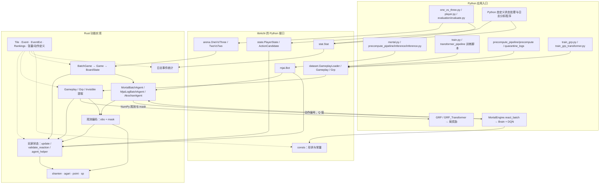

`state.PlayerState` 是可以单独调用的较低层接口。现有主推理程序使用 `mjai.Bot`，由 Bot 持有状态并连接 engine；自对战程序使用 arena，由环境持有四家状态并调度多个引擎。

`algo`、`agent`、`Tile`、`Event` 的实现通过 Rust 代码复用。Python 顶层注册的子模块为 `consts`、`state`、`dataset`、`arena`、`stat`、`mjai`；对应注册代码见 [lib.rs](../libriichi/src/lib.rs)。

### 1.3 主要结构之间的关系

下图中的成员只列出阅读主流程需要的部分。完整字段会在后文按职责解释。

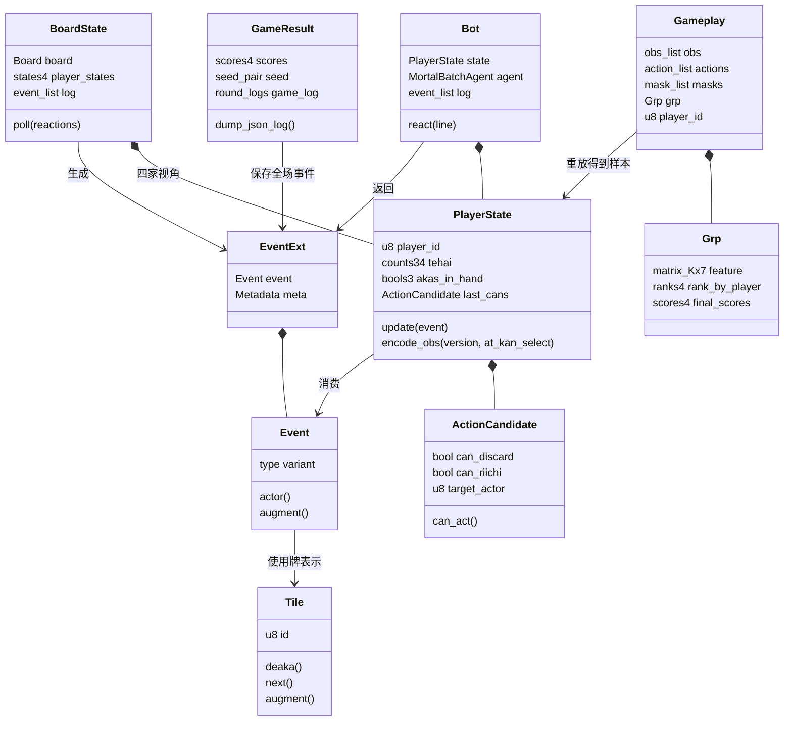

一场牌谱可以生成四份 `Gameplay`，每份对应一个玩家视角；每份中的 `Grp` 描述同一场比赛的局边界。`Bot` 管理一个玩家，`BoardState` 管理一局中的四个玩家，全场对局由 `Game` 继续推进。

### 1.4 训练、推理和在线训练的数据链路

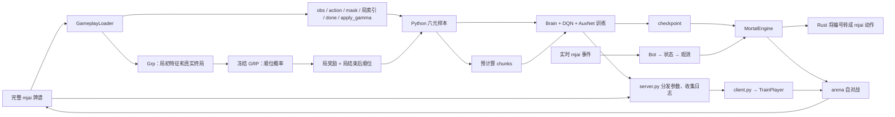

普通主策略样本包含六项：`obs, action, mask, steps_to_done, kyoku_reward, player_rank`。Rust 生成前面三项以及计算后三项需要的素材；Python 结合顺位模型与局边界完成样本组装。Oracle 模式额外插入隐藏观测。

顺位预测模型单独训练。GRU 版 `GRP` 和 Transformer 版 `GRP_Transformer` 都预测四家最终顺位的 24 种排列，具体入口、网络结构和 checkpoint 各自独立。主策略训练时把已经训练好的顺位模型作为固定奖励来源。

### 1.5 仓库其他部分的位置

| 目录或文件 | 在整个项目中的作用 |
| --- | --- |
| `mortal/model.py`、`engine.py` | 模型定义与 Rust 回调接口；把观测映射到动作编号 |
| `mortal/train.py`、`dataloader.py`、`reward_calculator.py` | 通用主策略训练、日志供数和 GRU 奖励 |
| `mortal/transformer_pipeline/` | Transformer 顺位模型、配套离线训练和早期预计算缓存链路 |
| `mortal/precompute_pipeline/` | 固定六元样本生产、日志筛查、缓存训练、Conv2d 优化训练、配套推理与评测 |
| `mortal/server.py`、`client.py`、`common.py` | 在线训练 TCP 参数与日志传输 |
| `exe-wrapper/` | Windows 分发使用的可执行包装器 |
| `log-viewer/` | mjai 日志静态查看器；消费对局日志 |
| `docs/` | 上游 mdBook 文档站源码 |
| `docs2/`、`CONTEXT.md` | 当前仓库的阅读说明、架构决策和领域术语 |
| `data/`、`artifacts*/`、`target/` | 外部数据、实验产出和编译产物；具体内容由本地运行环境决定 |

### 1.6 推荐源码阅读顺序

按下列顺序阅读，可先确定每个值的含义，再追踪它如何被计算和消费。后续章节沿用这一顺序。

| 顺序 | 文件 | 阅读时要回答的问题 | 对应章节 |
| --- | --- | --- | --- |
| 1 | `consts.rs`、`tile.rs`、`chi_type.rs`、`mjai/event.rs`、`rankings.rs` | 牌、事件、动作编号、座位和排名如何表示？ | 第 2 章 |
| 2 | `state/player_state.rs`、`state/item.rs`、`state/action.rs` 的结构定义；`dataset` 与 `arena` 的结构定义 | 一名玩家、一份样本、一局和一场对局各保存什么？ | 第 2、4、6、8 章 |
| 3 | `hand.rs`、`array.rs`、`macros.rs`、`vec_ops.rs` | 测试牌型、数组和牌常量怎样构造？ | 第 2 章 |
| 4 | `algo/shanten.rs`、`point.rs`、`agari.rs`、`sp/` | 状态机依赖的麻将计算如何实现？ | 第 3 章 |
| 5 | `state/update.rs`、`agent_helper.rs`、`action.rs`、`getter.rs` | 事件怎样改变状态，合法动作怎样确定？ | 第 4 章 |
| 6 | `state/obs_repr.rs`、`sp_tables.rs` | 状态怎样编码为模型数组？ | 第 5 章 |
| 7 | `dataset/grp.rs`、`gameplay.rs`、`invisible.rs` | 牌谱怎样变成监督素材？ | 第 6 章 |
| 8 | `agent/defs.rs`、`mortal.rs`、`py_agent.rs`、`mjai/bot.rs`，再看其他代理 | Rust 如何调用 Python 决策并生成协议动作？ | 第 7 章 |
| 9 | `arena/result.rs`、`board.rs`、`game.rs`、`one_vs_three.rs`、`two_vs_two.rs` | 如何从一次动作推进到整场批量对局？ | 第 8 章 |
| 10 | `stat.rs`、`bin/`、`state/test.rs`、`benches/bench.rs` | 如何分析、检查和验证结果？ | 第 9 章 |
| 11 | `lib.rs`、各 `mod.rs`、`py_helper.rs`、`Cargo.toml`、`build.rs` | Rust 功能如何成为 Python 扩展？ | 第 10 章 |
| 12 | Python 的 `model.py`、`engine.py`、数据加载器和应用入口 | 接口返回值怎样用于训练、推理和评测？ | 第 11、12 章 |

## 2. 基础数据与协议：先统一值的含义

本功能组定义各模块交换的数据。它依赖标准库、Serde 等基础库，被状态、算法、样本提取、代理、对局和统计共同使用。Python 直接读取其中的张量常量；牌和事件通常通过 JSON 字符串跨越语言边界。

源码频繁使用日语术语的罗马字：`tehai` 是暗手，`kawa` 是弃牌河，`fuuro` 是吃碰明杠等公开面子，`oya` 是庄家，`agari/hora` 是和牌，`houjuu` 是放铳，`ryukyoku` 是流局，`renchan` 是庄家连庄。门清表示保持未吃碰明杠的状态，暗杠仍可保持门清；振听会限制荣和。后文保留这些字段名，正文使用对应中文名称。

### 2.1 `consts.rs`：张量和动作空间契约

[consts.rs](../libriichi/src/consts.rs) 定义 `MAX_VERSION=4`、`ACTION_SPACE=46`、`GRP_SIZE=7`，以及两个 Python 函数。

| 观测版本 | `obs_shape(version)` | `oracle_obs_shape(version)` |
| --- | --- | --- |
| 1 | `(938, 34)` | `(211, 34)` |
| 2 | `(942, 34)` | `(217, 34)` |
| 3 | `(934, 34)` | `(217, 34)` |
| 4 | `(1012, 34)` | `(217, 34)` |

这里的维度是单个样本的 `(特征通道数, 牌种数)`。Python 合并 batch 后得到 `(B,C,34)`。合法版本为整数 `1..4`，其他值会触发 Rust 的断言或不可达分支。模型权重、数据编码和 engine 的 `version` 必须一致。

动作编号表如下。它同时用于数据标签、mask、DQN 输出和动作还原。

| 编号 | 普通决策时的含义 | 转出的事件 |
| --- | --- | --- |
| `0..26` | 打出 `1m..9m, 1p..9p, 1s..9s` | `dahai` |
| `27..33` | 打出 `E,S,W,N,P,F,C` | `dahai` |
| `34..36` | 打出 `5mr,5pr,5sr` | `dahai` |
| `37` | 宣言立直 | `reach` |
| `38` | 吃入的牌位于顺子最低位 | `chi` |
| `39` | 吃入的牌位于顺子中间 | `chi` |
| `40` | 吃入的牌位于顺子最高位 | `chi` |
| `41` | 碰 | `pon` |
| `42` | 决定杠 | 结合候选还原为 `daiminkan`、`ankan` 或 `kakan` |
| `43` | 和牌 | `hora`，自摸和荣和通过 `actor/target` 区分 |
| `44` | 九种九牌流局声明 | `ryukyoku` |
| `45` | 放弃当前响应机会 | `none` |

杠选择阶段使用同一长度的输出向量。此时 `0..33` 表示要杠的去红牌种，`at_kan_select=True` 标识阶段，mask 只开放对应候选牌种。动作编号的解释因此需要同时看阶段。

### 2.2 `tile.rs`：单张牌与红宝牌

[tile.rs](../libriichi/src/tile.rs) 的 `Tile(u8)` 用一个整数保存牌身份。

| ID | 牌 | 说明 |
| --- | --- | --- |
| `0..8` | `1m..9m` | 万子 |
| `9..17` | `1p..9p` | 筒子 |
| `18..26` | `1s..9s` | 索子 |
| `27..30` | `E,S,W,N` | 东南西北 |
| `31..33` | `P,F,C` | 白、发、中 |
| `34..36` | `5mr,5pr,5sr` | 三种赤五 |
| `37` | `?` | 未知牌占位 |

`TryFrom<u8/usize>` 检查整数范围，`FromStr` 从 mjai 牌字符串查找 `Tile`。字符串映射由 `LazyLock<AHashMap<...>>` 在首次使用时构造。Serde 的序列化与反序列化复用这些转换，因此协议中使用 `"5mr"` 这样的字符串。

主要方法及使用场合：

- `as_u8()`、`as_usize()`：得到索引，用于动作标签和数组访问。
- `deaka()`：把赤五映射到普通五，用于 34 维计数与牌型算法。
- `akaize()`：把普通五映射到赤五，其余牌保留自身，用于还原副露牌列表。
- `next()`、`prev()`：宝牌循环中的后一张、前一张。数牌按 1 到 9 循环，风牌与三元牌各自循环；例如 `9m.next()` 是 `1m`，`N.next()` 是 `E`。
- `is_aka()`、`is_jihai()`、`is_yaokyuu()`、`is_unknown()`：牌种分类。
- `augment()`：交换万子与筒子，同时保留赤牌身份；索子、字牌与未知牌保留自身。
- `cmp_discard_priority()`：在单人牌效率的数值相同时提供稳定的打牌偏好。

常见手牌表示有两种：`[u8;34]` 把赤五数量合并到普通五，再配合 `[bool;3]` 保存赤五是否在手中；`[u8;37]` 把三种赤五单独计数。读取代码时要确认当前数组采用哪种表示。

`Tile::new_unchecked` 由调用方保证范围；处理外部输入应沿用经过检查的字符串或整数转换。`?` 可以表达对手的隐藏牌，自己的起手、自己的摸牌和已经公开的牌需要具体牌值。

### 2.3 `mjai/event.rs`：事件驱动协议

[event.rs](../libriichi/src/mjai/event.rs) 的 `Event` 是带字段的枚举，Serde（JSON序列化与反序列化） 使用 `type` 作为标签并把变体名转成 snake_case。每行 JSON 表示一个事件。

| 事件组 | 事件及主要字段 | 状态或环境据此做什么 |
| --- | --- | --- |
| 全场边界 | `start_game(names, seed?)`、`end_game` | 识别玩家、种子，通知代理生命周期 |
| 局开始 | `start_kyoku(bakaze,dora_marker,kyoku,honba,kyotaku,oya,scores,tehais)` | 初始化局面；每家 13 张起手，庄家第一摸另发事件 |
| 摸切 | `tsumo(actor,pai)`、`dahai(actor,pai,tsumogiri)` | 移动手牌、更新牌河、生成打牌或响应机会 |
| 吃碰 | `chi/pon(actor,target,pai,consumed[2])` | 从手中消耗两张，并记录来源玩家 |
| 三类杠 | `daiminkan(...,consumed[3])`、`kakan(...,consumed[3])`、`ankan(actor,consumed[4])` | 记录副露或暗杠，环境安排岭上与新宝牌 |
| 宝牌 | `dora(dora_marker)` | 加入指示牌并重算宝牌计数 |
| 立直 | `reach(actor)`、`reach_accepted(actor)` | 先宣言并打牌，再确认扣除 1000 点与增加供托 |
| 和牌 | `hora(actor,target,deltas?,ura_markers?)` | 动作请求或带结算数据的结果事件 |
| 流局与局结束 | `ryukyoku(deltas?)`、`end_kyoku` | 请求九种九牌流局，或记录环境结算和局边界 |
| 无动作 | `none` | 放弃响应或协议占位 |

`actor` 是行为主体，`target` 是被吃碰牌、放铳牌等的来源。自摸 `hora` 的 `actor == target`。JSON 反序列化通过 `BoundedU8` 限制玩家编号为 `0..3`、`start_kyoku.kyoku` 为 `1..4`。

四个常用局面术语：

- `bakaze`：场风，例如东场、南场。
- `kyoku`：该场风下的第几局；协议从 1 开始。
- `honba`：本场数，影响和牌结算，并参与 arena 的牌山种子。
- `kyotaku`：尚未领取的立直棒数，每根 1000 点。

`EventExt` 在 `Event` 上附加可选 `Metadata`，JSON 通过 `flatten` 保持同一对象结构。元数据包括合法动作的 Q 值、`mask_bits`、是否贪心、batch 大小、耗时、向听、振听，以及可选的嵌套杠选择结果。（TODO：261027
）

`EventWithCanAct` 附加 `can_act: Option<bool>`，供 Bot 控制“本次只推进状态”或“推进后允许决策”。它与 `ActionCandidate.can_act` 分别表达调用方许可和规则许可。

`Event::augment()` 会遍历事件涉及的牌，包括起手、消费牌、宝牌与里宝牌，统一调用 `Tile::augment()`。数据增强因此保持整场事件之间的牌关系。

### 2.4 `chi_type.rs` 与 `rankings.rs`

[chi_type.rs](../libriichi/src/chi_type.rs) 定义 `ChiType::{Low,Mid,High}`。`ChiType::new(consumed,pai)` 对去红后的三张牌比较大小，判断吃入牌在顺子中的位置。数据标签提取和反应校验都使用它，因而动作 `38..40` 的语义一致。

[rankings.rs](../libriichi/src/rankings.rs) 定义两张互逆表：

- `player_by_rank[r]`：第 `r` 名对应的玩家 ID。
- `rank_by_player[p]`：玩家 `p` 的排名，`0..3` 对应一至四位。

（备注：玩家ID（从0开始）和start_game事件里的names列表有关。例如：{"type":"start_game","names":["小明","小红","小李","小王"]}，则分别对应0123）
  

（接上例，若scores = [25000, 25000, 30000, 20000]，则player_by_rank = [2, 0, 1, 3]（从0开始排顺位，所以是第一名ID2也即小李），rank_by_player = [1, 2, 0, 3]（从0开始排位，则4家顺位为2314））

`Rankings::new(scores)` 从玩家顺序 `[0,1,2,3]` 出发稳定地按点数降序排序。同点数时 ID 较小者在前。`Grp`、arena 和统计都复用这一规则，Python 的辅助标签使用稳定 `argsort` 与它对齐。

例如 `[25000,25000,30000,20000]` 得到 `player_by_rank=[2,0,1,3]`、`rank_by_player=[1,2,0,3]`。

### 2.5 基础工具文件

这些文件为算法、编码与测试提供小型数据操作，Python 通过上层功能间接使用它们。

| 文件 | 数据结构或函数 | 实现与使用方式 |
| --- | --- | --- |
| [hand.rs](../libriichi/src/hand.rs) | `hand_with_aka`、`hand`、`tile37_to_vec`、`tile34_to_vec`、`tiles_to_string` | 解析 `123m 405p 123z` 形式的紧凑手牌；`0` 表示赤五，`z` 表示字牌。主要用于测试和状态打印 |
| [array.rs](../libriichi/src/array.rs) | `Simple2DArray<COLS,T>` | 底层保存连续 `Vec<T>`，用 `row*COLS+col` 寻址；提供填充整行、单格和连续多行，最后构造 `ndarray::Array2` |
| [macros.rs](../libriichi/src/macros.rs) | `t!`、`tu8!`、`tuz!`、`matches_tu8!`、`must_tile!` | 把牌字面量映射到 `Tile`、`u8`、`usize`，减少手写索引；由编译器展开（TODO：要详细解释） |
| [vec_ops.rs](../libriichi/src/vec_ops.rs) | `vec_add_assign` | 对两个切片逐项相加，用于点数变化与计数汇总（TODO：优先看codex的解释） |

`hand()` 采用天凤紧凑手牌格式，mjai 事件采用单张牌字符串格式。编写测试时可用前者构造计数数组，再用后者构造实际事件。

## 3. 规则算法：状态判断所依赖的计算

算法模块依赖牌表示与编译进程序的查表数据，被 `PlayerState`、单人牌效率计算和对局结算调用。主要结果类型为向听数 `i8`、`Agari`、`Point` 和 `Vec<Candidate>`。Python 调用状态、数据加载或 arena 时会进入这些算法。

### 3.1 `shanten.rs`：计算距离和牌的步数

[shanten.rs](../libriichi/src/algo/shanten.rs) 提供：

| 函数 | 输入与输出 | 计算内容 |
| --- | --- | --- |
| `calc_normal(tiles,len_div3)` | `[u8;34]` 与 `0..4` → `i8` | 普通面子手的向听 |
| `calc_chitoi(tiles)` | 手牌计数 → `i8` | 七对子向听 |
| `calc_kokushi(tiles)` | 手牌计数 → `i8` | 国士无双向听 |
| `calc_all(tiles,len_div3)` | 手牌与剩余面子数 → `i8` | 在适用牌型中取最小向听 |
| `ensure_init()` | 无参数 | 初始化并检查数牌和字牌查表 |

常用含义为：`-1` 已构成和牌形，`0` 听牌，`1` 一向听。`len_div3` 表示当前暗手要组成的面子数，完整门清手一般取 4；吃碰杠从暗手移出面子后相应减小。

普通手计算把万、筒、索、字牌拆开。每种牌的张数处于 `0..4`，因此可以把一个花色的计数按五进制编码为表索引。表项保存不同面子数与雀头分配所需的数量，`add_suhai`、`add_jihai` 合并各组的最优结果。（TODO：要详细解释？？）

七对子使用已有对子数、牌种数计算；国士无双统计十三种幺九牌及是否已有对子。`calc_all` 在完整暗手条件下考虑特殊牌型，且在已经得到足够小的结果时提前返回。

`shanten_suhai.bin.gz`、`shanten_jihai.bin.gz` 通过 `include_bytes!` 编译进库，`LazyLock` 保存解压后的表（TODO：要详细解释？？）。Python 导入扩展时会调用 `ensure_init()`，首次导入会承担这部分初始化成本。

### 3.2 `point.rs`：从符番转换为支付点数

[point.rs](../libriichi/src/algo/point.rs) 的 `Point` 有三个字段：

- `ron`：荣和时的基础支付点数。
- `tsumo_ko`：自摸时每位闲家支付的点数。
- `tsumo_oya`：闲家自摸时庄家支付的点数；和牌者为庄家时该字段取 0。

`Point::calc(is_oya,fu,han)` 根据庄闲、符、番数查询支付表，包含满贯及以上档位。`yakuman(is_oya,count)` 计算役满倍数，`tsumo_total(is_oya)` 汇总自摸收入。

本场棒、供托和包牌支付由 `BoardState::handle_hora` 在基础点数上继续处理。点数表的测试使用基本点数公式与百点进位规则逐项核对。

### 3.3 `agari.rs`：判断役、计算符番、检查立直后暗杠(TODO: 261110)

[agari.rs](../libriichi/src/algo/agari.rs) 的主要类型如下。

| 类型 | 保存的信息 |
| --- | --- |
| `AgariCalculator` | 含和牌张的暗手、吃碰明杠暗杠、门清状态、场风、自风、和牌张与荣和标记 |
| `Agari` | `Normal {fu,han}` 或 `Yakuman(count)` |
| `Div` | 一种拆牌结果：雀头、刻子、顺子与部分预先识别的牌型标志 |
| `DivWorker` | 在具体拆牌结果上检查役、等待形式、符及暗刻归属所需的上下文 |

实现从牌型提取紧凑 key，在 `AGARI_TABLE` 中寻找可能的拆分。表由 `agari.bin.gz` 解压后放入 `BoomHashMap`。同一手牌可对应多个拆分，代码对这些拆分分别评估，再按 `Agari` 的比较规则选择结果。（TODO：究竟存的是什么呢，有待研究）

`has_yaku()` 只需找到一个成立的役，适用于合法荣和或自摸判断。`search_yakus()` 返回牌型自身提供的役与符番。`AgariCalculator::agari(additional_hans,doras)` （235行）加上立直、一发、门清自摸、抢杠等情境番与宝牌番，并保留“至少有一个役”的要求。

`is_ron` 参与符、三暗刻和四暗刻等计算。门清自摸等情境番由调用方显式提供。`PlayerState::agari_points` 汇总这些条件，也处理天和与地和的一倍役满规则。

`DivWorker::calc_fu` 根据雀头、明暗刻杠、幺九、等待形式、荣和或自摸计算符。代码还处理和牌张可放入多个面子的歧义，例如它既可补顺子又可补刻子的情况。相邻测试覆盖这些特殊组合。

`check_ankan_after_riichi(tehai,len_div3,tile,strict)` 判断立直后新摸牌能否用于暗杠。状态机采用 `strict=false` 的天凤口径，检查原有等待在暗杠后仍成立等条件；`strict=true` 还比较暗杠前后的拆分数量，以限制听牌和和牌形状的变化。

### 3.4 `algo/sp/`：为 v4 观测计算单人牌效率

这里的单人计算根据当前手牌、已见牌和剩余摸牌次数，估计未来听牌概率、和牌概率与自摸点数期望。它为模型提供牌效率特征，实际四人对局的响应、放铳与结算由状态机和 arena 处理。

| 文件 | 主要结构与职责 |
| --- | --- |
| [sp/state.rs](../libriichi/src/algo/sp/state.rs) | `InitState` 接收手牌、赤牌与已见牌；内部 `State` 保存剩余牌、递归状态，提供摸牌/撤销摸牌、打牌/撤销打牌、有效牌枚举 |
| [sp/tile.rs](../libriichi/src/algo/sp/tile.rs) | `RequiredTile {tile,count}` 表示有效牌及剩余张数；内部类型记录候选摸切牌和向听变化 |
| [sp/candidate.rs](../libriichi/src/algo/sp/candidate.rs) | `Candidate` 保存候选打牌、有效牌、逐巡概率与期望，`CandidateColumn` 定义排序指标 |
| [sp/calc.rs](../libriichi/src/algo/sp/calc.rs) | `SPCalculator` 保存固定局面条件，执行摸切递归、缓存和分值估计 |
| [sp/mod.rs](../libriichi/src/algo/sp/mod.rs) | 导出类型，并定义默认计算与 `sp_reproduce_cpp_ver` 的差异 |

`SPCalculator::calc(init_state,can_discard,tsumos_left,cur_shanten)` 区分两种入口：可打牌时逐项分析候选舍牌，等待摸牌时直接分析当前手牌。返回的每个 `Candidate` 包含：

- `tile`：候选舍牌；纯摸牌分析使用未知牌占位。
- `required_tiles`、`num_required_tiles`：能改善手牌的牌和剩余数量。
- `tenpai_probs`、`win_probs`、`exp_values`：随剩余时间变化的听牌概率、和牌概率和点数期望。
- `shanten_down`：该候选是否使向听倒退。

三向听及以内使用带缓存的递归计算。`draw_cache`、`discard_cache` 复用相同状态的结果；预先生成的概率表描述某巡摸到有效牌的概率，以及此前连续未摸到有效牌的概率。四向听及以上使用有效牌数量分析，概率数组保持空。

可选开关控制是否计算手变、向听倒退，以及按和牌概率或期望值排序。`PlayerState::single_player_tables` 当前采用最大期望值排序，并关闭手变和向听倒退计算。

默认最多考虑 17 次后续自摸，具体计算长度取现场推导的剩余次数。`sp_reproduce_cpp_ver` feature 调整向听函数、时间长度等行为以复现上游 C++ 版本。因此改变该 feature 会影响生成的牌效率特征。

`get_score` 调用 `AgariCalculator` 估计自摸收入，并根据门清、立直偏好、双立直、一发和海底等条件构造分值。只有一张宝牌指示牌时，里宝牌概率按剩余牌计数计算；多张指示牌时使用编译进程序的 `algo/data/uradora_prob_table.txt`。这些概率与未来摸切分支一起形成 `exp_values`。

## 4. 玩家状态：由事件维护一个人的可见局面

`state/` 依赖 `Tile`、`Event`、排名与规则算法，被 Bot、数据加载器、arena 和日志校验工具调用。核心类型是 `PlayerState`；对外操作包括事件更新、观测编码、反应校验和状态读取。

### 4.1 `player_state.rs` 与 `item.rs` 保存什么

[player_state.rs](../libriichi/src/state/player_state.rs) 把状态分成以下几组。

| 字段组 | 主要字段 | 保存原因 |
| --- | --- | --- |
| 自己的暗手 | `tehai`、`akas_in_hand`、`tehai_len_div3` | 计算牌型、候选舍牌和消费牌 |
| 可见牌与宝牌 | `tiles_seen`、`akas_seen`、`dora_factor`、`dora_indicators`、`doras_owned`、`doras_seen` | 排除已见完的牌，计算宝牌和牌效率 |
| 局况 | `bakaze`、`jikaze`、`kyoku`、`honba`、`kyotaku`、`scores`、`rank`、`oya`、`is_all_last` | 为决策和终局规则提供场况 |
| 弃牌与副露 | `kawa`、`kawa_overview`、`fuuro_overview`、`ankan_overview`、`last_tedashis`、`riichi_sutehais` | 同时支持有顺序的历史编码与汇总编码 |
| 当前可选动作 | `last_cans`、`ankan_candidates`、`kakan_candidates`、`last_self_tsumo`、`last_kawa_tile` | 生成合法 mask，并把模型输出恢复为动作 |
| 向听和等待 | `shanten`、`waits`、`keep_shanten_discards`、`next_shanten_discards`、`has_next_shanten_discard` | 复用频繁读取的计算结果 |
| 禁止舍牌与振听 | `forbidden_tiles`、`discarded_tiles`、`at_furiten`、`to_mark_same_cycle_furiten` | 处理食替、舍牌振听与同巡振听 |
| 立直和时序条件 | `riichi_declared`、`riichi_accepted`、`can_w_riichi`、`is_w_riichi`、`at_ippatsu`、`at_rinshan`、`chankan_chance` | 区分宣言、确认、一发、岭上与抢杠窗口 |
| 暗手之外的面子 | `chis`、`pons`、`minkans`、`ankans`、`is_menzen` | 供役、点数与牌效率算法使用 |
| 回合推进 | `at_turn`、`tiles_left`、`kans_on_board`、`intermediate_kan`、`intermediate_chi_pon` | 处理摸牌次数、四杠限制和牌河历史组合 |

玩家 ID 使用绝对座位编号。内部四家数组通常旋转为相对顺序：`0=自己，1=下家，2=对家，3=上家`。转换公式为：

```text
relative_actor = (absolute_actor + 4 - player_id) % 4
```

例如玩家 2 的 `scores[0]` 是绝对玩家 2 的点数，`scores[1]` 是绝对玩家 3 的点数。`Grp.feature` 的点数列保持绝对玩家顺序，因此从状态与顺位特征取值时需分别使用各自的索引约定。

[item.rs](../libriichi/src/state/item.rs) 定义牌河历史项：

- `Sutehai`：牌、是否普通宝牌、是否手切、是否立直宣言牌。
- `ChiPon`：吃碰消费的两张牌与吃碰目标牌。
- `KawaItem`：一次舍牌及它之前关联的吃碰、杠记录。

`kawa` 中的 `None` 保存相对回合的空位。例如有人碰牌导致中间玩家跳过出牌，代码会用 `pad_kawa_for_pon_or_daiminkan` 补齐这些位置。观测编码因此能够表达事件顺序。`TinyVec` 允许包含空位的历史超过常见长度；汇总视图保存实际牌。

### 4.2 `update.rs`：每条事件如何改变状态

[update.rs](../libriichi/src/state/update.rs) 的调用骨架为：

```text
Python update(JSON) → update_json → Event 反序列化
Rust update(&Event) → update_with_keep_cans(event,false) → update_inner
    → 重置本次动作候选
    → 落实前次留下的振听、抢杠等时序状态
    → 按事件变体更新字段
    → 返回 last_cans
```

`update_with_keep_cans(event,true)` 供 Rust 日志校验使用：在 `reach_accepted`、`dora`、`hora` 公告事件期间保留前一次候选。普通 `update()` 会按每条事件重新建立候选。

主要事件处理规则如下。

| 处理函数 | 实现步骤与结果 |
| --- | --- |
| `start_kyoku` | 清空上一局数据；设置场况与相对座位；加入宝牌指示牌及自己的 13 张手牌；计算排名、向听、等待与振听；补齐牌河初始空位 |
| `tsumo` | 每家摸牌都减少 `tiles_left`；自己摸牌时增加手牌与巡数，开放打牌，检查九种九牌、自摸、立直、暗杠与加杠 |
| `dahai` | 自己打牌时减少手牌，其他人打牌时登记新公开牌；追加牌河；自己的舍牌后更新等待与振听，其他人舍牌后检查荣和、吃碰和大明杠 |
| `chi`、`pon` | 更新公开副露，自己副露时消费手牌、关闭门清与一发条件，设置食替限制，并开放随后的打牌 |
| `daiminkan` | 记录公开杠与消费牌，更新面子数和向听，标记岭上相关状态 |
| `kakan` | 将已有碰升级为杠；其他玩家加杠时给当前视角建立抢杠机会 |
| `ankan` | 记录暗杠，自己的暗手移出四张牌，减少暗手面子数；清除一发等条件 |
| `reach` | 记录立直宣言；自己宣言后继续开放打牌，并记录双立直条件 |
| `reach_accepted` | 扣除对应玩家 1000 点、增加供托、更新排名，并确认立直与一发 |
| `dora` | 登记新指示牌并重算已拥有、已见的宝牌数量 |

`start_game`、`hora`、`ryukyoku`、`end_kyoku`、`end_game` 在此状态机中主要经过公共的候选重置和时序处理。局结算点数由 arena 或日志中的后续局初数据提供；`Grp` 和 `Stat` 会读取结算事件的 `deltas`。

### 4.3 手牌、已见牌与振听的维护

`witness_tile` 表示“这张实体牌第一次进入当前玩家的可见范围”，会更新已见数量和宝牌数量，并检查未知牌及第五张同种牌。自己的起手和摸牌、对手公开的舍牌或消费牌、宝牌指示牌会触发它。

`move_tile` 表示牌进入或离开自己的暗手。它根据 `MoveType::{Tsumo,Discard,FuuroConsume}` 更新手牌计数、赤五标志和宝牌归属。副露消费把牌移到公开面子，玩家仍然拥有这些宝牌；打牌则减少拥有的宝牌。

向听缓存按事件时机维护：`update_shanten` 会把算法返回的 `-1` 截到 `0`；自己摸牌后主要通过 `update_shanten_discards` 计算各候选舍牌能否保持或降低向听。`real_time_shanten` 根据当前 3n+1 或 3n+2 张阶段还原实时向听，单人牌效率计算使用这个值。

`update_waits_and_furiten` 在 3n+1 张阶段逐种试加一张牌，检查能否构成和牌形。它分别记录：

- `waits`：当前仍有未见张数的形式等待牌，役的判断在和牌候选生成时进行。
- `at_furiten`：是否因自己曾打出等待牌、放过荣和等条件处于振听。

即使某种等待牌已经全部可见，自己的舍牌记录仍可能形成振听。立直确认后，相关振听状态具有持续性；普通同巡振听按照事件推进和下一轮等待更新清除。

### 4.4 `action.rs`：动作种类与反应检查

[action.rs](../libriichi/src/state/action.rs) 的 `ActionCandidate` 保存各类 `can_*` 布尔值与 `target_actor`。它的 Python 属性包括：

```text
can_discard
can_chi_low, can_chi_mid, can_chi_high
can_pon, can_daiminkan, can_kakan, can_ankan
can_riichi, can_tsumo_agari, can_ron_agari, can_ryukyoku
target_actor
can_chi, can_kan, can_agari, can_pass, can_act
```

最后五项是组合 getter。例如 `can_pass` 对吃、碰、大明杠、荣和机会成立；`can_act` 汇总所有实际可行动种类。具体可舍的牌与可杠的牌保存在状态及 mask 中。

`validate_reaction` 检查传入 mjai 反应的主体、当前动作类别、牌来源和消费牌。打牌还检查牌是否在手中与摸切声明是否符合最近自摸；吃检查上家关系与低中高候选；杠检查对应候选集合；和牌检查自摸或荣和许可。

`Event::None` 会直接通过此函数。该函数的检查范围应按各分支理解：例如打牌分支检查持牌与摸切，完整的可舍牌限制由 `discard_candidates_aka()` 与 mask 给出。`validate_logs` 会额外核对实际舍牌是否在候选集合中。

### 4.5 `agent_helper.rs`：供代理、观测与环境复用的规则

[agent_helper.rs](../libriichi/src/state/agent_helper.rs) 集中实现：

| 方法组 | 功能与调用方 |
| --- | --- |
| `discard_candidates`、`discard_candidates_aka` | 在 34 或 37 种表示中返回可舍牌；处理立直后摸切、宣言后保持听牌、食替和赤五区分；用于 mask 与代理 |
| `discard_candidates_with_unconditional_tenpai*` | 检查舍牌后仍有可和张、满足役与振听限制的听牌；用于观测特征 |
| `yaokyuu_kind_count`、`rule_based_ryukyoku` | 统计幺九种数，提供九种九牌的规则决策辅助 |
| `rule_based_agari` | 根据终局场况与最高可能和牌分数判断该和牌是否有助于摆脱末位；供可选和牌保护逻辑调用 |
| `agari_points` | 组合手牌役、立直一发、岭上抢杠、宝牌里宝牌，返回基础支付 `Point` |
| `real_time_shanten` | 返回当前阶段的实际向听，用于牌效率分析与调试 |
| `single_player_tables` | 从可见状态构造 `InitState` 和 `SPCalculator`，估算剩余摸牌次数并生成最大期望表 |
| `kans_count` | 返回当前玩家明杠与暗杠总数，供四杠散了判断 |

这些 helper 是 Rust 方法。Python 对 `PlayerState` 的公开方法以 `#[pymethods]` 为准，主要集中在 `player_state.rs`、`getter.rs`、`obs_repr.rs`。

### 4.6 Python 读取状态的接口

[getter.rs](../libriichi/src/state/getter.rs) 暴露只读属性：

```text
player_id, kyoku, honba, kyotaku, is_oya
tehai, akas_in_hand, chis, pons, minkans, ankans
at_turn, shanten, waits, last_cans
can_w_riichi, self_riichi_declared, self_riichi_accepted, at_furiten
```

以下四项是方法，返回牌字符串或字符串列表：`last_self_tsumo()`、`last_kawa_tile()`、`ankan_candidates()`、`kakan_candidates()`。

`brief_info()` 输出手牌、牌河、动作候选、向听和单人牌效率表，适用于分析某个已知错误现场。它可能执行额外的牌效率计算。

最小使用形式如下，`events` 应为按顺序提供的合法事件字符串：

```python
from libriichi.state import PlayerState

state = PlayerState(0)
for line in events:
    candidates = state.update(line)
    if candidates.can_act:
        obs, mask = state.encode_obs(4, False)
        # obs: float32[1012, 34]；mask: bool[46]
```

应先提供 `start_kyoku` 初始化，随后依照牌谱顺序推进。编码用于真实决策点；没有可用动作时的全假 mask 无法供 DQN 正常选取动作。

## 5. 观测编码：把现场转成模型输入

[obs_repr.rs](../libriichi/src/state/obs_repr.rs) 依赖 `PlayerState`、动作常量、数组工具和单人牌效率计算，被数据提取与 Mortal 代理共同调用。`ObsEncoderContext` 保存状态引用、目标数组、mask、当前写入通道 `idx`、版本和杠选择标记；输出为 `(Array2<f32>,Array1<bool>)`，Python 包装层再转为 NumPy 数组。

### 5.1 编码的基本方式

所有观测都沿 34 个去红牌种展开，赤牌信息通过额外通道表达。单个通道既可以是逐牌特征，也可以把一个全局数值填满 34 列。

例如手里有三张 `1m`，前四个手牌计数通道的 `1m` 列为 `[1,1,1,0]`。某个赤五在手中时，对应赤牌通道整行填 1。点数、剩余牌数等标量按照各自尺度归一化后整行填充。

`IntegerEncoder` 统一实现版本相关的整数编码：v1 使用连续多行置 1；v2、v3 按调用参数组合 one-hot、缩放与径向基函数；v4 使用 one-hot 或缩放。版本变化涉及通道数量和语义，输入形状只是兼容检查的一部分。

编码过程中 `idx` 顺序向后移动。结尾断言写入总行数与 `obs_shape(version)` 一致，调试构建还检查所有数值处于 `[0,1]`。

[sp_tables.rs](../libriichi/src/state/sp_tables.rs) 定义 `SinglePlayerTables { max_ev_table: Vec<Candidate> }`，把状态推导出的单人分析结果交给编码器。它保存按期望排序的候选表，具体计算仍由 `agent_helper.rs` 和 `algo/sp/` 完成。

### 5.2 牌河与副露如何进入观测

自己的牌河单项占 4 个通道：此前的杠、舍牌种类、赤牌标志、普通宝牌标志。其他三家的单项占 8 个通道，额外包含吃碰消费牌、手切和立直宣言信息。

每家编码最早 6 项与从最近往前的 18 项，短历史用零填充，较短牌河可能同时出现在这两个窗口。`None` 空位占用对应位置，保留碰杠造成的回合跳转。

v3、v4 还按弃牌距当前的时间写入 `exp(-0.2 * age)`。自己的汇总有一个通道，其他玩家各有舍牌、手切、立直宣言三个通道。副露汇总保留每个面子的牌数量与赤牌信息，暗杠单独编码。

### 5.3 v4 的完整通道分段

下表使用 Python 半开切片 `[start:stop]`，最后一行结束于 1012。三个对手依次为下家、对家、上家。

| 通道切片 | 数量 | 内容 |
| --- | --- | --- |
| `[0:4]` | 4 | 自己手牌的累计数量 |
| `[4:7]` | 3 | 自己三种赤五标志 |
| `[7:15]` | 8 | 四家点数，各用 100000 与 30000 两个尺度 |
| `[15:19]` | 4 | 当前排名 one-hot |
| `[19:23]` | 4 | 场内局号 one-hot |
| `[23:24]` | 1 | 本场数，截到 10 后除以 10 |
| `[24:25]` | 1 | 供托数，截到 10 后除以 10 |
| `[25:27]` | 2 | 场风、自风对应的字牌位置 |
| `[27:28]` | 1 | 场况进度缩放值；西场沿用南场区间的表示 |
| `[28:35]` | 7 | 已公开宝牌指示牌集合 |
| `[35:59]` | 24 | 自己最早 6 个牌河位置 |
| `[59:131]` | 72 | 自己最近 18 个牌河位置 |
| `[131:132]` | 1 | 自己舍牌时间衰减特征 |
| `[132:327]` | 195 | 下家牌河：48 + 144 + 3 |
| `[327:522]` | 195 | 对家牌河：48 + 144 + 3 |
| `[522:717]` | 195 | 上家牌河：48 + 144 + 3 |
| `[717:718]` | 1 | 剩余摸牌数除以 69 |
| `[718:722]` | 4 | 四家已知拥有宝牌数，各截到 12 后缩放 |
| `[722:723]` | 1 | 尚未见到的宝牌数量缩放 |
| `[723:751]` | 28 | 四家弃牌集合，各 7 通道 |
| `[751:831]` | 80 | 四家公开副露，每家最多 4 组、每组 5 通道 |
| `[831:835]` | 4 | 四家暗杠牌种 |
| `[835:836]` | 1 | 每种牌已见数量除以 4 |
| `[836:845]` | 9 | 三家最近手切牌，每家 3 通道 |
| `[845:854]` | 9 | 三家立直宣言牌，每家 3 通道 |
| `[854:857]` | 3 | 三家已宣言立直 |
| `[857:860]` | 3 | 三家已确认立直 |
| `[860:861]` | 1 | 自己当前等待牌 |
| `[861:862]` | 1 | 自己振听标志 |
| `[862:869]` | 7 | 状态中缓存的向听 one-hot |
| `[869:870]` | 1 | 自己已确认立直 |
| `[870:871]` | 1 | `at_kan_select` |
| `[871:874]` | 3 | 可响应的最近舍牌或抢杠牌：牌种、赤牌、宝牌 |
| `[874:879]` | 5 | 可舍牌、保持向听、降低向听、无条件听牌、自己立直宣言 |
| `[879:880]` | 1 | 可立直 |
| `[880:883]` | 3 | 可吃低、中、高 |
| `[883:884]` | 1 | 可碰 |
| `[884:885]` | 1 | 可大明杠 |
| `[885:886]` | 1 | 可暗杠的牌种 |
| `[886:887]` | 1 | 可加杠的牌种 |
| `[887:888]` | 1 | 可和牌 |
| `[888:889]` | 1 | 可九种九牌流局 |
| `[889:891]` | 2 | 单人最大期望值的两种缩放 |
| `[891:925]` | 34 | 保持向听类候选的“舍牌 × 有效牌”关系 |
| `[925:959]` | 34 | 向听倒退类候选的“舍牌 × 有效牌”关系 |
| `[959:960]` | 1 | 可打牌阶段按候选排序选出的有效牌最优舍牌位置 |
| `[960:961]` | 1 | 等待摸牌阶段的有效牌集合 |
| `[961:978]` | 17 | 各时间位置的听牌概率 |
| `[978:995]` | 17 | 各时间位置的和牌概率 |
| `[995:1012]` | 17 | 各时间位置相对于最大期望值缩放的点数期望 |

牌集合的 7 通道由 4 个累计数量通道和 3 个赤牌标志构成。副露组的 5 通道由 4 个累计数量通道和 1 个“含赤牌”标志构成。

默认 `single_player_tables` 关闭向听倒退计算，相关关系区通常保持为零。四向听及以上只有有效牌信息，逐巡概率和期望区保持为零。剩余摸牌不足或手牌已经完成时，编码尝试用当前最低自摸支付点数填充两条期望值通道，其余单人表区域保留零值。

### 5.4 mask 与观测同步产生

编码器在写入动作相关特征时同步设置 mask：

1. 普通决策开放 `discard_candidates_aka()` 中的牌，按 `can_*` 开放 `37..44`。
2. 对吃碰、大明杠或荣和响应，开放 `45`，允许选择放弃。
3. 杠选择阶段只开放候选去红牌种；大明杠对应目标牌，暗杠和加杠对应各自候选列表。

Python `DQN.forward` 用 mask 计算合法动作优势均值，并把非法动作 Q 值设为负无穷。数据标签和推理输出均应落在当前 mask 的真值位置。

### 5.5 Oracle 观测

Oracle 观测在普通观测之外补充三家真实手牌、赤牌、向听、等待、振听，以及未来普通摸牌、岭上牌、宝牌和里宝牌指示牌。v2..v4 共 217 行：

```text
三家状态：3 × (4 + 3 + 8 + 1 + 1) = 51
后续普通摸牌槽位：69 × 2 = 138
岭上槽位：4 × 2 = 8
宝牌与里宝牌指示牌：10 × 2 = 20
合计：217
```

每张隐藏牌使用一行牌种和一行赤牌标志。已消耗的未来槽位通过填零保持固定形状。v1 对向听使用 6 行表示，合计 211 行。

日志提取由 `Invisible::encode` 实现，实际对战由 `BoardState::encode_oracle_obs` 实现。两个编码器维护同一格式，修改时需同时检查。原有 `Brain` 支持按通道拼接隐藏观测；当前 `MortalEngine` 的 v1 分支传入隐藏观测，v2..v4 分支调用 `brain(obs)`。研究其他版本的 Oracle 路径时，需要连同 Python 前向调用核对。

## 6. 数据提取：从完整牌谱生成学习素材

`dataset/` 依赖事件定义、玩家状态、观测编码、排名与牌山重建，被普通数据加载器、GRP 训练、Transformer 数据链路和新预计算链路调用。Python 导出 `GameplayLoader`、`Gameplay`、`Grp` 三个类。

### 6.1 `Grp`：按局排列的场况与终局标签

[grp.rs](../libriichi/src/dataset/grp.rs) 的 `Grp` 保存：

| 字段 | Rust 类型 | Python 取出形式 | 含义 |
| --- | --- | --- | --- |
| `feature` | `Array2<f64>` | NumPy `float64[K,7]` | 每个 `start_kyoku` 一行 |
| `rank_by_player` | `[u8;4]` | 四个整数 | 每位绝对玩家的最终排名 |
| `final_scores` | `[i32;4]` | 四个整数 | 最终点数，包含末局结算与残余供托归属 |

特征列依次为：

```text
[grand_kyoku, honba, kyotaku,
 score_player_0 / 10000, score_player_1 / 10000,
 score_player_2 / 10000, score_player_3 / 10000]
```

`grand_kyoku` 的东一为 0、南一为 4、南四为 7、西四为 11。同一个局号的连庄会生成多行，因此特征行数 `K` 表示实际进行的局数。点数按绝对玩家 ID 排列，源码采用东一庄家为玩家 0 的约定。

`Grp::load_events` 逆序扫描牌谱。先积累最后一局的 `hora/ryukyoku.deltas` 与立直确认扣点，再与最后一个 `start_kyoku.scores` 相加得到最终点数，计算排名。总分低于 100000 时把差额分给第一名；这体现了标准四人 25000 点开局和残余供托的假设。随后收集所有局初特征，并恢复为时间顺序。

公开接口：

```python
from libriichi.dataset import Grp

record = Grp.load_log(raw_log)                 # 一场逐行 JSON 文本
records = Grp.load_gz_log_files(filenames)     # 每个 gzip 文件一个 Grp
feature = record.take_feature()              # 转移数组所有权
ranks = record.take_rank_by_player()          # 读取标量数组
scores = record.take_final_scores()
```

`take_feature()` 取走内部数组，再次调用取得空数据；两个终局数组方法按值返回。`Grp` 的创建入口是两个静态加载方法。

完整训练数据应包含局边界与结算。`load_events` 对末局结算事件要求 `deltas`，其输入完整性检查集中在实际解析与扫描路径。处理外部牌谱时还应结合日志筛查与样本有效性检查。

### 6.2 `GameplayLoader` 的配置与返回层级

[gameplay.rs](../libriichi/src/dataset/gameplay.rs) 同时定义加载器、返回容器和逐玩家回放过程。

```python
from libriichi.dataset import GameplayLoader

loader = GameplayLoader(
    version,
    oracle=True,
    player_names=None,
    excludes=None,
    trust_seed=False,
    always_include_kan_select=True,
    augmented=False,
)
```

除 `version` 外都是关键字参数。

| 参数 | 实际作用 |
| --- | --- |
| `version` | 选择观测格式 |
| `oracle` | 额外提取隐藏观测；Rust 构造默认值为 `True`，普通 Python 数据加载器通常显式传 `False` |
| `player_names` | 非空时，仅选择 `start_game.names` 中匹配名称的座位 |
| `excludes` | `player_names` 为空时，排除匹配名称的座位 |
| `trust_seed` | Oracle 模式下，允许用日志 seed 按本库洗牌算法恢复牌山 |
| `always_include_kan_select` | 为杠动作附加牌种选择样本，即使对应类别只有一个候选 |
| `augmented` | 在解析后对整场事件交换万子和筒子 |

`load_log(raw_log)` 返回 `list[Gameplay]`，包含筛选后的玩家视角。`load_gz_log_files(filenames)` 返回 `list[list[Gameplay]]`，外层对应输入文件。文件加载用 Rayon 并行执行，并在错误上附加 `error when reading <filename>` 上下文；每场选中的玩家视角也通过 Rayon 展开。

这些 API 一次返回所请求文件的完整样本。Python 的 `file_batch_size` 决定每批展开的文件量，模型训练的 batch size 决定每次优化使用的样本量，两者需要分别配置。

### 6.3 `Gameplay` 的字段与所有权

| Python 方法 | 返回值 | 每项的含义 |
| --- | --- | --- |
| `take_obs()` | NumPy 数组列表，每项 `float32[C,34]` | 当前决策的可见观测 |
| `take_invisible_obs()` | NumPy 数组列表 | Oracle 观测；关闭 Oracle 时列表为空 |
| `take_actions()` | 整数列表 | 日志中的实际动作标签 |
| `take_masks()` | NumPy 数组列表，每项 `bool[46]` | 当前决策合法动作 |
| `take_at_kyoku()` | 整数列表 | 所属实际局的零基索引，包括连庄局 |
| `take_dones()` | 布尔列表 | 当前玩家在本局中的最后一条决策样本 |
| `take_apply_gamma()` | 布尔列表 | 该动作是否增加折扣步数 |
| `take_at_turns()` | 整数列表 | 当前玩家的自摸巡数 |
| `take_shantens()` | 整数列表 | 采样时状态中的缓存向听 |
| `take_grp()` | `Grp` | 全场的局初特征与终局标签 |
| `take_player_id()` | 整数 | 当前视角的绝对玩家 ID |

向量与 `Grp` 通过 `mem::take` 移出容器；NumPy 数组由 `from_owned_array` 接管 Rust 数组存储。`take_player_id()` 直接返回标量，可以重复读取。Rust 的 `player_name` 字段在回放时被设置，当前 Python 类未提供对应 getter。

有决策样本的 `Gameplay` 各逐动作数组应具有相同长度。现有 Rust 实现会在 `dones` 构造末尾追加一个 `true`；零决策视角因此需要消费者显式处理。新预计算与筛查流程有针对空样本和长度的检查，普通数据加载器依赖有效训练牌谱。

### 6.4 为什么回放需要向后看四个事件

逐玩家回放由 `Gameplay::load_events_by_player` 创建 `LoaderContext`。它保存当前玩家状态、实际局索引；Oracle 模式还保存三个对手状态和普通牌山、岭上牌的读取位置。

核心循环使用 `events.windows(4)`。对每个窗口：

1. 用第一个事件更新状态，得到当前决策候选。
2. 检查后续事件，通常取紧邻事件；若它是 `reach_accepted` 或 `dora`，按当前实现跳过这一条公告再取下一条。
3. 根据后续行为推导当前视角实际选择了什么。
4. 多家荣和时在窗口后面查找当前玩家的 `hora`。
5. 用此时的状态编码样本，再在下一窗口继续推进。

这使模型输入停留在决策发生前，动作标签来自决策后的记录。

日志没有逐条记录所有人的主动 pass。代码通过是否存在可选吃碰杠荣和，以及随后是否有人采取更高优先级动作，判断该 pass 能否作为样本。例如可吃但下一事件为正常自摸，说明该吃机会被放弃；被他家碰或荣和截断的吃机会按照对应分支处理。

杠的第一条标签为 `42`。满足配置或候选数量条件时，再以同一个现场生成 `at_kan_select=True` 的第二条样本，标签为去红牌种。数据提取时附加大明杠牌种样本的策略由 `always_include_kan_select` 控制；实际推理时大明杠目标已经由场面确定。

`add_entry` 附加观测、mask、动作、局号、巡数和向听。`apply_gamma` 的实际条件是 `label <= 37`：普通打牌、杠牌种选择及立直声明计入折扣，其他动作不增加该计数。

回放结束后比较相邻样本的 `at_kyoku`，把进入新一局前的样本标记为 `done=True`，并标记全场最后一条样本。这里的 done 描述当前玩家样本序列的局边界。

### 6.5 `Invisible` 如何获得隐藏信息

[invisible.rs](../libriichi/src/dataset/invisible.rs) 的 `Invisible` 保存按使用时间从早到晚排列的普通牌山、岭上牌、宝牌指示牌和里宝牌指示牌，供 Oracle 编码使用。

存在两种来源：

- `trust_seed=True` 且牌谱含 seed：构造相应局号、本场的 `Board`，调用 `init_from_seed` 恢复牌山，再调整向量顺序以匹配时间顺序。
- 使用完整牌谱记录：收集已经发生的摸牌、岭上、宝牌和里宝牌，从 136 张标准牌中扣除已记录牌，再将未确定部分随机补齐。

第二种方式的后续未知牌来自随机补全，确定性由记录本身和随机过程共同决定。Oracle 提取要求全信息训练牌谱，四家起手与真实摸牌用于状态重放及剩余牌计数。在线面向某一玩家的遮蔽日志适合该玩家的 Bot 状态更新。

## 7. 代理与 Bot：把 Python 决策接入 Rust

代理层依赖玩家状态、观测与事件，被 Bot 和 arena 调用。它解决模型与环境之间的数据格式、批量处理、动作还原和生命周期问题。Python 提供 engine 对象，Rust 保存该对象并调用约定的方法。

### 7.1 `defs.rs`：单体与批量代理接口

[defs.rs](../libriichi/src/agent/defs.rs) 定义两个 trait：

| trait | 关键方法 | 设计用途 |
| --- | --- | --- |
| `Agent` | `react(log,state,invisible_state)` | 单个座位现场直接生成 `EventExt` |
| `BatchAgent` | `set_scene(index,...)`、`get_reaction(index,...)` | 先收集多个现场，再批量决策并按索引取回 |

两个 trait 都提供 `name()`、`oracle_obs_version()` 和 `start_game/end_kyoku/end_game` 生命周期方法。`InvisibleState` 是 `Array2<f32>` 的类型别名。

`index` 表示该代理管理的某个玩家实例。同一个引擎可跨多个对局控制许多座位，因此需由 arena 的 `Index` 保存“哪一个批量代理”和“该代理内部哪个实例”的映射。

[batchify.rs](../libriichi/src/agent/batchify.rs) 的 `BatchifiedAgent<A>` 为每个实例创建一个单体 `Agent`，在 `set_scene` 调用 `react` 并缓存结果，在 `get_reaction` 取走结果。摸切代理与 Akochan 通过它接入统一调度。

### 7.2 Python Mortal engine 的契约

[mortal.rs](../libriichi/src/agent/mortal.rs) 的 `MortalBatchAgent::new` 读取以下属性：

```text
name
is_oracle
version
enable_quick_eval
enable_rule_based_agari_guard
react_batch（可调用方法）
```

arena 的 `new_py_agent` 还读取 `engine_type`，Mortal 引擎取值为 `"mortal"`。

回调签名为：

```python
actions, q_values, returned_masks, is_greedy = engine.react_batch(
    obs, masks, invisible_obs
)
```

输入 `obs` 和 `masks` 是等长 NumPy 数组列表；`invisible_obs` 为数组列表或 `None`。返回四项的 batch 长度相同，每项含义为：

| 返回项 | 每个样本的内容 |
| --- | --- |
| `actions` | 一个动作编号 |
| `q_values` | 46 个浮点 Q 值 |
| `returned_masks` | 46 个布尔值，供 Rust 记录元数据 |
| `is_greedy` | 是否由贪心选择得到 |

`MortalEngine` 在 Python 内部 stack 输入数组、转成设备张量、执行 `Brain + DQN`，按参数贪心或采样选动作，最后返回普通列表供 PyO3 提取。

### 7.3 `MortalBatchAgent` 的批处理实现

`set_scene` 会先检查快速决策条件：当前只有一个合法舍牌，且没有立直、自摸、杠、九种九牌等其他决策时，可直接生成该舍牌。

需要模型时，代码克隆当前状态并提交 Rayon 任务，生成普通观测和必要的杠选择观测。`SyncFields` 用互斥锁保存观测、mask 与实例到 batch 行的映射；`WaitGroup` 记录尚未完成的编码任务。

第一次 `get_reaction` 调用 `evaluate()`，等待全部编码完成，然后在持有 Python GIL 的范围内一次调用 `react_batch`。同一批其他实例随后从已保存结果中读取各自动作。由此，耗 CPU 的状态编码可以并行，神经网络可以集中使用 GPU batch。

杠选择观测会与普通观测一同预先送入模型。普通动作选到 `42` 后，再读取对应杠选择行；启用快速决策且暗杠与加杠候选总数只有一个时可直接确定牌种。

### 7.4 从编号恢复完整 mjai 动作

`get_reaction` 根据第 2 章的动作表构造 `Event`：

- 打牌填入自己的绝对 `actor`、具体牌和由最近自摸推导的 `tsumogiri`。
- 吃碰从最近目标牌与手中赤五情况构造 `consumed`；吃的三种编号决定相邻两张牌。
- 杠先选择牌种，再根据当前候选恢复大明杠、暗杠或加杠，补齐消费牌中的赤五。
- 和牌使用候选保存的 `target_actor`；动作请求的 `deltas` 与里宝牌留给环境结算。
- pass 产生 `Event::None`。

可选 `enable_rule_based_agari_guard` 在模型选择和牌时调用 `rule_based_agari()`。如果规则判断该和牌无法达到终局目标，会按返回 Q 值选择其他动作。这个功能独立于麻将规则中的“能否和牌”，配置时需明确实验是否启用。

元数据只保存 mask 为真的 Q 值，并用 `mask_bits` 标识各值对应的动作位置。解码时按 `0..45` 顺序枚举置位 bit，并逐项对应紧凑 Q 值列表。杠选择结果放在 `meta.kan_select` 中。快速确定的舍牌直接返回无元数据事件。

### 7.5 `mjai/bot.rs`：单个玩家的在线入口

[bot.rs](../libriichi/src/mjai/bot.rs) 的 `Bot` 持有一个 `PlayerState`、一个 `MortalBatchAgent` 和当前局日志。

```python
bot = Bot(engine, player_id)
reply = bot.react(line, can_act=True)
```

`line` 为位置参数，`can_act` 为关键字参数。返回值为动作 JSON 字符串或 Python `None`。

每次 `react` 的执行过程为：

1. 反序列化 `EventWithCanAct`。
2. 按全场开始、局结束、全场结束调用生命周期方法；局结束时清空局日志。
3. 调用 `PlayerState.update`。
4. 同时检查方法参数 `can_act`、JSON 内 `can_act` 和规则 `cans.can_act()`。
5. 允许决策时调用代理的 `set_scene` 与 `get_reaction`。
6. 将 `EventExt` 序列化为 JSON 返回。

`bot.react(...,can_act=False)` 仍推进状态。未决策时返回的 Python `None` 表示本次没有响应输出；一次实际的 pass 决策会返回内容为 `{"type":"none",...}` 的字符串。

Bot 构造时直接创建 `MortalBatchAgent`，适合张量型 Mortal engine。arena 则通过 `new_py_agent` 选择引擎类型。

### 7.6 日志型 engine 与外部代理

[py_agent.rs](../libriichi/src/agent/py_agent.rs) 支持两种 `engine_type`：

- `"mortal"`：构造上述张量型代理。
- `"mjai-log"`：构造 [MjaiLogBatchAgent](../libriichi/src/agent/mjai_log.rs)。

日志型引擎需要 `name`、`set_player_ids(player_ids)`、`react_batch(game_states)`、`start_game(index)`、`end_kyoku(index)`、`end_game(index,scores)`。每个 `game_state` 对象有 `game_index`、`state` 和 `events_json` 三个属性；`events_json` 是当前局事件列表的 JSON 数组字符串。回调返回每个现场的动作 JSON 字符串。

这些 `GameState` 对象由 Rust 作为回调参数创建。示例 [ExampleMjaiLogEngine](../mortal/engine.py) 读取其中的 `PlayerState.last_cans` 和 `last_self_tsumo()` 实现摸切，可作为接入自定义规则策略的参考。

[akochan.rs](../libriichi/src/agent/akochan.rs) 创建外部 `system.exe pipe ...` 子进程，通过 stdin/stdout 交换 mjai。路径与策略文件由 `AKOCHAN_DIR`、`AKOCHAN_TACTICS` 指定。它记录事件发送进度，并缓存吃碰或立直之后需要继续执行的舍牌；析构时关闭和回收子进程。

[tsumogiri.rs](../libriichi/src/agent/tsumogiri.rs) 提供 Rust 的 `Tsumogiri`，可打牌时丢弃最近摸到的牌，其余时刻返回 `none`。它主要用于环境测试和最小基准。

## 8. 对局环境：从牌山推进到整场比赛

`arena/` 依赖事件、四家玩家状态、算法与批量代理，被一对三评测、在线自对战和独立 Conv2d 评测使用。它把“产生合法事件”和“让引擎选择动作”分成可交替推进的阶段。

### 8.1 四层结构各自管理什么

| 结构 | 文件 | 管理范围 | 主要输入与输出 |
| --- | --- | --- | --- |
| `Board` | `board.rs` | 一局的完整牌山和初始场况 | seed、局号、本场、点数 → 起手、普通牌山、岭上与宝牌 |
| `BoardState` | `board.rs` | 一局内的事件推进与结算 | 四家 `EventExt` 反应 → 下一决策现场或 `KyokuResult` |
| `Game` | `game.rs` | 一场比赛的多个局 | 局结果 → 连庄、下一局、终局和 `GameResult` |
| `BatchGame` | `game.rs` | 多场比赛与多个引擎 | 座位映射、种子、`BatchAgent` → 有序 `Vec<GameResult>` |

[result.rs](../libriichi/src/arena/result.rs) 的 `KyokuResult` 保存局号、能否连庄、是否和牌、是否途中流局、残余供托与点数。`GameResult` 保存名称、终局点数、seed 和逐局日志，并提供 `rankings()` 与 `dump_json_log()`。

### 8.2 `Board::init_from_seed`：可复现的配牌

[board.rs](../libriichi/src/arena/board.rs) 用 `(nonce,key)` 与 `[kyoku,honba]` 计算 SHA3-256，作为 `ChaCha12Rng` 的种子，对标准 136 张牌序列洗牌。

洗牌结果分配为四家各 13 张起手、4 张岭上、5 张宝牌指示牌、5 张里宝牌指示牌和 70 张普通牌山。`yama`、`rinshan`、`dora_indicators` 从向量末尾 `pop()`，里宝牌按正序读取。

同一场种子、局号、本场决定同一初始牌山；供托与分数留在局面状态中。评测通过固定种子和轮换座位减少配牌差异对比较的影响。

### 8.3 `BoardState::poll` 与 `step`

首次 `step` 调用 `haipai()`，广播 `start_kyoku` 和庄家第一条 `tsumo`。`broadcast` 把事件交给四个 `PlayerState.update`，每家只把自己的暗手作为自己的可见信息处理。

后续 `step` 接收四家反应，逐一调用 `validate_reaction`，再选择执行事件。优先级为和牌，其次碰/大明杠，再其次其他动作，最后为 `none`。和牌路径会收集多家合法荣和。

事件执行后，`poll` 持续自动推进，直到至少一家 `can_act()` 或本局结束。`Poll::InGame` 表示引擎需要决策，`Poll::End` 表示可领取局结果。

环境额外维护了玩家视角之外的状态：待确认立直、待翻宝牌、下一次是否岭上、流局检查、包牌责任、局点数变化与完整日志。典型时序包括：

- 立直宣言先等待舍牌与其他人的响应，再在适当时点生成 `reach_accepted`。
- 暗杠立即增加宝牌；大明杠与加杠通过待处理标记安排翻宝牌，加杠期间保留抢杠窗口。
- 正常无人响应时，从普通或岭上牌山发下一张牌，并递减剩余摸牌数。
- 第四杠之后在相应时点检查是否由多家完成，从而决定四杠散了。

### 8.4 和牌、流局与终局规则

`handle_hora` 先让和牌者的 `PlayerState.agari_points` 在真实里宝牌条件下算分，再处理庄闲支付、本场、供托和包牌。多家荣和按放铳者之后的座位顺序结算，供托与本场按实现中的首位获奖者规则分配。

`exhaustive_ryukyoku` 在普通牌山耗尽时检查流局满贯；普通荒牌流局按听牌人数分配总计 3000 点的听牌罚符。九种九牌、四风连打、四家立直和四杠散了走途中流局分支。

源码声明以天凤规则为基础，并采用以下明确规则：三家荣和分别结算；天和与地和按单倍役满处理。阅读其他规则实现时，以本库的状态和结算代码为准。

`Game::poll` 消费局结果并处理：

- 点数低于 0 的击飞终局。
- 途中流局保持局号并增加本场。
- 庄家继续坐庄时连庄；换庄时推进局号，和牌换庄重置本场，流局换庄增加本场。
- 南四及延长局中，满足至少 30000 点且庄家第一的连庄结束条件。
- 西入延长及其结束条件；半庄最多推进到西四结束后的边界。
- 终局残余供托归第一名。

这些判断集中在 `Game`，局内事件与结算集中在 `BoardState`。

### 8.5 `BatchGame` 为什么分两次遍历

[game.rs](../libriichi/src/arena/game.rs) 的 `BatchGame::run` 每轮先遍历所有未结束对局，调用 `Game::poll`，把各决策现场交给对应代理的 `set_scene`；再遍历这些对局调用 `Game::commit`，从代理 `get_reaction` 取回动作。

这种安排让 Mortal 代理在第一次取结果前收齐多场比赛的现场，从而执行一次较大的 Python batch 推理。场内推进按环境循环完成，观测编码由代理提交 Rayon 并行任务。结束的对局从活动列表移出，结果仍按原始对局索引保存。

每个座位的 `Index` 保存 `agent_idx` 和 `player_id_idx`，分别定位引擎和引擎管理的具体实例。Oracle 引擎还会得到该座位对应的隐藏观测。

### 8.6 Python 对阵 API

两个类的构造形式相同：

```python
env = OneVsThree(disable_progress_bar=False, log_dir=None)
env = TwoVsTwo(disable_progress_bar=False, log_dir=None)
```

| 方法 | 对阵安排 | Python 返回值 |
| --- | --- | --- |
| `OneVsThree.py_vs_py(challenger,champion,seed_start,seed_count)` | 挑战者一席，对手三席；每 seed 轮换四个座位 | 挑战者一至四位计数 `[n1,n2,n3,n4]` |
| `OneVsThree.ako_vs_py(engine,seed_start,seed_count)` | Akochan 一席，Python 三席 | Akochan 的顺位计数 |
| `OneVsThree.py_vs_ako(engine,seed_start,seed_count)` | Python 一席，Akochan 三席 | Python 的顺位计数 |
| `TwoVsTwo.py_vs_py(challenger,champion,seed_start,seed_count)` | 两组引擎各占两席，每 seed 两个互换安排 | `None` |
| `TwoVsTwo.ako_vs_py(...)`、`py_vs_ako(...)` | 对应一组引擎由 Akochan 提供 | `None` |
| `TwoVsTwo.py_vs_ako_one(engine,seed,split)` | 运行指定 seed 的单个安排，`split` 取 `0` 或 `1` | `None` |

一对三运行 `4 * seed_count` 场；二对二运行 `2 * seed_count` 场，座位安排分别为 `[A,B,A,B]` 与 `[B,A,B,A]`。每位玩家仍独立争取个人顺位。

`seed_start` 为 `(nonce,key)`，运行时递增 nonce。设置 `log_dir` 后，结果写成 `<nonce>_<key>_<split>.json.gz`，一对三的 split 为 `a..d`，二对二为 `a..b`。同名路径使用文件创建方式写入，因此调用方应安排独立输出目录或不重复的种子区间。

Rust arena 会创建输出目录。Python `TestPlayer.test_play`、`TrainPlayer.train_play` 在启动对局前还会清空各自配置的日志目录，阅读和试运行时需先核对这些上层行为。

## 9. 统计、校验与测试：检查生成的数据和行为

这一功能组消费事件和结果，依赖协议、排名与部分规则函数，为训练评测、数据检查和开发验证提供依据。Python 的公开统计类型为 `Stat`，另外两个命令行程序直接使用 Rust 库。

### 9.1 `stat.rs`：从事件累计统计

[stat.rs](../libriichi/src/stat.rs) 的 `Stat` 保存可相加的计数和点数累计值。`from_game(events,player_id)` 顺序扫描事件，在局开始重置局内变量，根据舍牌、立直、副露、和牌和流局更新统计，最后确定最终顺位。

Python 创建入口为：

```python
from libriichi.stat import Stat

stat = Stat.from_log(raw_log, 0)
stat = Stat.from_dir(log_dir, "mortal", disable_progress_bar=True)
print(stat.avg_rank)
print(stat.agari_rate)
print(stat.avg_pt([90, 45, 0, -135]))
```

`from_dir` 递归扫描 `.json` 与 `.json.gz`，按 `start_game.names` 匹配玩家名，并汇总所有匹配座位。相同名称出现在多个座位时，这些座位会分别计入。

原始字段带有 Python get/set，分组如下：

| 类别 | 原始字段 |
| --- | --- |
| 对局与顺位 | `game`、`round`、`oya`、`point`、`rank_1..rank_4`、`tobi` |
| 副露 | `fuuro`、`fuuro_num`、`fuuro_point`、`fuuro_agari`、`fuuro_agari_jun`、`fuuro_agari_point`、`fuuro_houjuu` |
| 和牌 | `agari`、`agari_as_oya`、`agari_jun`、`agari_point_oya`、`agari_point_ko` |
| 放铳 | `houjuu`、`houjuu_jun`、`houjuu_to_oya`、`houjuu_point_to_oya`、`houjuu_point_to_ko` |
| 立直 | `riichi`、`riichi_as_oya`、`riichi_jun`、`riichi_agari`、`riichi_agari_point`、`riichi_agari_jun`、`riichi_houjuu`、`riichi_ryukyoku`、`riichi_point`、`chasing_riichi`、`riichi_got_chased` |
| 默听与流局 | `dama_agari`、`dama_agari_jun`、`dama_agari_point`、`ryukyoku`、`ryukyoku_point` |
| 特殊结果 | `yakuman`、`nagashi_mangan` |

派生值主要通过只读属性访问：

| 类别 | 属性或方法 |
| --- | --- |
| 顺位 | `avg_rank`、`rank_1_rate..rank_4_rate`、`tobi_rate`；方法 `total_pt(pts)`、`avg_pt(pts)` |
| 常见频率 | `agari_rate`、`houjuu_rate`、`riichi_rate`、`fuuro_rate`、`ryukyoku_rate` |
| 平均点数 | `avg_point_per_game`、`avg_point_per_round`、`avg_point_per_agari`、`avg_point_per_oya_agari`、`avg_point_per_ko_agari`、`avg_point_per_riichi_agari`、`avg_point_per_fuuro_agari`、`avg_point_per_dama_agari`、`avg_point_per_ryukyoku` |
| 放铳点数与巡数 | `avg_point_per_houjuu`、`avg_point_per_houjuu_to_oya`、`avg_point_per_houjuu_to_ko`、`avg_houjuu_jun` |
| 和牌巡数 | `avg_agari_jun`、`avg_riichi_agari_jun`、`avg_fuuro_agari_jun`、`avg_dama_agari_jun` |
| 立直后结果 | `agari_rate_after_riichi`、`houjuu_rate_after_riichi`、`chasing_riichi_rate`、`riichi_chased_rate`、`avg_riichi_jun`、`avg_riichi_point` |
| 副露后结果 | `avg_fuuro_num`、`agari_rate_after_fuuro`、`houjuu_rate_after_fuuro`、`avg_fuuro_point` |
| 庄家与特殊结果 | `agari_rate_as_oya`、`agari_as_oya_rate`、`houjuu_to_oya_rate`、`yakuman_rate`、`nagashi_mangan_rate` |

各属性的分母由名称对应的事件数决定。例如 `agari_rate_as_oya` 是庄家和牌数除以做庄局数，`agari_as_oya_rate` 是庄家和牌数除以全部和牌数。分母为零时当前实现直接执行浮点除法，结果可能为 NaN 或无穷，展示层需按使用场景处理。

统计口径由事件累计代码确定：暗杠保留门清归类；立直后放铳从宣言时开始识别；立直相关点数有自己的供托扣除时点。最终点数同样采用 25000 点起始、总分 100000 的约定。`yakuman` 和 `nagashi_mangan` 计数依据结算点数阈值推断。

统计依赖 `hora/ryukyoku.deltas`。用于实际决策的和牌请求 JSON 可以省略结算字段，供统计使用的完整牌谱需要提供这些字段。

### 9.2 两个 Rust 命令行工具

| 文件 | 命令形式 | 主要流程 |
| --- | --- | --- |
| [bin/stat.rs](../libriichi/src/bin/stat.rs) | `stat <DIR> <PLAYER_NAME>` | 调用 `Stat::from_dir`，输出可读统计报告 |
| [bin/validate_logs.rs](../libriichi/src/bin/validate_logs.rs) | `validate_logs <DIR>` | 逐文件读取 JSON/gzip，重建四家状态，对日志动作核对可行性 |

`validate_logs` 在动作发生前使用上一个现场保存的候选，检查舍牌 mask、吃牌来源、杠候选和和牌条件，再推进四家状态。公告期间使用 `update_with_keep_cans(...,true)` 保留待校验决策的信息。

它会捕获单文件错误或 panic、打印带路径的上下文并继续扫描。因此审查结果需要阅读错误输出，单独观察最终进程退出码不足以判断全部牌谱有效。

新的 Python 日志筛查还执行输入结构、牌张和分数规则检查，并通过 `GameplayLoader` 判断能否生成当前训练所需样本。其调用过程见第 12 章。

### 9.3 测试与性能入口

[state/test.rs](../libriichi/src/state/test.rs) 中的回归用例覆盖等待牌、吃牌限制、振听、杠后宝牌、终局规则和牌、同分排名、手中加杠、无条件听牌、多人抢杠和零向听吃牌等情况。测试辅助方法在每次更新后核对状态内部约束。

算法相邻测试分别覆盖向听、役与符、立直后暗杠、点数表、单人牌效率。`arena/game.rs` 的摸切对局测试检查完整环境能否推进到终局。

[benches/bench.rs](../libriichi/benches/bench.rs) 使用 Criterion 对向听、和牌、单人牌效率和观测编码做基准。v4 的编码成本包含单人牌效率计算，分析供数耗时时应把它与 gzip 解压、Python 奖励前向和模型训练分别测量。

当前仓库在 `precompute_pipeline/**/tests/` 和 `transformer_pipeline/tests/` 还包含 Python 测试，覆盖预计算、恢复、读取、优化训练、推理、评测和文件迁移等局部功能。验证某条 Python 链路时应查阅对应目录的实际测试。

## 10. 扩展装配、构建与跨语言运行约定

扩展装配依赖 PyO3、numpy、各功能模块的注册函数。它把 Rust 类型、函数与 Python 对象连接起来，被所有 `import libriichi...` 的代码使用。

### 10.1 Cargo 名称与 Python 模块名称

[libriichi/Cargo.toml](../libriichi/Cargo.toml) 中包名为 `libriichi`，Rust 库名为 `riichi`，构建类型为 `cdylib` 和 `rlib`。Rust 程序使用 `riichi::...`，Python 模块由 `#[pymodule] fn libriichi(...)` 导出。

Linux 动态库文件为 `libriichi.so`；Windows 构建产物为 `riichi.dll`，供 Python 使用时复制为 `libriichi.pyd`。仓库中的 Python 脚本通常导入 `mortal/` 目录下的副本。

默认 features 包含 `pymod` 与 `mimalloc`。`pymod` 启用 PyO3 扩展链接方式，`mimalloc` 设置分配器；`abi3` 与 `sp_reproduce_cpp_ver` 提供额外构建选项。[build.rs](../libriichi/build.rs) 调用 PyO3 的扩展链接配置。

### 10.2 导入时发生的事情

`lib.rs::libriichi` 依次执行日志桥接初始化、向听表初始化、和牌表初始化，设置 `__version__` 与 `__profile__`，然后注册六个子模块。

[py_helper.rs](../libriichi/src/py_helper.rs) 的 `add_submodule` 同时把子模块附到父对象和 `sys.modules['libriichi.<name>']`，从而支持 `from libriichi.dataset import GameplayLoader` 这种导入。

| Python 子模块 | 导出内容 | 注册位置 |
| --- | --- | --- |
| `consts` | `MAX_VERSION`、`ACTION_SPACE`、`GRP_SIZE`、`obs_shape`、`oracle_obs_shape` | `consts.rs` |
| `state` | `PlayerState`、`ActionCandidate` | `state/mod.rs` |
| `dataset` | `GameplayLoader`、`Gameplay`、`Grp` | `dataset/mod.rs` |
| `arena` | `OneVsThree`、`TwoVsTwo` | `arena/mod.rs` |
| `stat` | `Stat` | `stat.rs` |
| `mjai` | `Bot` | `mjai/mod.rs` |

`Gameplay`、`Grp`、`ActionCandidate` 和 `Stat` 的实例由加载器、状态更新或静态方法创建；显式 `#[new]` 构造函数分别位于 `PlayerState`、`GameplayLoader`、`Bot` 和两个 arena 类中。

各目录的 `mod.rs` 负责声明子模块与重导出类型，含 Python 接口的目录还在这里集中注册类。`algo/mod.rs` 和 `agent/mod.rs` 组织 Rust 算法与代理的可见接口；它们的上层调用经由状态、Bot 和 arena 完成。

### 10.3 数据转换、GIL 与错误

NumPy 互操作通过 `numpy` crate 完成。Rust 观测使用 `f32`，GRP 特征使用 `f64`；转到 PyTorch 后沿用 dtype。动作向量的 Rust 元素为 `i64`，Python 通常继续构造整数 Tensor。

Bot 的 `react_py` 和 arena 对阵方法使用 `py.allow_threads` 在 Rust 主工作期间释放 GIL；真正调用 Python engine 时再通过 `Python::with_gil` 获取 GIL。Gameplay、Grp 和 Stat 的当前 Python 加载包装没有显式 `allow_threads`，内部 Rayon 并行只说明 Rust 工作在线程池中执行。Python DataLoader 多进程是另一层并行，需要分别配置 worker 数与 `RAYON_NUM_THREADS`。

可预期失败大多由 `anyhow::Result` 返回，PyO3 的 anyhow 支持将其转换为 Python 异常，并保留追加的上下文。代码中也存在 `assert!`、`expect`、`unreachable!`，会在假设被破坏时触发 panic。排查时应保留完整异常文本，先定位文件、事件和状态，再判断是输入问题还是程序问题。

### 10.4 构建与确认实际导入文件

以下命令从仓库根目录运行，前提是 Rust stable、Python 环境、编译依赖和 NumPy 已准备好；模型运行还需要匹配环境的 PyTorch。

```bash
cargo build -p libriichi --lib --release
```

确认需要更新的目标副本后，Linux 环境使用：

```bash
cp target/release/libriichi.so mortal/libriichi.so
PYTHONPATH=/home/tml104/Mortal/mortal python -c 'import libriichi; print(libriichi.__file__, libriichi.__version__, libriichi.__profile__)'
```

复制操作会替换 `mortal/libriichi.so`。已有训练或推理任务使用扩展时，应按该实验的切换安排更新文件并重新启动相关进程。只执行 Cargo 构建，Python 目录里的扩展副本仍保持原来的内容。

上面的导入检查可用于确认模块路径、版本和 debug/release 构建。它会初始化算法查表。性能比较应使用 release 扩展，并记录实际的 `libriichi.__file__`。

## 11. Python 如何使用 Rust 的输出

本章按功能解释 Python 消费端，后续第 12 章给出逐入口的详细调用图。

### 11.1 主策略网络与 `MortalEngine`

[model.py](../mortal/model.py) 依赖 Rust 的维度常量和 PyTorch，被训练、推理、奖励和评测脚本复用。主要结构为：

| 模型 | 输入 | 输出 | 作用 |
| --- | --- | --- | --- |
| `Brain` v2..v4 | `(B,C,34)` | `(B,1024)` 的特征 `phi` | 卷积残差网络编码决策现场 |
| `Brain` v1 | 观测与可选隐藏观测 | 两个 `(B,512)` 张量 `mu,logsig` | 供旧版潜变量路径使用 |
| `DQN` | 特征与 `(B,46)` mask | `(B,46)` Q 值 | 给合法动作评分 |
| `AuxNet` | `(B,1024)` | 按 `dims` 拆分的 logits | 当前主策略使用四类局结束后顺位辅助监督 |
| `GRP` | 多个变长 `(K_i,7)` 序列 | `(B,24)` | GRU 最终顺位联合预测 |
| `GRP_Transformer` | 变长前缀或 padded 序列与 padding mask | `(B,24)` | Transformer 最终顺位联合预测 |

`Brain` 的主干由 Conv1d、残差块、通道注意力、归一化和激活组成，最后把 34 个牌种位置的特征压成 1024 维。通道注意力对牌种轴做平均与最大汇聚，经过共享 MLP 生成每个通道的权重。

`DQN` 使用状态价值 `v` 与动作优势 `a`，计算：

```text
mean_a = 所有合法动作的 a 之和 / 合法动作数
q[action] = v + a[action] - mean_a
非法动作的 q = -inf
```

[engine.py](../mortal/engine.py) 的 `MortalEngine` 保存模型、设备、版本和采样参数。`react_batch` 使用 `torch.inference_mode()`，并按配置启用 autocast。默认选择最大 Q 值；启用探索时，以 `boltzmann_epsilon` 选择采样分支，再使用温度和 top-p 限制采样分布。

Conv2d 优化链路的 [BrainConv2d](../mortal/precompute_pipeline/common/optimized_model.py) 在外部仍接收 `(B,1012,34)`，在模型内部增加高度为 1 的维度并使用 channels_last。Rust 观测和 engine 回调格式因此继续复用。新 checkpoint 保存原生 Conv2d 参数，其加载和旧参数迁移由 `optimized_checkpoint.py` 与 `train_optimize/migrate.py` 管理。

### 11.2 顺位模型为何需要完整历史前缀

`Grp.feature` 的每一行描述某局开始前的场况。Python 为长度为 K 的比赛构造 K 个输入：第一局、前两局、一直到前 K 局。每个前缀都以相同真实最终 `rank_by_player` 为监督。

`GRP` 使用 `pad_sequence` 与 `pack_padded_sequence` 把前缀送入 GRU，并汇集各层最终隐藏状态。`GRP_Transformer` 使用投影、位置编码和 padding mask，序列长度受模型配置中的 `max_seq_len` 限制。两种模型都使用 24 类表示四位玩家排名的全部排列。

`get_label` 将真实四人排名映射到排列类别；`calc_matrix` 把排列 softmax 概率相加，得到 `matrix[batch,player,rank]`。Rust 的 `Grp` 提供特征和标签，Python 的 `GRP` 执行神经网络前向。

### 11.3 从 `Gameplay` 组成六元训练样本

[dataloader.py](../mortal/dataloader.py) 的 `FileDatasetsIter` 依赖 `GameplayLoader`、GRU 模型与 [RewardCalculator](../mortal/reward_calculator.py)，被通用主策略训练调用。它延迟到 worker 实际迭代时加载奖励模型，按文件批次解析日志，组装样本后在缓冲区混洗。

设 `P[k,p,r]` 是第 k 个局初前缀下玩家 p 最终排名 r 的概率，`u[r]` 是配置 `pts` 中的顺位效用。局奖励计算为：

```text
V[k,p] = sum_r P[k,p,r] * u[r]
V[K,p] = u[真实最终排名[p]]
reward[k,p] = V[k+1,p] - V[k,p]
```

所以一局中的决策共享同一个未折扣局奖励。折扣步数从该玩家样本序列末尾反向计算：

```text
done[i] 为真：steps[i] = 0
否则：steps[i] = steps[i+1] + int(apply_gamma[i])
```

辅助顺位标签来自真实点数：把 K 个局初点数与真实终局点数拼成 `(K+1,4)`，稳定排序得到排名序列。第 k 局的样本取边界 `k+1` 上的该玩家排名。

例如当前局该玩家有“立直声明、立直舍牌、放弃一次响应、最后一次舍牌”四条样本，其 `apply_gamma=[True,True,False,True]`、`done=[False,False,False,True]`，得到 `steps=[2,1,0,0]`。局末样本的折扣距离固定为零。

### 11.4 主策略训练器与后续数据链路

[train.py](../mortal/train.py) 从 DataLoader 获得六元样本，计算 `Brain → DQN`，取出实际动作的 Q 值，拟合 `gamma ** steps_to_done * kyoku_reward`。离线训练包含对日志外动作的 CQL 项，`AuxNet` 学习局结束后顺位。模型、优化器等状态写入 checkpoint，并按配置执行 `TestPlayer` 评测。

当前存在以下供数与训练路线：

| 路线 | 入口与内部模块 | Rust 使用位置 |
| --- | --- | --- |
| 通用日志训练 | `train.py` → `dataloader.py` → GRU 奖励 | 每批日志调用 `GameplayLoader` |
| Transformer 奖励日志训练 | `transformer_pipeline/train_mortal_offline_with_grp_transformer.py` → `dataloader_with_grp_transformer.py` | 仍调用 `GameplayLoader`，同一场四家共享一次 GRP 推理 |
| 固定 batch 包装与基准 | `train_mortal_offline_with_grp_transformer_bs1024.py`、`benchmark_offline_grp_transformer_bs1024.py` | 通过上述训练器或数据集间接调用 |
| 早期预计算 | `transformer_pipeline/precompute_grp_transformer_cache.py` → `collect_file_batch` | 直接调用加载器，再复用 `iter_file_samples` |
| 早期缓存训练与基准 | `train_with_precomputed_cache.py`、`benchmark_precomputed_cache.py`、`precomputed_cache.py` | 样本读取阶段使用已写好的缓存；模型构造仍使用维度常量 |
| 新预计算 | `precompute_pipeline/precompute/precompute.py` → `samples.SampleGenerator` | 生成时展开牌谱，冻结 Transformer 奖励并写入六元样本 |
| 新缓存训练 | `precompute_pipeline/train/train.py` 与 `reader.py` | 训练消费固定 chunks，省去每轮牌谱展开与奖励前向 |
| Conv2d 优化训练 | `precompute_pipeline/train_optimize/train.py`、`reader.py`、公共优化模型 | 继续消费相同六元样本，使用独立模型与 checkpoint 执行表示 |
| 日志筛查 | `precompute_pipeline/quarantine_logs/quarantine_logs.py` → `sample_applicability.py` | 以当前 v4 样本规则调用 `GameplayLoader.load_log` |

新预计算的 [samples.py](../mortal/precompute_pipeline/precompute/samples.py) 中，`SampleGenerator` 固定 v4、全部玩家、关闭 Oracle 和花色增强、包含杠选择。它读取一次牌谱得到四家视角，共享终局与 GRP 奖励结果，再检查 shape、动作范围、mask、局号、done 和有限数值。

新缓存格式由 `precompute_pipeline/common/codec.py`、`dataset.py` 和存储模块定义，维度中含有 v4 的固定常量。改变 Rust 观测语义时需要同步修改这些消费者并按新的生成规则重建数据。早期缓存与新缓存的格式、持久化和恢复契约各自独立，阅读时应沿具体入口追踪。

### 11.5 推理、复盘和评测入口

| 入口 | 模型与运行方式 | Rust 接口 |
| --- | --- | --- |
| [mortal.py](../mortal/mortal.py) | 从主策略 checkpoint 建立 `Brain + DQN`，CPU 普通推理；stdin/stdout 使用逐行 mjai | `Bot` |
| 同文件复盘模式 | `MORTAL_REVIEW_MODE=1` 时保留每行响应与全场日志，结束后用 GRU 版 `GRP` 输出顺位矩阵 | `Bot`、`Grp.load_log` |
| [precompute_pipeline/inference/inference.py](../mortal/precompute_pipeline/inference/inference.py) | `--config` 指定设置，加载原生 Conv2d checkpoint，普通 mjai 推理 | `Bot` |
| [one_vs_three.py](../mortal/one_vs_three.py) | 根据配置创建对阵引擎，多批种子评测 | `OneVsThree.py_vs_py` 或 `ako_vs_py` |
| [player.py](../mortal/player.py) 的 `TestPlayer` | 训练期间对固定基线评测，再读日志统计 | `OneVsThree.py_vs_py`、`Stat.from_dir` |
| 同文件的 `TrainPlayer` | 根据 profile 使用带探索的主策略与基线生成 replay | `OneVsThree.py_vs_py` |
| [precompute_pipeline/evaluation/evaluate.py](../mortal/precompute_pipeline/evaluation/evaluate.py) | 两侧均使用原生 Conv2d checkpoint，保存评测结果和配置记录 | `OneVsThree.py_vs_py` |

原始 `one_vs_three.py` 的 Akochan 分支实际调用 `ako_vs_py`，返回数组统计的是 Akochan 的一席成绩。分析该分支输出时按 Rust 接口中的挑战者身份解释。

### 11.6 在线训练、配置与外围程序

在线训练由 [server.py](../mortal/server.py) 接收参数和 replay，客户端 [client.py](../mortal/client.py) 拉取参数后调用 `TrainPlayer`，训练器 drain 新日志后沿普通数据加载路线更新参数。网络消息封装、参数提交与 drain 辅助在 [common.py](../mortal/common.py)。Rust 的参与位置为客户端生成对局和训练端展开日志。

[config.py](../mortal/config.py) 优先读取 `MORTAL_CFG`，否则读取当前工作目录下的 `config.toml`。当前根配置只包含 `grp` 与 `grp_transformer`；普通主策略入口需要完整的 control、resnet、dataset、env 等配置，可对照 `mortal/config.example.toml`。新预计算链路的一些入口使用独立 `--config`，具体以其 `main/parse_args` 为准。

[prelude.py](../mortal/prelude.py) 配置日志与输入编码；[lr_scheduler.py](../mortal/lr_scheduler.py) 提供 warm-up 与余弦学习率计划。`transformer_pipeline/_bootstrap.py` 负责让直接运行的实验脚本找到平铺的 `mortal/` 模块，`_rename_compat.py` 为迁移后的路径身份提供兼容辅助。

[exe-wrapper/src/main.rs](../exe-wrapper/src/main.rs) 在分发目录定位自带 Conda 环境，调整子进程 PATH，启动 `python mortal.py`，转发参数和标准输入输出。[log-viewer](../log-viewer/README.md) 消费保存的 mjai 日志进行展示。

`server.py` 启动会清空并重建 buffer/drain 目录，部分训练与评测包装会清空日志目录，日志隔离流程会移动被判为不可用的文件。运行这些入口前应核对具体配置和输出目标。

## 12. Python → Rust 的完整调用链路

本章覆盖当前 Python 源码中的直接导入与调用，以及公开 API 可供外部程序使用的路径。多个入口共用的 Rust 内部流程在对应图中统一展开。

### 12.1 导入与维度查询

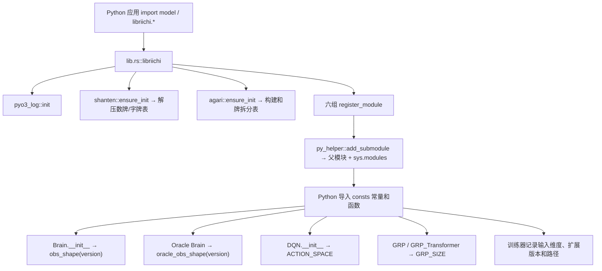

直接调用来源包括 `model.py`、通用 `train.py` 和 Transformer 离线训练器。Conv2d 公共模型继承或复用这些网络定义，因此也经过相同常量读取。`__file__`、`__version__`、`__profile__` 用于运行信息记录；它们来自扩展导入与初始化。

### 12.2 单独管理玩家状态

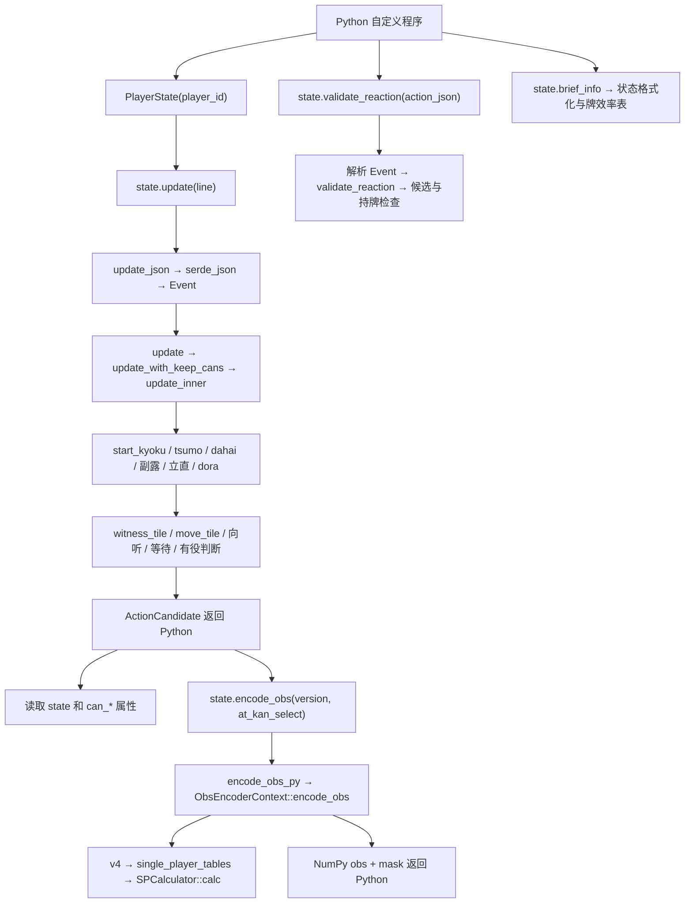

状态的写入由 `update` 集中完成，getter 读取已经维护好的字段。日志型 Python engine 收到的 `game_state.state` 也是此类实例，因此读取 `last_cans`、`last_self_tsumo()` 等属性或方法会重新跨入 Rust。

### 12.3 普通 mjai 推理与 Conv2d 推理

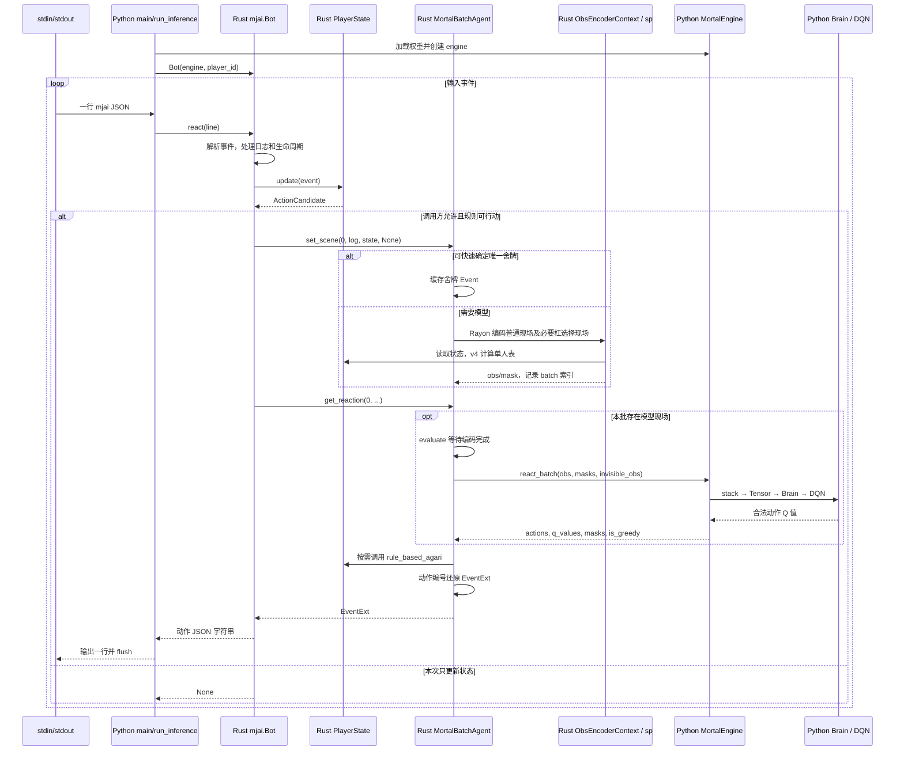

原入口 `mortal/mortal.py::main` 从 checkpoint 的配置中获取模型版本与结构，加载 `mortal` 和 `current_dqn`。新入口 `precompute_pipeline/inference/inference.py::run_inference` 经 `policy.create_engine → optimized_checkpoint.load_policy` 加载 Conv2d 模型，再复用相同 engine 和 Bot。

Rust 编码与 Python 模型推理之间转换的是当前现场数组。返回 Python 的协议响应由 Rust 依据动作编号与状态字段组合，`consumed`、`target`、`tsumogiri` 等协议细节集中在代理适配中。

复盘模式额外执行第二条链：收集原始输入 → `Grp.load_log` → `take_feature` → Python GRU `GRP` 前缀预测 → 输出 `phi_matrix`。复盘会关闭快速舍牌路径以获取更完整的动作元数据。

### 12.4 普通主策略日志训练

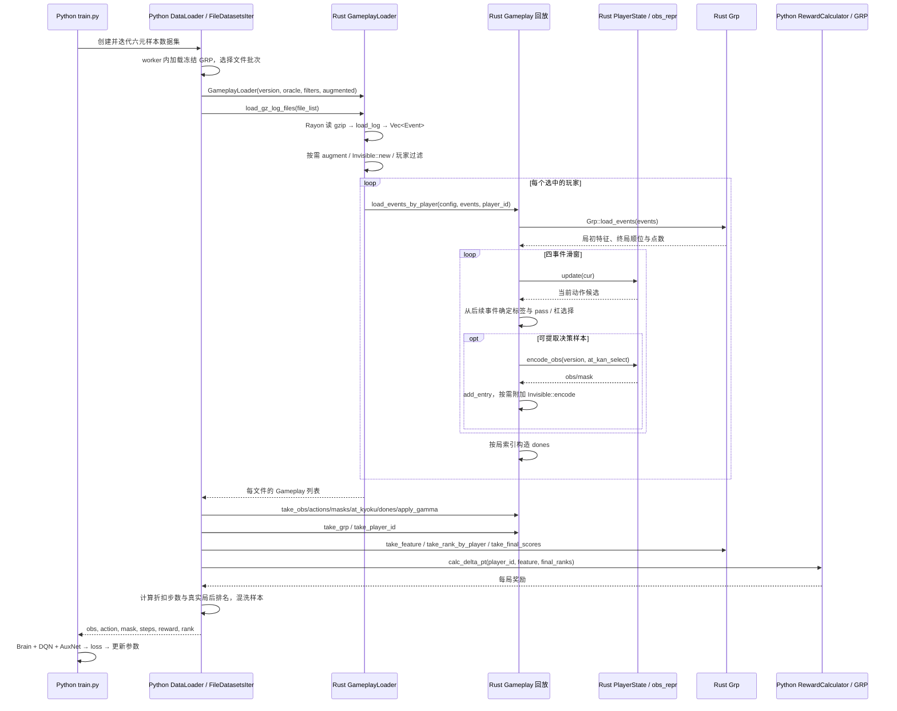

Oracle 分支在 `LoaderContext` 中持续更新其他三家状态，并跟踪普通与岭上摸牌位置，再为每条样本生成隐藏观测。

Transformer 奖励的日志训练沿用同一个 Rust 加载过程。Python 子类在 `_load_files_with_quarantine` 调用 `load_gz_log_files`，由 `iter_file_samples` 读取 `take_*`，通过 `_build_shared_grp_targets` 一次预测四家奖励。普通数据集按玩家调用 GRU 奖励，Transformer 数据集在一场牌谱内共享计算结果。

### 12.5 GRP/Transformer 训练与复盘特征提取

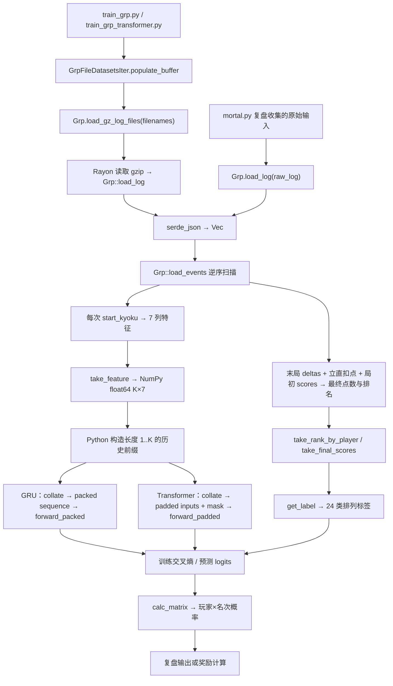

两种训练入口调用相同的 Rust `Grp`。Rust 使用 `float64` 特征，两个顺位模型也采用双精度。序列 padding、packing、位置编码与 24 类标签映射发生在 Python。

### 12.6 新预计算、旧预计算与日志筛查

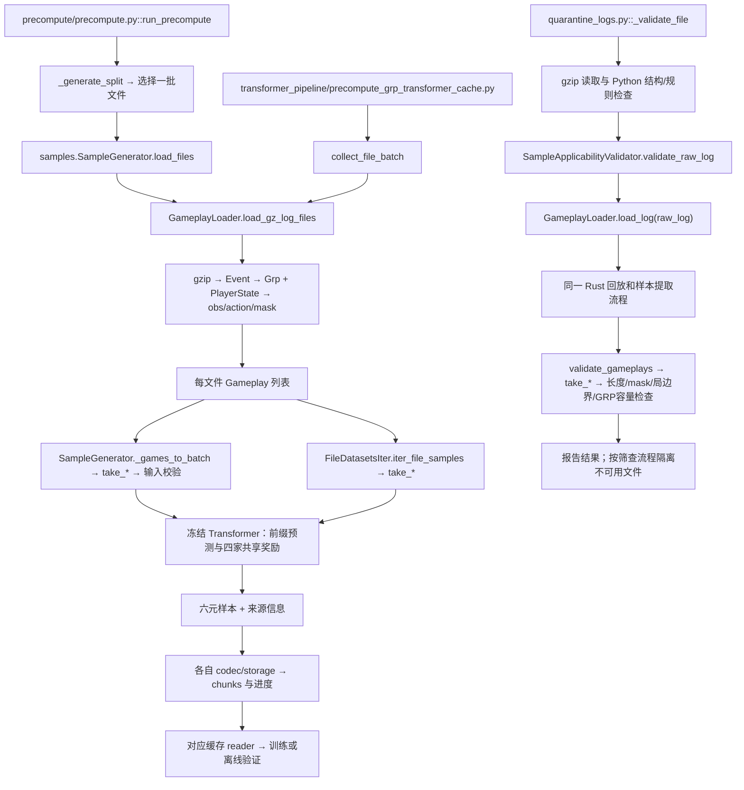

新预计算在生成阶段固定 `steps/reward/rank`，缓存训练直接消费这些结果。新格式保留观测 `float32` 精度，其编码和恢复约定见当前 `common/codec.py` 与 ADR 0001。早期预计算复用 Transformer 数据集的样本组装函数，并使用自己的缓存模块。

日志筛查也执行 Rust 观测生成，因此可能包含 v4 单人牌效率计算成本。筛查阶段检查 GRP 特征长度与样本结构，顺位模型前向属于样本生产阶段。父进程与 worker 的安排由筛查入口管理，worker 初始化时设置 Rayon 线程并创建可复用验证器。

### 12.7 一对三与二对二的完整调度

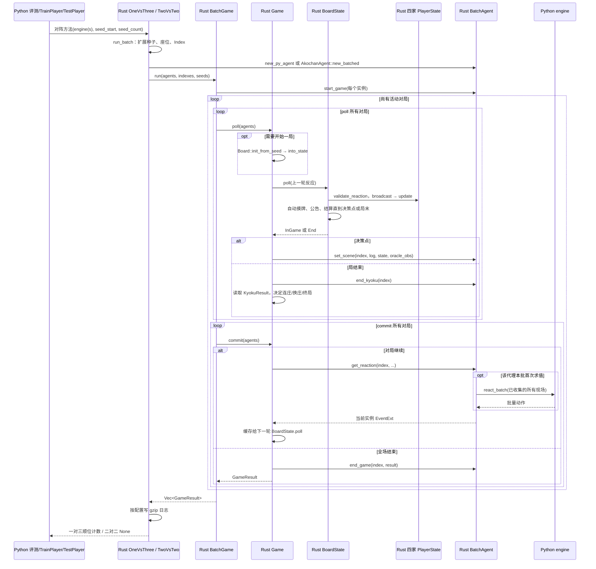

Mortal 代理中的 Python 回调、杠选择和动作还原沿用 12.3 的过程。对阵入口的差异集中在座位分配、引擎创建和返回值汇总；局内规则与整场推进共用同一环境。

Python 的独立评测、训练内评测、在线 replay 生成以及 Conv2d 评测都进入此流程。`TwoVsTwo` 是扩展公开的可用入口，当前仓库的主要 Python 对局脚本采用 `OneVsThree`。

### 12.8 自定义日志引擎与 Akochan 的分支

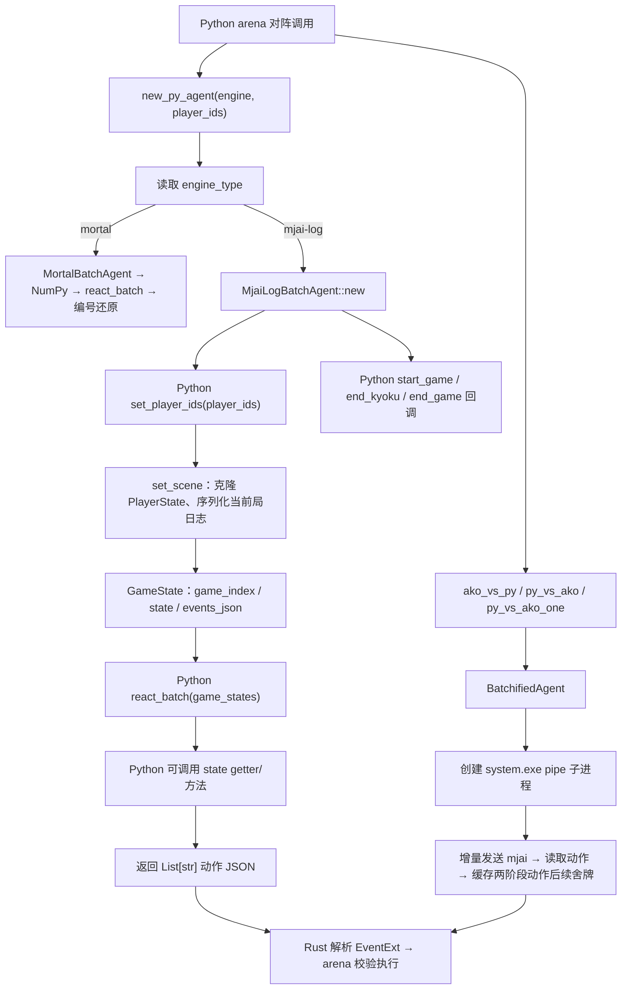

日志型回调接收的 `events_json` 包含从本局开始到当前时刻的事件，`game_index` 用于区分一个引擎管理的多个实例。生命周期调用同样按此索引分发。

Akochan 作为 Rust 代理调用外部进程，Python 通过 arena 选择这条分支并配置路径。`py_vs_ako_one` 属于二对二的单场接口。

### 12.9 对局后统计

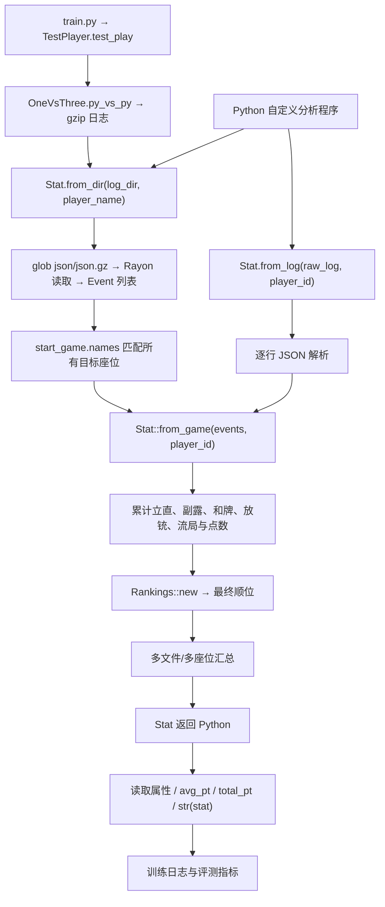

属性读取再次进入 Rust 执行相应除法或汇总。统计从已保存的结果事件取得数据，与模型推理的 Q 值记录分别服务于成绩分析和单步决策分析。

### 12.10 在线训练把两条 Rust 调用路径连接起来

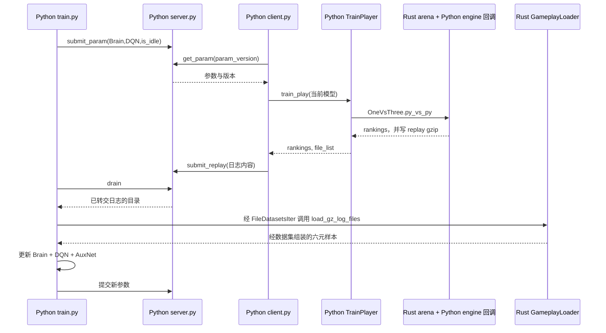

网络协议由 Python 维护，Rust 接受本地文件或 Python 对象。参数服务器分发模型状态，日志文件把自对战与训练阶段连接起来。

### 12.11 调用覆盖核对表

| Python 调用面 | 当前仓库使用位置或可用方式 | 详细链路 |
| --- | --- | --- |
| 导入、版本与 shape | `model.py`、`train.py`、Transformer 离线训练器、优化模型的间接导入 | 12.1 |
| `PlayerState` 构造、更新、编码、检查、getter | 自定义程序；`ExampleMjaiLogEngine` 使用回调传入的状态 | 12.2、12.8 |
| `Bot` 构造与 `react` | 原始推理、原始复盘、Conv2d 推理 | 12.3 |
| `GameplayLoader.load_gz_log_files` | 普通数据加载、Transformer 数据加载、两套预计算 | 12.4、12.6 |
| `GameplayLoader.load_log` | 新日志筛查、外部单文本加载 | 12.4、12.6 |
| `Gameplay.take_*` | 各数据消费者读取样本、辅助字段与 `Grp` | 12.4、12.6 |
| `Grp.load_gz_log_files` | GRU 与 Transformer 顺位模型训练 | 12.5 |
| `Grp.load_log` | 原始复盘和外部分析 | 12.3、12.5 |
| `Grp.take_*` | 顺位模型训练、奖励、预计算和筛查 | 12.4、12.5、12.6 |
| `OneVsThree` 三类对阵方法 | 训练内评测、在线自对战、独立评测、外部对阵 | 12.7、12.8、12.10 |
| `TwoVsTwo` 三类批量对阵与单场接口 | 扩展公开的外部调用入口 | 12.7、12.8 |
| `Stat.from_dir/from_log`、字段与派生值 | `TestPlayer` 和外部日志分析 | 12.9 |
| Rust → Python engine 回调 | Mortal 批量推理与日志型策略 | 12.3、12.7、12.8 |

缓存训练和缓存基准通过 Python reader 读取已生成样本；它们对 Rust 的依赖主要来自模型维度和所沿用的数据契约。后续增加新入口时，可从 `from libriichi...` 搜索开始，并继续追踪复用的数据集、engine 和 arena 包装。

## 13. 二次开发时如何沿调用链定位改动

### 13.1 常见需求对应的检查位置

| 要改的行为 | 首先查看 | 同时需要核对 |
| --- | --- | --- |
| 牌字符串、赤牌、座位或协议事件 | `tile.rs`、`mjai/event.rs` | 状态推进、数据标签、代理动作还原、arena、统计和日志校验 |
| 吃碰杠、立直、振听或和牌规则 | `state/update.rs`、`agent_helper.rs`、`action.rs` | `algo/`、`arena/board.rs`、`state/test.rs`、日志样本的一致性 |
| 观测特征 | `state/obs_repr.rs`、`consts.rs` | `Brain` 输入通道、两个 Oracle 编码器、所有缓存 codec、已有权重与数据版本 |
| 动作空间或编号 | `consts.rs`、`obs_repr.rs` | `dataset/gameplay.rs` 标签、`agent/mortal.rs` 还原、DQN、mask、折扣条件和缓存格式 |
| 顺位特征或标签 | `dataset/grp.rs`、`rankings.rs` | 两种 GRP 的输入、前缀长度、奖励与复盘、预计算容量和已有权重 |
| 奖励定义、折扣规则 | `reward_calculator.py`、各样本组装器 | Rust `apply_gamma/dones/at_kyoku`、缓存生成规则、训练目标与恢复契约 |
| 模型推理或采样策略 | `engine.py`、`model.py` | Rust engine 属性、回调返回 shape、快速决策、和牌保护、checkpoint 兼容 |
| 自对战调度、随机性或终局 | `arena/board.rs`、`game.rs`、两个对阵包装 | seed 复现、代理生命周期、日志完整性、统计结果 |
| 批量数据性能 | `GameplayLoader`、v4 编码、SP 计算 | Rayon、DataLoader workers、Python GRP 前向、磁盘和缓存读取 |

### 13.2 几组容易混淆的约定

| 名称或值 | 应采用的解释 |
| --- | --- |
| Rust `Grp` 与 Python `GRP` | 前者提取局初特征及终局标签，后者执行 GRU 顺位预测 |
| 协议 `kyoku`、状态 `kyoku`、`grand_kyoku`、`at_kyoku` | 分别为 1..4 场内局号、0..3 场内局号、含场风的局号、包含连庄的实际局索引 |
| `PlayerState.scores` 与 `Grp.feature[:,3:]` | 前者按自己起始的相对顺序，后者按绝对玩家顺序 |
| 34、37、38、46 | 去红牌种数、含赤五可操作牌数、含未知占位的 Tile 数量、动作空间大小 |
| 3n+1 与 3n+2 | 暗手在等待摸牌阶段与可打牌阶段的张数形式，n 随副露变化 |
| `dones` | 当前玩家本局最后一条已提取样本 |
| `apply_gamma` | 动作是否增加从当前样本到局末的折扣计数 |
| `shanten` 与 `real_time_shanten()` | 前者按状态更新时机维护并截到至少零，后者计算当前摸切阶段的实际向听 |
| Python `None` 与 JSON `type=none` | 前者表示 Bot 本次无输出，后者是一条协议动作 |
| `take_*` | 容器类字段常见为取走所有权，标量与固定长度终局数组按各方法实现读取 |
| 名次效用与点数 | `pts` 表示学习/评价中各名次的价值；麻将点数由局结算累积 |

### 13.3 建议验证顺序

Rust 局部规则修改先运行相邻回归测试，再按影响范围扩展。以下命令来自当前 CI 的 Rust 检查矩阵，从仓库根目录执行：

```bash
cargo fmt --all --check
cargo clippy --workspace --all-targets --all-features -- -Dwarnings
cargo test --workspace --no-default-features --features flate2/zlib -- --nocapture
cargo test --workspace --no-default-features --features flate2/zlib,sp_reproduce_cpp_ver -- --nocapture
cargo test -p libriichi --no-default-features --benches
```

修改构建或导出接口时，再检查相应目标：

```bash
cargo build -p libriichi --lib
cargo build -p libriichi --bins --no-default-features
cargo build -p exe-wrapper
```

Python 侧先做语法与受影响 API 的小型验证。更换 Rust 扩展后记录实际导入路径，并检查状态更新、观测 shape、dtype、合法 mask 和对应动作。修改预计算语义时还需验证新样本和缓存恢复规则；模型结构变化需单独确认 checkpoint 加载或迁移。

一次完整训练同时依赖 GPU、数据、权重、配置与输出目录，验证成本高。普通规则或接口开发可以用固定牌谱片段和小型 CPU 张量验证；真实训练与对局强度评估作为有明确数据和资源安排的独立步骤。

## 14. 总结

Mortal 的基础数据契约由牌、mjai 事件、座位、动作编号和观测形状组成。`PlayerState` 消费事件，把规则算法的结果维护成一个玩家的可见状态；观测编码把它转换为模型输入。

日志学习与实际决策共用这套状态和编码。`GameplayLoader` 在牌谱中重放决策，Python 用 `Grp` 特征计算局奖励和辅助标签；Bot 与 arena 在实时现场请求 Python engine 决策，再由 Rust 把动作编号还原为协议事件。

arena 从确定的牌山推进完整对局，生成的日志又可进入训练、预计算和统计。Python 管理模型、优化与实验，Rust 管理规则、状态和高频数据处理。后续修改沿“定义 → 生产 → 跨语言接口 → 消费 → 验证”的顺序检查，即可定位一项行为在仓库中的完整实现范围。
